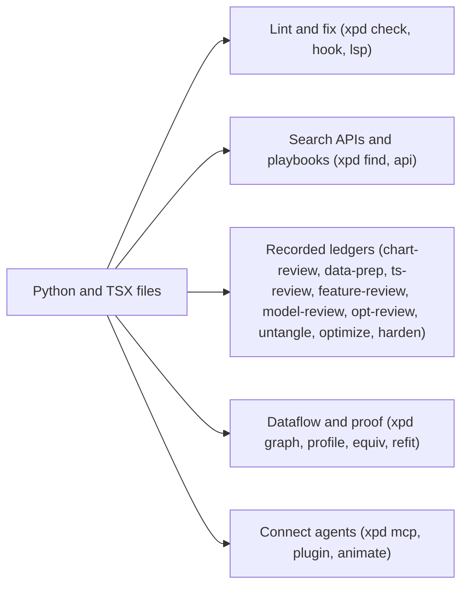

# xpd

Run `uvx xpd check .` to catch slow or wrong Python library code without running Python, and add `--fix` to rewrite what can be fixed automatically. `xpd` ships rule packs for pandas, Polars, NumPy, SciPy, scikit-learn, scikit-lego, MAPIE, Category Encoders, LightGBM, XGBoost, statsmodels, linearmodels, arch, CVXPY, skfolio, pymoo, Nixtla forecasting libraries, plotly, Apache Hamilton, and core Python.

Read the full documentation at <https://bjoernaagaard.github.io/xpd/>.



## Install

`xpd` requires Python 3.13 or newer. Install it once with [uv](https://docs.astral.sh/uv/), or invoke any command directly with `uvx xpd`.

```sh
uv tool install --python '>=3.13' xpd
```

## Check and fix a file

Save `bad.py` in an empty folder. `xpd` parses the source statically, so you do not need pandas installed.

```python title="bad.py"
import pandas as pd

df = pd.DataFrame({"a": [1, 2], "k": [1, 2]})
other = df.copy()
for i, row in df.iterrows():
    df["a"][i] = row["a"] * 2
df.dropna(inplace=True)
m = pd.merge(df, other, on="k")
out = pd.DataFrame()
for f in ["x.csv"]:
    out = pd.concat([out, pd.read_csv(f)])
```

Run `xpd check bad.py --format text`. Terminal runs default to text, and piped runs default to JSON.

```console
$ xpd check bad.py --format text
bad.py:5:15: warning [pandas/row-loop] iterrows() builds a Series for every row. Compute on whole columns instead, such as df["a"] * df["w"]. When each row has to become a Python object, loop over itertuples() or to_dict("records").
bad.py:6:5: error [pandas/chained-assignment] Chained assignment writes to a copy under copy-on-write, so the frame keeps its old values. Assign to df.loc[i, "a"] instead.
bad.py:7:1: info [pandas/no-inplace] inplace=True gives no speedup and blocks chaining. Reassign instead.
bad.py:8:5: warning [pandas/merge-without-validate] merge without validate= can silently duplicate rows.
bad.py:11:5: warning [pandas/concat-in-loop] out grows by one concat per pass, and each concat copies every earlier row. Collect the frames in a list and concat once after the loop.
xpd: 5 issues, 2 more with --fix --unsafe-fixes
```

| Severity | Meaning | Exit code |
| --- | --- | --- |
| `error` | Code gives a wrong result or raises an exception | `1` |
| `warning` | Code is slow or easy to get wrong | `0` |
| `info` | A shorter or newer form exists | `0` |

Apply safe rewrites with `--fix`. Add `--unsafe-fixes` when you accept fixes that can change runtime behavior, and review the diff afterwards.

```console
$ xpd check bad.py --fix --unsafe-fixes --format text
...
xpd: fixed 2, 3 issues
```

```diff
 for i, row in df.iterrows():
-    df["a"][i] = row["a"] * 2
-df.dropna(inplace=True)
+    df.loc[i, "a"] = row["a"] * 2
+df = df.dropna()
```

Set `style = "strict"` in `[tool.xpd]` of `pyproject.toml` or in `~/.config/xpd/config.toml` to promote house style `info` rules to warnings. See [`xpd check`](https://bjoernaagaard.github.io/xpd/commands/check/#house-style) for details.

## Commands at a glance

Run `xpd <command> -h` or read the [command reference](https://bjoernaagaard.github.io/xpd/commands/) for every option and exit status.

| Area | Commands | What they do |
| --- | --- | --- |
| Lint and guard | `check`, `rules`, `hook`, `lsp` | Lint files, list rules, guard agent edits, and serve editor diagnostics |
| Code ledgers | `untangle`, `optimize`, `harden` | Audit structural coupling, measured CPU or memory waste, and reliability or flaky tests |
| Domain ledgers | `chart-review`, `data-prep`, `ts-review`, `feature-review`, `model-review`, `opt-review` | Audit charts and tables, data prep, time series, features, model validation, and numerical optimization |
| Library lookup | `find`, `api`, `index` | Search indexed library symbols, rules, and playbooks for a task |
| Dataflow and proof | `graph`, `graph map`, `graph impact`, `profile`, `equiv`, `refit` | Trace dataflow, plan pandas to Polars migrations, profile files, and prove refactors or model refits |
| Authoring and media | `rules new`, `rules test`, `rules run`, `rules outline`, `animate` | Author custom ast-grep rules, map modules, and render editable Manim animations |
| Integrations | `mcp`, `doctor`, `skill`, `completions` | Run the MCP server, Ruff and ty profile doctor, bundled skills, and shell completions |

## Connect agents and editors

Install the xpd plugin in Claude Code to enable edit hooks, MCP tools, and skills in one step.

```sh
claude plugin marketplace add bjoernaagaard/xpd
claude plugin install xpd@xpd
```

| Goal | Setup | Guide |
| --- | --- | --- |
| Guard every agent edit with hooks, MCP, and skills | Install the Claude Code or Codex plugin | [Agent plugin](https://bjoernaagaard.github.io/xpd/guides/claude-code/#agent-plugin) |
| Install only the agent skills | `npx skills add bjoernaagaard/xpd` | [Agent skill](https://bjoernaagaard.github.io/xpd/guides/claude-code/#agent-skill) |
| Add visual MCP tools and model gates | `claude mcp add xpd -- uvx xpd mcp` | [Connect an agent with MCP](https://bjoernaagaard.github.io/xpd/guides/mcp/) |
| Verify a scikit-learn pipeline with 15 gates | Call `discovery_gate` and `gates` over MCP | [Train a model with gates](https://bjoernaagaard.github.io/xpd/guides/gates/) |
| Lint and quick-fix while typing in an editor | Configure `xpd lsp` | [Use xpd in an editor](https://bjoernaagaard.github.io/xpd/guides/editors/) |
| Add custom project rules or a library pack | `xpd rules new rule` | [Write a rule](https://bjoernaagaard.github.io/xpd/guides/write-a-rule/) |
| Review charts or render Manim animations | `xpd chart-review` or `xpd animate` | [Chart review](https://bjoernaagaard.github.io/xpd/guides/chart-review/) and [Animate](https://bjoernaagaard.github.io/xpd/guides/animate/) |

## License

You may use `xpd` under MIT or Apache-2.0. Bundled recipes and dependencies keep their own licenses in `licenses/`.

| Component | License | Location |
| --- | --- | --- |
| `xpd` source and playbooks | MIT or Apache-2.0 | `LICENSE-MIT`, `LICENSE-APACHE` |
| Library recipes | Library license (MIT, BSD-3-Clause, Apache-2.0, or NCSA) | `licenses/` (`xpd api <recipe>` prints license and source) |
| Manim Community API index | MIT | [Manim Community](licenses/manim-community-MIT), [3Blue1Brown](licenses/manim-MIT) |
| `option-ext` | MPL-2.0 | `licenses/option-ext-LICENSE.txt`, `licenses/option-ext-0.2.0-source.tar.gz` |
| `libcst` | MIT and PSF-2.0 | `licenses/libcst-LICENSE` |
| EmbeddingGemma (`xpd find` download) | Gemma Terms of Use (<https://ai.google.dev/gemma/terms>) | Downloaded on first `xpd find`, not shipped |
