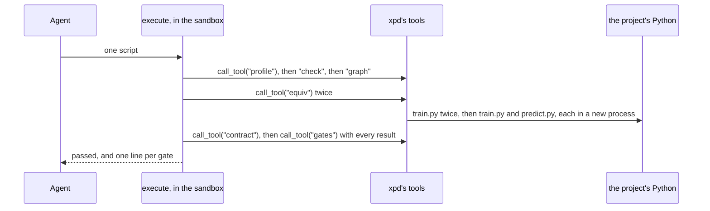

# Code mode

!!! note "First draft"

    This page is a first draft. Discovery now starts the workflow, and the agent records its
    choice before the checks. It describes one way for an agent to take a data file to a
    saved scikit-learn model through `xpd mcp --code-mode`, with checks that xpd runs itself.
    The tool names, the contract and the gates may change. The last section lists what is
    open.

With [`--code-mode`](mcp.md#settings), the server shows three tools in place of its own:
`search`, `get_schema` and `execute`. This is FastMCP's
[code mode](https://gofastmcp.com/docs/servers/transforms/code-mode). The agent sends a short
Python script to `execute`, the script calls xpd's tools one after another, and only what the
script returns goes back to the agent.



## What the sandbox can do

The design follows what FastMCP documents for code mode, and it uses the default settings.

| Fact | What it means here |
| --- | --- |
| `call_tool(name, params)` is the only function in the sandbox | The script cannot import scikit-learn or read a file. The model code is in project files, and the script runs xpd's tools on them |
| `call_tool` returns the tool's structured result | The script hands one tool's result to the next tool as it is |
| A tool runs in the server, with the same checks as a direct call | A path outside the project root is still refused |
| The sandbox stops a script after 30 seconds and 100 MB, and the time a tool takes does not count | A long training run does not stop the script |
| One `execute` call makes at most 50 tool calls | The pipeline script below makes 14 |
| Prompts and resources are not tools | The agent reads the `build_pipeline` prompt through its client, before it calls `execute` |

## What worked before this draft

Code mode could already chain `profile`, `check`, `graph` and `equiv` in one `execute` call.
Nothing said what a finished model run looks like, and nothing judged the results together.
An agent had to decide for itself whether a run was good.

## What the draft adds

| Addition | Kind | What it does |
| --- | --- | --- |
| `discovery_gate` | Tool | Reads direct imported calls in the chosen modules and compares their names and literal keywords with `api` |
| The stages of a run | Typed models in `python/xpd/mcp/models.py` | Name what each stage hands to the next |
| `contract` | Tool | Reads the JSON file that the training script saves beside its model |
| `gates` | Tool | Takes the results of the other tools and returns one verdict, with one line per requirement |
| `build_pipeline` | Prompt | Tells the agent which three files to write, and holds the script for `execute` |
| `samples/pipeline/` | Sample project | A run that passes every gate, and a leaky script that fails one |
| `xpd equiv` in two processes | Command | Runs each script in its own Python process, so the prediction script gets no module and no path from the training script |

Neither new tool runs Python or loads a model, and the server needs no new package. The
project's Python needs pandas and scikit-learn.

## The stages

A run has nine stages when it starts with discovery. Each one hands a typed result to the next.

| Stage | What it hands on | Model | Where it comes from |
| --- | --- | --- | --- |
| Discovery | The task, inspected candidates and the choice with its reason | `DiscoveryQuestion`, `DiscoveryEntry`, `DiscoveryChoice`, `Discovery` | `find`, `api` and the agent |
| Raw data | The file, the target column and the row count | `RawData` | The contract |
| Profile | Each column's dtype, nulls and distinct values | `Profile` | The `profile` tool |
| Split | The seed, the share held out and the rows on each side | `Split` | The contract |
| Preprocessing | The raw columns the model takes, and each step of the one Pipeline | `InputColumn`, `FittedStep` | The contract |
| Model | The last step of the Pipeline | `FittedStep` | The contract |
| Validation | One score per fold, and one score for the held out rows | `Validation` | The contract |
| Proof | What `check`, `graph` and `equiv` found | `Proof` | Those three tools |
| Persisted model | The model file, the class of the saved object, the versions that wrote it and the code files it imports | `SavedModel` | The contract |

The contract is one JSON file with those parts. The JSON below shows the model fields;
the sample also records the discovery object shown in the discovery section. The training script writes it, and it names
every file that a script needs to serve the model: the data, the model and the code under
`model.code`. joblib saves the function of a `FunctionTransformer` by its module and name, so
the sample's model loads only where `features.py` can be imported. This is the contract of the
sample run.

```json
{
  "data": {"file": "penguins.csv", "target": "species", "rows": 344},
  "split": {"seed": 0, "test_size": 0.25, "stratified": true, "train_rows": 258, "test_rows": 86},
  "inputs": [
    {"column": "island", "dtype": "str"},
    {"column": "sex", "dtype": "str"},
    {"column": "bill_length_mm", "dtype": "float64"},
    {"column": "bill_depth_mm", "dtype": "float64"},
    {"column": "flipper_length_mm", "dtype": "float64"},
    {"column": "body_mass_g", "dtype": "float64"}
  ],
  "steps": [
    {"name": "features", "estimator": "FunctionTransformer"},
    {"name": "columns", "estimator": "ColumnTransformer"},
    {"name": "classifier", "estimator": "LogisticRegression"}
  ],
  "validation": {
    "scoring": "accuracy",
    "folds": 5,
    "cv_scores": [0.9808, 0.9808, 1.0, 1.0, 0.9804],
    "test_score": 0.9884
  },
  "model": {
    "file": "model/model.joblib",
    "type": "sklearn.pipeline.Pipeline",
    "versions": {
      "python": "3.15.2",
      "scikit-learn": "1.9.1",
      "pandas": "3.1.1",
      "numpy": "2.5.5",
      "joblib": "1.6.0"
    },
    "code": ["features.py"]
  }
}
```

## The gates

In this draft, a run is done when it passes the eleven original gates below and, when discovery is supplied, the two discovery gates. `gates` returns each one
with `passed` and a `detail`. The last column names the tools whose results decide the gate.

A gate shows only what its column says. No gate shows that a run has no leak:
`check-reports-no-error` passes when `check` has no rule for a leak or does not know the held
out rows by their name. [What is open](#what-is-open) lists leaks that pass every gate.

| Gate | Stage | The run passes when | Decided by |
| --- | --- | --- | --- |
| `indexed-api-calls` | Discovery | `discovery_gate` confirms direct imported callable names and literal keyword names in the chosen modules | `api`, source files |
| `discovery-is-recorded` | Discovery | The contract and proof have the same discovery record | `contract`, supplied proof |
| `data-is-profiled` | Raw data | The contract names the profiled file with its row count, and the target has no nulls | `profile`, `contract` |
| `split-covers-every-row` | Split | The training rows and the held out rows add up to the rows of the file | `profile`, `contract` |
| `split-is-seeded` | Split | `check` reports no draw without a seed in scikit-learn, scikit-lego, MAPIE, Category Encoders, arch or pymoo code, by the rules in the table below | `check`, `contract` |
| `inputs-are-file-columns` | Preprocessing | Each input of the contract has the name and dtype of a column of the file, and none is the target. The values are not compared | `profile`, `contract` |
| `dataflow-connects` | Preprocessing | `graph` reports no error or warning, and each feature step reads only input columns and columns of earlier steps | `graph`, `contract` |
| `one-pipeline` | Model | The contract names the saved object as `sklearn.pipeline.Pipeline` and lists its steps | `contract` |
| `check-reports-no-error` | Proof | `check` reports no error of any pack. The table below names the errors that are leaks | `check` |
| `cross-validated` | Validation | The contract has one score for each of two or more folds. Which rows the folds hold is not checked | `contract` |
| `reproducible` | Proof | `equiv` of the training script with itself is equivalent, so two runs in two Python processes leave an equal `result` | `equiv` |
| `saved-model-predicts` | Persisted model | `equiv` of the training script with the prediction script is equivalent, so a new Python process that loads the model from disk leaves the `result` of the fitted one | `equiv` |
| `versions-recorded` | Persisted model | The contract records Python, scikit-learn and pandas, and its pandas is the one `profile` ran with | `profile`, `contract` |

`check-reports-no-error` counts every error of every pack, and not a list of rules.
`split-is-seeded` reads a list of rules, and the server refuses to start when the binary no
longer has one of them. Its rules are from the six packs in the table below. A draw from another
library, such as `np.random.default_rng()` without a seed, is in no list, and only `reproducible`
can find it.

| Pack | Rules that fail `split-is-seeded` | Errors about a leak that fail `check-reports-no-error` |
| --- | --- | --- |
| sklearn | `missing-random-state`, `random-state-without-shuffle` | `fit-before-split`, `fit-on-test`, `tune-on-test` |
| sklego | `unseeded-random-estimator` | None. Its errors are wrong numbers and code that raises |
| mapie | `unseeded-resampling` | `calibrate-on-training-rows`, `coverage-on-seen-rows` |
| category_encoders | `encoder-noise-without-seed` | `encode-before-split`, `transform-with-test-target` |
| arch | `arch-unseeded-draws` | None. Its errors are removed names, unknown options and code that raises |
| pymoo | `unseeded-run`, `numpy-seed-ignored` | None. Its errors are removed names, ignored arguments, wrong results and code that raises |

## A run from raw rows to a saved model

`samples/pipeline/` is a small project. Its data is the
[Palmer penguins](https://github.com/allisonhorst/palmerpenguins) table, which is under the
CC0 license: 344 rows, with nulls in five columns.

```text
samples/pipeline/
├── discovery.json  the inspected planning record copied into the training contract
├── grouped.py      one fitted model per group, for 24 groups of made up rows
├── bootstrap.py    arch and MAPIE block resampling, and forward validation
├── figure.py       a new Plotly scatter figure
├── invalid_api.py  made up API names that the discovery gate refuses
├── penguins.csv     the raw rows
├── features.py      two feature steps, as step code that graph reads
├── train.py         split, one Pipeline, cross-validation, the saved model and its contract
├── predict.py       loads the saved model from the contract and gives the class probabilities of the held out rows
├── leaky.py         train.py with one leak
└── model/           what train.py writes. Git ignores it
    ├── model.joblib
    └── contract.json
```

The client below starts the server with code mode on and sends one script. Run it in the
repository, in an environment that has xpd, pandas and scikit-learn.

```python
import asyncio
import json

from fastmcp import Client
from fastmcp.client.transports import StdioTransport

STAGES = """
DATA = "penguins.csv"
FEATURES = "features.py"
TRAIN = "train.py"
PREDICT = "predict.py"
CONTRACT = "model/contract.json"
TASK = "classify penguin species with a logistic regression pipeline"
CHOICE = "sklearn.linear_model.LogisticRegression"
REASON = "Class probabilities for the species target."
SYMBOLS = [CHOICE]
found = await call_tool("find", {"task": TASK})
candidates = found["result"]
inspected = [await call_tool("api", {"name": item["name"]}) for item in candidates]
discovery = {
    "question": {"task": TASK}, "candidates": inspected,
    "choice": {"name": CHOICE, "reason": REASON, "symbols": SYMBOLS},
}
api_proof = await call_tool("discovery_gate", {
    "paths": [TRAIN, PREDICT, FEATURES], "discovery": discovery,
})
if not api_proof["gate"]["passed"]:
    return api_proof

profile = await call_tool("profile", {"file": DATA})
lint = await call_tool("check", {"paths": [TRAIN, PREDICT, FEATURES]})
if any(issue["severity"] == "error" for issue in lint["issues"]):
    return {"passed": False, "lint": lint, "discovery": api_proof}
dataflow = await call_tool("graph", {"paths": [FEATURES]})
reproducible = await call_tool("equiv", {"old": TRAIN, "new": TRAIN})
served = await call_tool("equiv", {"old": TRAIN, "new": PREDICT})
contract = await call_tool("contract", {"file": CONTRACT})
proof = {
    "lint": lint, "dataflow": dataflow, "reproducible": reproducible,
    "served": served, "discovery": api_proof,
}
report = await call_tool("gates", {"profile": profile, "contract": contract, "proof": proof})
return {
    "passed": report["passed"],
    "gates": [
        {"name": gate["name"], "passed": gate["passed"], "detail": gate["detail"]}
        for gate in report["gates"]
    ],
    "validation": contract["validation"],
    "model": contract["model"],
}
"""


async def main() -> None:
    server = StdioTransport("xpd", ["mcp", "--code-mode", "--root", "samples/pipeline"])
    async with Client(server) as client:
        result = await client.call_tool("execute", {"code": STAGES})
        print(json.dumps(result.structured_content, indent=2))


asyncio.run(main())
```

The script is the one that the `build_pipeline` prompt returns for `data` set to
`penguins.csv` and `target` set to `species`. The first `equiv` call runs `train.py` twice,
which fits the Pipeline and saves the model and the contract. The second runs `train.py` and
`predict.py`. Each script runs in its own Python process, so `predict.py` has to import
`features.py` and load the model by itself. Both scripts leave the class probabilities of the
86 held out rows in `result`. This is what the client printed.

```json
{
  "passed": true,
  "gates": [
    {
      "name": "data-is-profiled",
      "passed": true,
      "detail": "penguins.csv has 344 rows, and the target species has no nulls."
    },
    {
      "name": "split-covers-every-row",
      "passed": true,
      "detail": "The contract counts 258 training rows and 86 held out rows."
    },
    {
      "name": "split-is-seeded",
      "passed": true,
      "detail": "The contract records the seed 0, and check reports no unseeded scikit-learn, scikit-lego, MAPIE, Category Encoders, arch or pymoo draw."
    },
    {
      "name": "inputs-are-file-columns",
      "passed": true,
      "detail": "The 6 inputs of the contract have the names and dtypes of columns of penguins.csv."
    },
    {
      "name": "dataflow-connects",
      "passed": true,
      "detail": "2 feature steps read only input columns and columns of earlier steps."
    },
    {
      "name": "one-pipeline",
      "passed": true,
      "detail": "The contract lists one Pipeline of FunctionTransformer then ColumnTransformer then LogisticRegression."
    },
    {
      "name": "check-reports-no-error",
      "passed": true,
      "detail": "check reports no error."
    },
    {
      "name": "cross-validated",
      "passed": true,
      "detail": "The contract records accuracy 0.9804 to 1.0 on 5 folds, and 0.9884 as the held out score."
    },
    {
      "name": "reproducible",
      "passed": true,
      "detail": "Two runs of the training script, each in its own Python process, leave an equal `result`."
    },
    {
      "name": "saved-model-predicts",
      "passed": true,
      "detail": "The prediction script, in its own Python process, leaves the `result` that the training script left."
    },
    {
      "name": "versions-recorded",
      "passed": true,
      "detail": "The contract records python 3.15.2, scikit-learn 1.9.1, pandas 3.1.1, numpy 2.5.5, joblib 1.6.0."
    },
    {
      "name": "indexed-api-calls",
      "passed": true,
      "detail": "Checked 1 direct imported calls for indexed callable names and literal keyword names in api's parameter lists. No code was run."
    },
    {
      "name": "discovery-is-recorded",
      "passed": true,
      "detail": "The contract records the discovery question, candidates and reason of the proof."
    }
  ],
  "validation": {
    "scoring": "accuracy",
    "folds": 5,
    "cv_scores": [
      0.9808,
      0.9808,
      1.0,
      1.0,
      0.9804
    ],
    "test_score": 0.9884
  },
  "model": {
    "file": "model/model.joblib",
    "type": "sklearn.pipeline.Pipeline",
    "versions": {
      "python": "3.15.2",
      "scikit-learn": "1.9.1",
      "pandas": "3.1.1",
      "numpy": "2.5.5",
      "joblib": "1.6.0"
    },
    "code": [
      "features.py"
    ]
  }
}
```

`predict.py` then predicts in a process of its own. Run in `samples/pipeline`, it gives the
probability of each species for the 86 held out rows, and the most likely species is right for
85 of them. These are the first three rows.

```text
     Adelie  Chinstrap  Gentoo
298  0.0461     0.9531  0.0008
157  0.0002     0.0045  0.9954
137  0.9884     0.0113  0.0003
```

The model needs `features.py` where it loads. With `model/`, `penguins.csv` and `predict.py`
copied to an empty folder, `predict.py` stops before it loads the model.

```text
FileNotFoundError: The model imports ['features.py'], and no such file is here.
```

## A leaky script stops before execution

`leaky.py` tries four strengths of regularization and keeps the one with the best score
on held out rows. The current prompt script stops at `check` when it sees
`sklearn/tune-on-test`, before either `equiv` call can run that code. To try it, set
`TRAIN = "leaky.py"` in the pipeline script above. This shows an error that the rule knows.
The same loop with the held out rows named `X_hold` remains a limit of that rule.

## Where the other parts plug in

The scikit-lego, MAPIE and Category Encoders packs and the language server are in the same
version as this draft.

| Part | Where it meets a run |
| --- | --- |
| The sklego, mapie and category_encoders packs | `check-reports-no-error` counts every error that `check` reports, so their errors fail the gate, and `split-is-seeded` reads their rule about a draw without a seed. A pack that is added later fails `check-reports-no-error` with no change to the server |
| mapie | A model with prediction intervals needs rows for calibration that no step was fitted on. `Split` would get a third row count, and the contract a section for the coverage. A contract may already hold sections that xpd does not know |
| category_encoders | An encoder that reads the target must be a step of the Pipeline. `inputs-are-file-columns` fails when the contract lists an input that the file does not have, or one with another dtype. It passes when code outside the Pipeline writes new values of the same dtype over a column |
| The language server | It shows the issues of `check` while the scripts are written, before any gate runs. A failed `check-reports-no-error` or `dataflow-connects` gate names a file and a line in its `detail`, which the language server could show in the editor |

## What is open

| Open item | What the draft does now |
| --- | --- |
| `gates` cannot tell which files a result is about | It trusts the script. A script that lints another file, or hands in an old result, passes. The tools would have to return the paths they ran on, or `gates` would have to run the stages itself |
| The contract is the training script's own account | `gates` checks the file, the rows, the columns, the dtypes and the pandas version against `profile`. The steps, the seed and the scores are not checked against the saved model. That needs a command that loads the model in the project's Python |
| No gate finds a leak that `check` has no rule for | Each script below passes all pipeline gates. A gate would need the rows that each step was fitted and scored on, from the run itself and not from the script's own account |
| The held out rows under another name | `leaky.py` with `candidate.score(X_hold, y_hold)`. The rule `tune-on-test` knows the rows by names such as `X_test` |
| A step fitted on every row before the split | `penguins[MEASURED] = StandardScaler().fit_transform(penguins[MEASURED])`, or the same with the mean and the standard deviation of pandas, and then `train_test_split` |
| A fit on every row | `cross_val_score(model, X, y, ...)` and `model.fit(X, y)`, and then `model.score(X_test, y_test)`. `cross-validated` reads the scores of the contract and not the rows behind them |
| The target copied into an input | `penguins["body_mass_g"] = penguins[TARGET].map({...})` before the split scores 1.0 on every fold. `inputs-are-file-columns` compares names and dtypes, and not values |
| `equiv` compares what the scripts leave in `result` | The sample leaves class probabilities, so a training run with unseeded NumPy noise fails `reproducible`. A script that leaves only the predicted classes passes with two models that have other coefficients. The saved model files are not compared |
| The model needs its code files | The contract lists them under `model.code`, `contract` refuses a contract that names a missing file, and `predict.py` checks them. Nothing finds a file that the training script left out of the list. A feature step from an installed package would need no file |
| No gate judges the score | A model that is no better than guessing passes. A gate could compare the scores with a baseline, and the held out score with the folds |
| The model file is a joblib pickle | Loading it runs code, so load only a file you wrote. The scikit-learn guide names `skops.io` as the safer format. The draft uses joblib because it installs with scikit-learn |
| One file, one random split | The contract has no place for groups, for a split by time, or for data from several files |
| Training runs three times | Each `equiv` call runs both of its scripts, each in a new Python process. A tool that runs a script once and keeps its result would cut that to one run |
| No time limit on a tool call | The draft sets no `wall_clock_timeout_secs`, so a training script that hangs keeps `execute` open |
| `fix` in a script | `fix` with `unsafe` asks the user to confirm. How that question travels through `execute` is not tested |
| The scripts run in the project root | `train.py` imports `features` and reads `penguins.csv` by a relative path, so the server's root has to be the folder of the scripts |

## Discovery before execution

This section extends the first draft. The agent first asks `find` about the task and reads
`api` for the returned candidates. It chooses a symbol or recipe and states its reason.
The kinds are data, so the scripts keep each kind rather than assuming two kinds.
For a recipe, `choice.symbols` names the indexed callable symbols the written example uses.
The agent says when a required library is missing and asks before adding it through the
project's dependency manager. Discovery itself works without that library installed.

The agent writes project files with its normal editing tools. FastMCP's default sandbox
cannot import libraries, write files or ask an LLM to choose. The scripts below repeat
discovery for an already written choice and check those files before running anything.
One `execute` call performs each complete check. It does not generate or install code.

```text
Discovery.question.task
Discovery.candidates[].kind, name, signature, summary, rules
Discovery.choice.name, reason, symbols
Contract.discovery
Proof.discovery = discovery_gate(paths, discovery)
```

`signature` displays parameter names from the source index, without defaults or parameter
kinds. `discovery_gate` reads the files in `paths` and checks direct imported calls in the
modules containing `choice.symbols`. For example, choosing GroupedPredictor checks direct
calls in `sklego.meta`. Import aliases are resolved by spelling, without Python scope or
type resolution. Each chosen symbol must occur as a call. Each literal keyword must occur
in the indexed parameter names. Unknown callable names and `**` arguments fail the gate.

It does not check instance methods, runtime aliases, shadowing, required arguments,
positional binding, argument values, dependency installation or calls in other modules.
Valid APIs absent from the index also fail in the checked modules. The gate does not prove
that a call will run. `gates` trusts supplied reports and does not check whether source
files changed after the gate. `discovery-is-recorded` compares the discovery record in the
contract with `Proof.discovery`; it does not check that the choice was the best one.

`samples/pipeline/discovery.json` is the inspected planning record for the penguin model.
The training scripts copy it into `model/contract.json`. After changing that choice, save
the new inspected record before running training. The earlier pipeline script returns
thirteen gates, including the API gate and the recorded discovery gate. Older contracts
and proofs with neither discovery field retain the eleven original gates.

### Run the scripts through the server

Build and install the wheel and the sample libraries into a throwaway environment. These
commands were run from this worktree, without changing the project's dependencies.
PyArrow and bottleneck satisfy the optional pandas package checks in this environment.

```sh
cargo build --release
uv venv /var/tmp/xpd-discovery-venv
uv pip install --python /var/tmp/xpd-discovery-venv/bin/python maturin
/var/tmp/xpd-discovery-venv/bin/maturin build --release --out /var/tmp/xpd-discovery-wheels
uv pip install --python /var/tmp/xpd-discovery-venv/bin/python /var/tmp/xpd-discovery-wheels/*.whl pandas scikit-learn scikit-lego arch mapie plotly pyarrow bottleneck
```

Paste one complete script below into `CODE` in this client and run it from the repository
with `/var/tmp/xpd-discovery-venv/bin/python`. `find` returns its list under `result`, as
FastMCP's output schema specifies. `api` returns an object directly.

```python
import asyncio
import json
from fastmcp import Client
from fastmcp.client.transports import StdioTransport

CODE = """paste one script below here"""

async def main():
    transport = StdioTransport(
        "/var/tmp/xpd-discovery-venv/bin/xpd",
        ["mcp", "--code-mode", "--root", "samples/pipeline"],
        env={"VIRTUAL_ENV": "/var/tmp/xpd-discovery-venv"},
    )
    async with Client(transport) as client:
        result = await client.call_tool("execute", {"code": CODE})
        print(json.dumps(result.structured_content, indent=2))

asyncio.run(main())
```

The following outputs were returned by the installed wheel's server through a real
FastMCP 4.2.0 client. `check` selects the Plotly pack because `figure.py` imports Plotly.
These standalone examples require the API gate, no lint errors, and equal `result` values
from two processes. They do not claim the saved model gates of the penguin workflow.

### One model per group

```python
TASK = 'going from one model on all data to one model per group, 24 groups'
CHOICE = 'sklego.meta.GroupedPredictor'
REASON = 'Fit one estimator per group instead of 24 handwritten fit loops.'
SYMBOLS = ['sklego.meta.GroupedPredictor']
ARCH = False
FILE = 'grouped.py'
found = await call_tool("find", {"task": TASK})
inspected = [await call_tool("api", {"name": item["name"]}) for item in found["result"]]
if ARCH:
    blocks = await call_tool("find", {"task": "block bootstrap", "package": "arch"})
    for item in blocks["result"]:
        inspected.append(await call_tool("api", {"name": item["name"]}))
discovery = {
    "question": {"task": TASK}, "candidates": inspected,
    "choice": {"name": CHOICE, "reason": REASON, "symbols": SYMBOLS},
}
proof = await call_tool("discovery_gate", {"paths": [FILE], "discovery": discovery})
if not proof["gate"]["passed"]:
    return {"passed": False, "gate": proof["gate"], "ran": False}
lint = await call_tool("check", {"paths": [FILE]})
errors = [issue for issue in lint["issues"] if issue["severity"] == "error"]
if errors:
    return {"passed": False, "lint": lint, "ran": False}
repeat = await call_tool("equiv", {"old": FILE, "new": FILE})
return {
    "passed": repeat["equivalent"],
    "candidates": [{"kind": item["kind"], "name": item["name"]} for item in inspected],
    "choice": discovery["choice"], "api_gate": proof["gate"],
    "lint": lint, "repeat": repeat,
}
```

```json
{
  "passed": true,
  "candidates": [
    {
      "kind": "symbol",
      "name": "sklearn.model_selection.LeaveOneGroupOut"
    },
    {
      "kind": "symbol",
      "name": "sklego.meta.GroupedPredictor"
    },
    {
      "kind": "symbol",
      "name": "sklego.meta.HierarchicalPredictor"
    },
    {
      "kind": "symbol",
      "name": "sklego.meta.GroupedTransformer"
    },
    {
      "kind": "symbol",
      "name": "category_encoders.OneHotEncoder"
    }
  ],
  "choice": {
    "name": "sklego.meta.GroupedPredictor",
    "reason": "Fit one estimator per group instead of 24 handwritten fit loops.",
    "symbols": [
      "sklego.meta.GroupedPredictor"
    ]
  },
  "api_gate": {
    "name": "indexed-api-calls",
    "stage": "discovery",
    "evidence": [
      "api",
      "source"
    ],
    "passed": true,
    "detail": "Checked 1 direct imported calls for indexed callable names and literal keyword names in api's parameter lists. No code was run."
  },
  "lint": {
    "fixed": 0,
    "fixable": 0,
    "issues": []
  },
  "repeat": {
    "equivalent": true,
    "detail": null
  }
}
```

### Time series bootstrap and validation

```python
TASK = 'time series bootstrap for cross validation'
CHOICE = 'mapie.subsample.BlockBootstrap'
REASON = 'Use MAPIE blocks for out of bag validation, arch blocks for sampling uncertainty, and TimeSeriesSplit for forward validation without resampling.'
SYMBOLS = ['mapie.subsample.BlockBootstrap', 'arch.bootstrap.StationaryBootstrap', 'arch.bootstrap.CircularBlockBootstrap', 'arch.bootstrap.MovingBlockBootstrap', 'sklearn.model_selection.TimeSeriesSplit']
ARCH = True
FILE = 'bootstrap.py'
found = await call_tool("find", {"task": TASK})
inspected = [await call_tool("api", {"name": item["name"]}) for item in found["result"]]
if ARCH:
    blocks = await call_tool("find", {"task": "block bootstrap", "package": "arch"})
    for item in blocks["result"]:
        inspected.append(await call_tool("api", {"name": item["name"]}))
discovery = {
    "question": {"task": TASK}, "candidates": inspected,
    "choice": {"name": CHOICE, "reason": REASON, "symbols": SYMBOLS},
}
proof = await call_tool("discovery_gate", {"paths": [FILE], "discovery": discovery})
if not proof["gate"]["passed"]:
    return {"passed": False, "gate": proof["gate"], "ran": False}
lint = await call_tool("check", {"paths": [FILE]})
errors = [issue for issue in lint["issues"] if issue["severity"] == "error"]
if errors:
    return {"passed": False, "lint": lint, "ran": False}
repeat = await call_tool("equiv", {"old": FILE, "new": FILE})
return {
    "passed": repeat["equivalent"],
    "candidates": [{"kind": item["kind"], "name": item["name"]} for item in inspected],
    "choice": discovery["choice"], "api_gate": proof["gate"],
    "lint": lint, "repeat": repeat,
}
```

```json
{
  "passed": true,
  "candidates": [
    {
      "kind": "symbol",
      "name": "sklearn.model_selection.TimeSeriesSplit"
    },
    {
      "kind": "symbol",
      "name": "mapie.regression.TimeSeriesRegressor"
    },
    {
      "kind": "symbol",
      "name": "sklearn.model_selection.cross_validate"
    },
    {
      "kind": "symbol",
      "name": "mapie.subsample.BlockBootstrap"
    },
    {
      "kind": "symbol",
      "name": "sklego.model_selection.TimeGapSplit"
    },
    {
      "kind": "symbol",
      "name": "arch.bootstrap.MovingBlockBootstrap"
    },
    {
      "kind": "symbol",
      "name": "arch.bootstrap.CircularBlockBootstrap"
    },
    {
      "kind": "symbol",
      "name": "arch.bootstrap.LocalBlockBootstrap"
    },
    {
      "kind": "symbol",
      "name": "arch.bootstrap.StationaryBootstrap"
    },
    {
      "kind": "symbol",
      "name": "arch.bootstrap.optimal_block_length"
    }
  ],
  "choice": {
    "name": "mapie.subsample.BlockBootstrap",
    "reason": "Use MAPIE blocks for out of bag validation, arch blocks for sampling uncertainty, and TimeSeriesSplit for forward validation without resampling.",
    "symbols": [
      "mapie.subsample.BlockBootstrap",
      "arch.bootstrap.StationaryBootstrap",
      "arch.bootstrap.CircularBlockBootstrap",
      "arch.bootstrap.MovingBlockBootstrap",
      "sklearn.model_selection.TimeSeriesSplit"
    ]
  },
  "api_gate": {
    "name": "indexed-api-calls",
    "stage": "discovery",
    "evidence": [
      "api",
      "source"
    ],
    "passed": true,
    "detail": "Checked 5 direct imported calls for indexed callable names and literal keyword names in api's parameter lists. No code was run."
  },
  "lint": {
    "fixed": 0,
    "fixable": 0,
    "issues": []
  },
  "repeat": {
    "equivalent": true,
    "detail": null
  }
}
```

### A Plotly figure from scratch

```python
TASK = 'build a plotly scatter figure from scratch'
CHOICE = 'plotly.express.scatter'
REASON = 'Build a new scatter figure from rows and check the Plotly pack before execution.'
SYMBOLS = ['plotly.express.scatter']
ARCH = False
FILE = 'figure.py'
found = await call_tool("find", {"task": TASK})
inspected = [await call_tool("api", {"name": item["name"]}) for item in found["result"]]
if ARCH:
    blocks = await call_tool("find", {"task": "block bootstrap", "package": "arch"})
    for item in blocks["result"]:
        inspected.append(await call_tool("api", {"name": item["name"]}))
discovery = {
    "question": {"task": TASK}, "candidates": inspected,
    "choice": {"name": CHOICE, "reason": REASON, "symbols": SYMBOLS},
}
proof = await call_tool("discovery_gate", {"paths": [FILE], "discovery": discovery})
if not proof["gate"]["passed"]:
    return {"passed": False, "gate": proof["gate"], "ran": False}
lint = await call_tool("check", {"paths": [FILE]})
errors = [issue for issue in lint["issues"] if issue["severity"] == "error"]
if errors:
    return {"passed": False, "lint": lint, "ran": False}
repeat = await call_tool("equiv", {"old": FILE, "new": FILE})
return {
    "passed": repeat["equivalent"],
    "candidates": [{"kind": item["kind"], "name": item["name"]} for item in inspected],
    "choice": discovery["choice"], "api_gate": proof["gate"],
    "lint": lint, "repeat": repeat,
}
```

```json
{
  "passed": true,
  "candidates": [
    {
      "kind": "symbol",
      "name": "plotly.express.scatter"
    },
    {
      "kind": "symbol",
      "name": "plotly.express.scatter_map"
    },
    {
      "kind": "symbol",
      "name": "plotly.express.scatter_geo"
    },
    {
      "kind": "symbol",
      "name": "plotly.express.scatter_3d"
    },
    {
      "kind": "symbol",
      "name": "plotly.express.scatter_polar"
    }
  ],
  "choice": {
    "name": "plotly.express.scatter",
    "reason": "Build a new scatter figure from rows and check the Plotly pack before execution.",
    "symbols": [
      "plotly.express.scatter"
    ]
  },
  "api_gate": {
    "name": "indexed-api-calls",
    "stage": "discovery",
    "evidence": [
      "api",
      "source"
    ],
    "passed": true,
    "detail": "Checked 1 direct imported calls for indexed callable names and literal keyword names in api's parameter lists. No code was run."
  },
  "lint": {
    "fixed": 0,
    "fixable": 0,
    "issues": []
  },
  "repeat": {
    "equivalent": true,
    "detail": null
  }
}
```

### An unknown class and argument

```python
TASK = 'going from one model on all data to one model per group, 24 groups'
CHOICE = 'sklego.meta.GroupedPredictor'
REASON = 'Fit one estimator per group.'
SYMBOLS = ['sklego.meta.GroupedPredictor']
ARCH = False
FILE = 'invalid_api.py'
found = await call_tool("find", {"task": TASK})
inspected = [await call_tool("api", {"name": item["name"]}) for item in found["result"]]
if ARCH:
    blocks = await call_tool("find", {"task": "block bootstrap", "package": "arch"})
    for item in blocks["result"]:
        inspected.append(await call_tool("api", {"name": item["name"]}))
discovery = {
    "question": {"task": TASK}, "candidates": inspected,
    "choice": {"name": CHOICE, "reason": REASON, "symbols": SYMBOLS},
}
proof = await call_tool("discovery_gate", {"paths": [FILE], "discovery": discovery})
if not proof["gate"]["passed"]:
    return {"passed": False, "gate": proof["gate"], "ran": False}
lint = await call_tool("check", {"paths": [FILE]})
errors = [issue for issue in lint["issues"] if issue["severity"] == "error"]
if errors:
    return {"passed": False, "lint": lint, "ran": False}
repeat = await call_tool("equiv", {"old": FILE, "new": FILE})
return {
    "passed": repeat["equivalent"],
    "candidates": [{"kind": item["kind"], "name": item["name"]} for item in inspected],
    "choice": discovery["choice"], "api_gate": proof["gate"],
    "lint": lint, "repeat": repeat,
}
```

```json
{
  "passed": false,
  "gate": {
    "name": "indexed-api-calls",
    "stage": "discovery",
    "evidence": [
      "api",
      "source"
    ],
    "passed": false,
    "detail": "invalid_api.py:5 sklego.meta.GroupedPredictor has no indexed parameter group_by. invalid_api.py:6 sklego.meta.ImaginaryPredictor is not known to api."
  },
  "ran": false
}
```

### Output from the project scripts

Running the three files directly in `samples/pipeline` with the throwaway environment's
Python printed these lines. The rows of these three examples are made up.

```text
groups=24, models=24, predictions=192, max_error=0.000000
arch_lengths=[48, 48, 48]
bootstrap_folds=3, forward_folds=3
forward_bounds=[(21, 24), (29, 32), (37, 40)]
traces=1, points=3, title=Daily count
```

A separate environment at `/var/tmp/xpd-discovery-bare` had only the wheel and its declared
dependencies. `importlib.util.find_spec("sklego")` was `None`. Its real server still returned
`sklego.meta.GroupedPredictor` with `estimator`, `groups`, `shrinkage`, `use_global_model`,
`check_X` and `shrinkage_kwargs` from one code mode `api` call.

The binary used for this draft predates the recipe index additions. Its runs prove symbols
and rules through code mode. Recipe records are accepted by the server's open `kind` field,
but a real indexed recipe run remains unverified until that binary is available.
