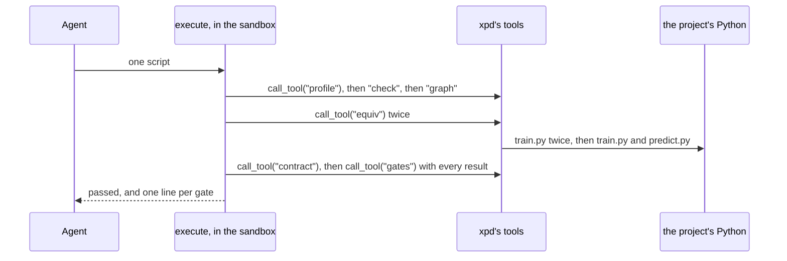

# Code mode

!!! note "First draft"

    This page is a first draft. It describes one way for an agent to take a data file to a
    saved scikit-learn model through `xpd mcp --code-mode`, with checks that xpd runs itself.
    The tool names, the contract and the gates may change. The last section lists what is
    open.

With [`--code-mode`](mcp.md#settings), the server shows three tools in place of its own:
`search`, `get_schema` and `execute`. This is FastMCP's
[code mode](https://gofastmcp.com/docs/servers/transforms/code-mode). The agent sends a short
Python script to `execute`, the script calls xpd's tools one after another, and only what the
script returns goes back to the agent.



## What the sandbox can do

The design follows what FastMCP documents for code mode, and it uses the default settings.

| Fact | What it means here |
| --- | --- |
| `call_tool(name, params)` is the only function in the sandbox | The script cannot import scikit-learn or read a file. The model code is in project files, and the script runs xpd's tools on them |
| `call_tool` returns the tool's structured result | The script hands one tool's result to the next tool as it is |
| A tool runs in the server, with the same checks as a direct call | A path outside the project root is still refused |
| The sandbox stops a script after 30 seconds and 100 MB, and the time a tool takes does not count | A long training run does not stop the script |
| One `execute` call makes at most 50 tool calls | The script below makes 7 |
| Prompts and resources are not tools | The agent reads the `build_pipeline` prompt through its client, before it calls `execute` |

## What worked before this draft

Code mode could already chain `profile`, `check`, `graph` and `equiv` in one `execute` call.
Nothing said what a finished model run looks like, and nothing judged the results together.
An agent had to decide for itself whether a run was good.

## What the draft adds

| Addition | Kind | What it does |
| --- | --- | --- |
| The stages of a run | Typed models in `python/xpd/mcp/models.py` | Name what each stage hands to the next |
| `contract` | Tool | Reads the JSON file that the training script saves beside its model |
| `gates` | Tool | Takes the results of the other tools and returns one verdict, with one line per requirement |
| `build_pipeline` | Prompt | Tells the agent which three files to write, and holds the script for `execute` |
| `samples/pipeline/` | Sample project | A run that passes every gate, and a leaky script that fails one |

Neither new tool runs Python or loads a model, and the server needs no new package. The
project's Python needs pandas and scikit-learn.

## The stages

A run has eight stages. Each one hands a typed result to the next.

| Stage | What it hands on | Model | Where it comes from |
| --- | --- | --- | --- |
| Raw data | The file, the target column and the row count | `RawData` | The contract |
| Profile | Each column's dtype, nulls and distinct values | `Profile` | The `profile` tool |
| Split | The seed, the share held out and the rows on each side | `Split` | The contract |
| Preprocessing | The raw columns the model takes, and each step of the one Pipeline | `InputColumn`, `FittedStep` | The contract |
| Model | The last step of the Pipeline | `FittedStep` | The contract |
| Validation | One score per fold of the training rows, and one score for the held out rows | `Validation` | The contract |
| Proof | What `check`, `graph` and `equiv` found | `Proof` | Those three tools |
| Persisted model | The model file, the class of the saved object and the versions that wrote it | `SavedModel` | The contract |

The contract is one JSON file with those parts. The training script writes it, and a script
that serves the model reads nothing else. This is the contract of the sample run.

```json
{
  "data": {"file": "penguins.csv", "target": "species", "rows": 344},
  "split": {"seed": 0, "test_size": 0.25, "stratified": true, "train_rows": 258, "test_rows": 86},
  "inputs": [
    {"column": "island", "dtype": "str"},
    {"column": "sex", "dtype": "str"},
    {"column": "bill_length_mm", "dtype": "float64"},
    {"column": "bill_depth_mm", "dtype": "float64"},
    {"column": "flipper_length_mm", "dtype": "float64"},
    {"column": "body_mass_g", "dtype": "float64"}
  ],
  "steps": [
    {"name": "features", "estimator": "FunctionTransformer"},
    {"name": "columns", "estimator": "ColumnTransformer"},
    {"name": "classifier", "estimator": "LogisticRegression"}
  ],
  "validation": {
    "scoring": "accuracy",
    "folds": 5,
    "cv_scores": [0.9808, 0.9808, 1.0, 1.0, 0.9804],
    "test_score": 0.9884
  },
  "model": {
    "file": "model/model.joblib",
    "type": "sklearn.pipeline.Pipeline",
    "versions": {
      "python": "3.15.2",
      "scikit-learn": "1.9.1",
      "pandas": "3.1.1",
      "numpy": "2.5.5",
      "joblib": "1.6.0"
    }
  }
}
```

## The gates

In this draft, industrial quality means that a run passes the eleven gates below. `gates`
returns each one with `passed` and a `detail`, and the run is done when all of them pass. The
last column names the tools whose results decide the gate.

| Gate | Stage | The run passes when | Decided by |
| --- | --- | --- | --- |
| `data-is-profiled` | Raw data | The contract names the profiled file with its row count, and the target has no nulls | `profile`, `contract` |
| `split-covers-every-row` | Split | The training rows and the held out rows add up to the rows of the file | `profile`, `contract` |
| `split-is-seeded` | Split | `check` reports no `missing-random-state` and no `random-state-without-shuffle` | `check`, `contract` |
| `inputs-are-raw-columns` | Preprocessing | Each input of the model is a column of the file with the same dtype, and none is the target. A column made outside the Pipeline fails here | `profile`, `contract` |
| `dataflow-connects` | Preprocessing | `graph` reports no error or warning, and each feature step reads only input columns and columns of earlier steps | `graph`, `contract` |
| `one-pipeline` | Model | The saved object is a `sklearn.pipeline.Pipeline` with its steps listed | `contract` |
| `no-leakage` | Validation | `check` reports no error, such as `fit-before-split`, `fit-on-test` or `tune-on-test` | `check` |
| `cross-validated` | Validation | The contract has one score for each of two or more folds | `contract` |
| `reproducible` | Proof | `equiv` of the training script with itself is equivalent, so two runs predict the same | `equiv` |
| `saved-model-predicts` | Persisted model | `equiv` of the training script with the prediction script is equivalent, so the model loaded from disk predicts what the fitted one did | `equiv` |
| `versions-recorded` | Persisted model | The contract records Python, scikit-learn and pandas, and its pandas is the one `profile` ran with | `profile`, `contract` |

`no-leakage` counts every error of every pack, and not a list of rules. `split-is-seeded` names
two rules, and the server refuses to start when the binary no longer has them.

## A run from raw rows to a saved model

`samples/pipeline/` is a small project. Its data is the
[Palmer penguins](https://github.com/allisonhorst/palmerpenguins) table, which is under the
CC0 license: 344 rows, with nulls in five columns.

```text
samples/pipeline/
├── penguins.csv     the raw rows
├── features.py      two feature steps, as step code that graph reads
├── train.py         split, one Pipeline, cross-validation, the saved model and its contract
├── predict.py       loads the saved model from the contract and predicts the held out rows
├── leaky.py         train.py with one leak
└── model/           what train.py writes. Git ignores it
    ├── model.joblib
    └── contract.json
```

The client below starts the server with code mode on and sends one script. Run it in the
repository, in an environment that has xpd, pandas and scikit-learn.

```python
import asyncio
import json

from fastmcp import Client
from fastmcp.client.transports import StdioTransport

STAGES = """
DATA = "penguins.csv"
FEATURES = "features.py"
TRAIN = "train.py"
PREDICT = "predict.py"
CONTRACT = "model/contract.json"
profile = await call_tool("profile", {"file": DATA})
lint = await call_tool("check", {"paths": [TRAIN, PREDICT, FEATURES]})
dataflow = await call_tool("graph", {"paths": [FEATURES]})
reproducible = await call_tool("equiv", {"old": TRAIN, "new": TRAIN})
served = await call_tool("equiv", {"old": TRAIN, "new": PREDICT})
contract = await call_tool("contract", {"file": CONTRACT})
proof = {"lint": lint, "dataflow": dataflow, "reproducible": reproducible, "served": served}
report = await call_tool("gates", {"profile": profile, "contract": contract, "proof": proof})
return {
    "passed": report["passed"],
    "gates": [
        {"name": gate["name"], "passed": gate["passed"], "detail": gate["detail"]}
        for gate in report["gates"]
    ],
    "validation": contract["validation"],
    "model": contract["model"],
}
"""


async def main() -> None:
    server = StdioTransport("xpd", ["mcp", "--code-mode", "--root", "samples/pipeline"])
    async with Client(server) as client:
        result = await client.call_tool("execute", {"code": STAGES})
        print(json.dumps(result.structured_content, indent=2))


asyncio.run(main())
```

The script is the one that the `build_pipeline` prompt returns for `data` set to
`penguins.csv` and `target` set to `species`. The first `equiv` call runs `train.py` twice,
which fits the Pipeline and saves the model and the contract. The second runs `train.py` and
`predict.py`. This is what the client printed.

```json
{
  "passed": true,
  "gates": [
    {
      "name": "data-is-profiled",
      "passed": true,
      "detail": "penguins.csv has 344 rows, and the target species has no nulls."
    },
    {
      "name": "split-covers-every-row",
      "passed": true,
      "detail": "258 training rows and 86 held out rows."
    },
    {
      "name": "split-is-seeded",
      "passed": true,
      "detail": "The split has the seed 0, and check reports no unseeded draw."
    },
    {
      "name": "inputs-are-raw-columns",
      "passed": true,
      "detail": "The model takes 6 columns of penguins.csv as they are read."
    },
    {
      "name": "dataflow-connects",
      "passed": true,
      "detail": "2 feature steps read only input columns and columns of earlier steps."
    },
    {
      "name": "one-pipeline",
      "passed": true,
      "detail": "One Pipeline of FunctionTransformer then ColumnTransformer then LogisticRegression."
    },
    {
      "name": "no-leakage",
      "passed": true,
      "detail": "check reports no error."
    },
    {
      "name": "cross-validated",
      "passed": true,
      "detail": "accuracy is 0.9804 to 1.0 on 5 folds of the training rows, and 0.9884 on the held out rows."
    },
    {
      "name": "reproducible",
      "passed": true,
      "detail": "Two runs of the training script predict the same for the held out rows."
    },
    {
      "name": "saved-model-predicts",
      "passed": true,
      "detail": "The model loaded from disk predicts what the fitted one did for the held out rows."
    },
    {
      "name": "versions-recorded",
      "passed": true,
      "detail": "python 3.15.2, scikit-learn 1.9.1, pandas 3.1.1, numpy 2.5.5, joblib 1.6.0"
    }
  ],
  "validation": {
    "scoring": "accuracy",
    "folds": 5,
    "cv_scores": [
      0.9808,
      0.9808,
      1.0,
      1.0,
      0.9804
    ],
    "test_score": 0.9884
  },
  "model": {
    "file": "model/model.joblib",
    "type": "sklearn.pipeline.Pipeline",
    "versions": {
      "python": "3.15.2",
      "scikit-learn": "1.9.1",
      "pandas": "3.1.1",
      "numpy": "2.5.5",
      "joblib": "1.6.0"
    }
  }
}
```

`predict.py` then predicts from the saved file alone. Run in `samples/pipeline`, it gives a
species for each of the 86 held out rows, and 85 of them are right. These are the first three.

```text
298    Chinstrap
157       Gentoo
137       Adelie
```

## A leaky script fails a gate

`leaky.py` is `train.py` with one change. It tries four strengths of regularization and keeps
the one with the best score on the held out rows, so that score no longer says how the model
does on rows it has not seen.

```python
best_score, best_strength = 0.0, 1.0
for strength in (0.01, 0.1, 1.0, 10.0):  # xpd: tune-on-test
    candidate = pipeline(strength=strength)
    candidate.fit(X_train, y_train)
    score = candidate.score(X_test, y_test)
    if score > best_score:
        best_score, best_strength = score, strength
model = pipeline(strength=best_strength)
```

The same client with `TRAIN = "leaky.py"` fails `no-leakage`, and the other ten gates still
pass. This is `diff -u` of the two results. The fold scores differ too, because the leak chose
another strength.

```diff
@@ -1,5 +1,5 @@
 {
-  "passed": true,
+  "passed": false,
   "gates": [
     {
       "name": "data-is-profiled",
@@ -33,13 +33,13 @@
     },
     {
       "name": "no-leakage",
-      "passed": true,
-      "detail": "check reports no error."
+      "passed": false,
+      "detail": "leaky.py:71 sklearn/tune-on-test."
     },
     {
       "name": "cross-validated",
       "passed": true,
-      "detail": "accuracy is 0.9804 to 1.0 on 5 folds of the training rows, and 0.9884 on the held out rows."
+      "detail": "accuracy is 0.9423 to 1.0 on 5 folds of the training rows, and 0.9884 on the held out rows."
     },
     {
       "name": "reproducible",
@@ -61,11 +61,11 @@
     "scoring": "accuracy",
     "folds": 5,
     "cv_scores": [
-      0.9808,
+      0.9423,
       0.9808,
       1.0,
       1.0,
-      0.9804
+      1.0
     ],
     "test_score": 0.9884
   },
```

`leaky.py` saves its model where `train.py` does, so run the first client again afterwards.

## Where the other parts plug in

Three rule packs and a language server are written at the same time as this draft. The draft
does not depend on any of them.

| Part | Where it meets a run |
| --- | --- |
| A new rule pack, such as sklego, mapie or category_encoders | `no-leakage` counts every error that `check` reports, so the errors of a new pack fail the gate with no change to the server |
| mapie | A model with prediction intervals needs rows for calibration that no step was fitted on. `Split` would get a third row count, and the contract a section for the coverage. A contract may already hold sections that xpd does not know |
| category_encoders | An encoder that reads the target must be a step of the Pipeline. `inputs-are-raw-columns` already fails when a column is encoded outside it |
| The language server | It shows the issues of `check` while the scripts are written, before any gate runs. A failed `no-leakage` or `dataflow-connects` gate names a file and a line in its `detail`, which the language server could show in the editor |

## What is open

| Open item | What the draft does now |
| --- | --- |
| `gates` cannot tell which files a result is about | It trusts the script. A script that lints another file, or hands in an old result, passes. The tools would have to return the paths they ran on, or `gates` would have to run the stages itself |
| The contract is the training script's own account | `gates` checks the file, the rows, the columns, the dtypes and the pandas version against `profile`. The steps, the seed and the scores are not checked against the saved model. That needs a command that loads the model in the project's Python |
| `equiv` compares predictions only | Two models that predict the same for the held out rows pass as the same model |
| No gate judges the score | A model that is no better than guessing passes. A gate could compare the scores with a baseline, and the held out score with the folds |
| The model file is a joblib pickle | Loading it runs code, so load only a file you wrote. The scikit-learn guide names `skops.io` as the safer format. The draft uses joblib because it installs with scikit-learn |
| One file, one random split | The contract has no place for groups, for a split by time, or for data from several files |
| Training runs three times | Each `equiv` call runs both of its scripts. A tool that runs a script once and keeps its result would cut that to one run |
| No time limit on a tool call | The draft sets no `wall_clock_timeout_secs`, so a training script that hangs keeps `execute` open |
| `fix` in a script | `fix` with `unsafe` asks the user to confirm. How that question travels through `execute` is not tested |
| The scripts run in the project root | `train.py` imports `features` and reads `penguins.csv` by a relative path, so the server's root has to be the folder of the scripts |
