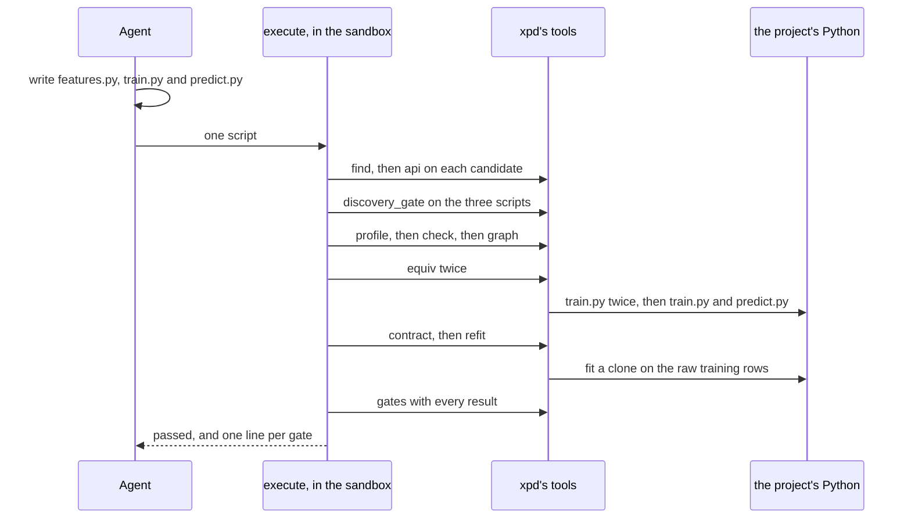

# Code mode

With `xpd mcp --code-mode`, an agent can take a data file to a saved scikit-learn model in one
`execute` call, and the `gates` tool tells it whether the run is done.

The [`--code-mode`](mcp.md#settings) flag makes the server show FastMCP's three
[code mode](https://gofastmcp.com/docs/servers/transforms/code-mode) tools, `search`,
`get_schema` and `execute`, in place of its own tools. The agent sends a short Python script to
`execute`, and the script calls xpd's tools in order. Only what the script returns goes back to
the agent.



## What the sandbox can do

A script in `execute` can only call xpd's tools, because the server uses FastMCP's default code
mode settings.

| Fact | What it means for a run |
| --- | --- |
| `call_tool(name, params)` is the only function in the sandbox | The script can't import scikit-learn, read a file or write a file. The agent writes the scripts with its own editing tools before it calls `execute` |
| `call_tool` returns the tool's structured result | The script passes one tool's result to the next tool as it is |
| A tool runs in the server, with the same checks as a direct call | A path outside the project root is still refused |
| The sandbox stops a script after 30 seconds of its own time or at 100 MB of memory, and the time spent waiting for a tool doesn't count | A long training run inside `equiv` doesn't stop the script |
| One `execute` call makes at most 50 tool calls | The pipeline script makes at most 21, because `find` returns at most 11 candidates |
| Prompts and resources are not tools | The agent reads the `build_pipeline` prompt through its client, before it calls `execute` |

## The run in order

The `build_pipeline` prompt takes `data`, `target` and an optional `task`, and it tells the
agent to do the run in the order below.

1. The agent calls `find` with the task and `api` on each candidate. It chooses one candidate
   and states the reason.
2. It calls `profile` on the data file, and it picks the steps from the real dtypes, nulls and
   distinct values.
3. It writes `features.py`, `train.py` and `predict.py` in the project root. When a chosen
   library is missing, it says so and asks before it adds the library through the project's
   dependency manager.
4. It calls `execute` once with the script that the prompt returns. The script repeats
   discovery and stops at a failed `discovery_gate` or at an error from `check`, before any
   project code runs.
5. The run is done when `gates` returns `passed: true`. For a gate that fails, the agent reads
   its `detail`, fixes the scripts and calls `execute` again. It never edits the contract by
   hand.

The script that the prompt returns calls the tools in the order below.

```text
execute(script)
  discovery
    find(task)
    api(name)                                   for each symbol, rule and recipe found
    discovery_gate(train.py, predict.py, features.py)
                                                stop when the gate fails
  checks that run no project code
    profile(penguins.csv)
    check(train.py, predict.py, features.py)    stop on an error
    graph(features.py)
  runs of project code
    equiv(train.py, train.py)                   reproducible
    equiv(train.py, predict.py)                 served
    contract(model/contract.json)
    refit(model/contract.json)
  verdict
    gates(profile, contract, proof)
```

## Discovery before execution

Discovery gives the run a saved record of the library call the agent chose and why, and
`discovery_gate` checks that the scripts call it with names that xpd's index knows. The record
has the shape below.

```text
discovery
├── question
│   └── task                 the task in plain words
├── candidates
│   ├── symbols[]            up to five from find
│   ├── rules[]              up to three from find
│   └── recipes[]            up to three from find
│       each entry is what api returned: kind, package, name, callable,
│       parameters, parameters_written, signature, summary, members and rules
└── choice
    ├── name                 the exact name of one candidate
    ├── reason
    └── symbols[]            the indexed callables that the code must call
```

`find` ranks by meaning and by keywords. `find` and `api` read the index in the xpd binary, so
they work when the library is not installed. For example, `xpd api
sklego.meta.GroupedPredictor --format json` gave the output below in a folder with no `.venv`,
where the Python on `PATH` has no scikit-lego.

```json
{"name":"sklego.meta.GroupedPredictor","kind":"symbol","callable":"class","parameters":["estimator","groups","shrinkage","use_global_model","check_X","shrinkage_kwargs"],"parameters_written":["estimator","groups","shrinkage=None","use_global_model=True","check_X=True","shrinkage_kwargs=None"]}
```

An entry that the agent reads with `api` is a candidate too, also when `find` did not return
it, so the agent adds it to the list of its kind. A `signature` lists the parameter names of
the index, and `parameters_written` holds each parameter as the source writes it, with its type
annotation and its default. For a recipe, `choice.symbols` names the callables that the recipe's
code uses.

`discovery_gate` takes `paths` and `discovery`, and it runs no code. It checks the record and
the files in the order below.

1. The chosen name must be one of the candidates. When the choice is a symbol, it must also be
   in `choice.symbols`.
2. The gate parses each file and resolves import aliases by their spelling.
3. It keeps each direct call into a module of a chosen symbol. For example, choosing
   `sklego.meta.GroupedPredictor` keeps the direct calls into `sklego.meta`.
4. It asks `api` about each kept call. A name that `api` doesn't know fails, and so does a
   literal keyword that is not one of the indexed parameters, or a `**` argument.
5. Each chosen symbol must have at least one direct call.

The gate returns `discovery`, `paths` and `gate`. The script passes that result to `gates` as
`proof.discovery`, and the training script saves the same record as `discovery` in the
contract. In the sample, `samples/pipeline/discovery.json` holds the record, and `train.py`
copies it into `model/contract.json`. After a new choice, save the new record in
`discovery.json` and run `train.py` again.

## The stages

A run hands one typed result from each stage to the next, and the training script writes most
of them into one JSON file, the contract.

| Stage | What it hands on | Model in `python/xpd/mcp/models.py` | Where it comes from |
| --- | --- | --- | --- |
| Discovery | The task, the inspected candidates, and the choice with its reason | `Discovery` | `find`, `api` and the agent |
| Raw data | The file, the target column and the row count | `RawData` | The contract |
| Profile | Each column's dtype, nulls and distinct values | `Profile` | The `profile` tool |
| Split | The seed, the share held out, and the rows on each side | `Split` | The contract |
| Preprocessing | The raw columns the model takes, and each step of the one Pipeline | `InputColumn`, `FittedStep` | The contract |
| Model | The last step of the Pipeline | `FittedStep` | The contract |
| Validation | The splitter, one score per fold, and one score for the held out rows | `Validation` | The contract |
| Proof | What `discovery_gate`, `check`, `graph`, `equiv` and `refit` found | `Proof` | The same tools |
| Persisted model | The model file, the class of the saved object, the versions that wrote it and the code files it imports | `SavedModel` | The contract |

The contract names every file that a script needs to serve the model, which is the data, the
model and each code file under `model.code`. joblib saves the function of a
`FunctionTransformer` by its module and name, so the sample's model loads only where
`features.py` can be imported. The sample run wrote the contract below, shown without its
`discovery` record.

```json
{
  "data": {"file": "penguins.csv", "target": "species", "rows": 344},
  "split": {"seed": 0, "test_size": 0.25, "stratified": true, "train_rows": 258, "test_rows": 86},
  "inputs": [
    {"column": "island", "dtype": "str"},
    {"column": "sex", "dtype": "str"},
    {"column": "bill_length_mm", "dtype": "float64"},
    {"column": "bill_depth_mm", "dtype": "float64"},
    {"column": "flipper_length_mm", "dtype": "float64"},
    {"column": "body_mass_g", "dtype": "float64"}
  ],
  "steps": [
    {"name": "features", "estimator": "FunctionTransformer"},
    {"name": "columns", "estimator": "ColumnTransformer"},
    {"name": "classifier", "estimator": "LogisticRegression"}
  ],
  "validation": {
    "scoring": "accuracy",
    "folds": 5,
    "splitter": {
      "class": "StratifiedKFold",
      "args": {"n_splits": 5, "shuffle": true, "random_state": 0}
    },
    "cv_scores": [0.9807692307692307, 0.9807692307692307, 1.0, 1.0, 0.9803921568627451],
    "test_score": 0.9883720930232558
  },
  "model": {
    "file": "model/model.joblib",
    "type": "sklearn.pipeline.Pipeline",
    "versions": {
      "python": "3.15.2",
      "scikit-learn": "1.9.1",
      "pandas": "3.1.1",
      "numpy": "2.5.5",
      "joblib": "1.6.0"
    },
    "code": ["features.py"]
  }
}
```

The `contract` tool refuses a file without one of the required fields. For example, a contract
without `validation.splitter` fails with `validation.splitter Field required`. It also refuses a
contract that names a data file, a model file or a code file that is not in the project.

## The gates

A run is done when every gate of the `gates` report passes. A run without discovery has 13
gates, and a run whose contract or proof has a discovery record has 15. The report lists them in
the order of this table, and each gate has `passed` and a `detail`. The last column names the
tools whose results decide the gate.

| Gate | Stage | The gate passes when | Decided by |
| --- | --- | --- | --- |
| `data-is-profiled` | Raw data | The contract names the profiled file with its row count, and the target has no nulls | `profile`, `contract` |
| `split-covers-every-row` | Split | Each side of the split has rows, and the training rows and the held out rows add up to the rows of the file | `profile`, `contract` |
| `split-is-seeded` | Split | `check` reports none of the rules in the table below about a draw without a seed | `check`, `contract` |
| `inputs-are-file-columns` | Preprocessing | The contract lists at least one input, each input has the name and dtype of a column of the file, and none is the target. The values are not compared | `profile`, `contract` |
| `dataflow-connects` | Preprocessing | `graph` reports no error or warning, and each feature step reads only input columns and columns of earlier steps | `graph`, `contract` |
| `one-pipeline` | Model | The contract names the saved object as `sklearn.pipeline.Pipeline` and lists its steps | `contract` |
| `check-reports-no-error` | Proof | `check` reports no error of any pack | `check` |
| `cross-validated` | Validation | The contract has two or more folds and one score for each fold | `contract` |
| `reproducible` | Proof | Two runs of the training script, each in its own Python process, leave an equal `result` | `equiv` |
| `refit-matches-model` | Proof | A clone fitted on the raw training rows gives the held out outputs of the saved model | `refit` |
| `refit-matches-scores` | Validation | The recorded held out score, fold scores, row counts and fold count equal the values that refit computes | `refit`, `contract` |
| `saved-model-predicts` | Persisted model | The prediction script, in a new Python process that loads the model from disk, leaves the `result` of the training script | `equiv` |
| `versions-recorded` | Persisted model | The contract records Python, scikit-learn and pandas, and its pandas is the one `profile` ran with | `profile`, `contract` |
| `indexed-api-calls` | Discovery | `discovery_gate` passed, as the discovery section describes | `api`, `source` |
| `discovery-is-recorded` | Discovery | The contract and `proof.discovery` hold the same discovery record | `contract` |

`split-is-seeded` reads the rules in the second column below. The server refuses to start when
the binary no longer has one of them, because a renamed rule would never match and the gate
would pass every run. `check-reports-no-error` counts every error of every pack, and the third
column names the errors about a leak.

| Pack | Rules that fail `split-is-seeded` | Errors about a leak that fail `check-reports-no-error` |
| --- | --- | --- |
| sklearn | `missing-random-state`, `random-state-without-shuffle` | `fit-before-split`, `fit-on-test`, `tune-on-test` |
| sklego | `unseeded-random-estimator` | None |
| mapie | `unseeded-resampling` | `calibrate-on-training-rows`, `coverage-on-seen-rows` |
| category_encoders | `encoder-noise-without-seed` | `encode-before-split`, `transform-with-test-target` |
| arch | `arch-unseeded-draws` | None |
| pymoo | `unseeded-run`, `numpy-seed-ignored` | None |

A draw from another library, such as `np.random.default_rng()` without a seed, is in no list.
It still fails `reproducible` when it changes the `result` of the training script.

## A run from raw rows to a saved model

The sample project `samples/pipeline/` trains a species classifier on the
[Palmer penguins](https://github.com/allisonhorst/palmerpenguins) table, which is under the CC0
license and has 344 rows with nulls in five columns.

```text
samples/pipeline/
├── penguins.csv      the raw rows
├── discovery.json    the discovery record that train.py copies into the contract
├── features.py       two feature steps, as step code that graph reads
├── train.py          the split, one Pipeline, cross-validation, the saved model and its contract
├── predict.py        loads the saved model and gives the class probabilities of the held out rows
├── leaky.py          train.py with one leak
├── grouped.py        one fitted model per group, for 24 groups of made up rows
├── bootstrap.py      arch and MAPIE block resampling, and forward validation
├── figure.py         a new Plotly scatter figure
├── invalid_api.py    made up API names that discovery_gate refuses
└── model/            what train.py writes, which Git ignores
    ├── model.joblib
    └── contract.json
```

The client below starts the server with code mode on and sends the script that
`build_pipeline` returns for `data` set to `penguins.csv` and `target` set to `species`. Run it
from the repository root in an environment that has xpd, pandas and scikit-learn. The client
passes `VIRTUAL_ENV` to the server, because `equiv` and `refit` run the scripts with the Python
of `VIRTUAL_ENV`, or else of the nearest `.venv`, and FastMCP's stdio client passes on only a
few environment variables.

```python
import asyncio
import json
import sys

from fastmcp import Client
from fastmcp.client.transports import StdioTransport

STAGES = """
DATA = "penguins.csv"
FEATURES = "features.py"
TRAIN = "train.py"
PREDICT = "predict.py"
CONTRACT = "model/contract.json"
TASK = "classify penguin species with a logistic regression pipeline"
CHOICE = "sklearn.linear_model.LogisticRegression"
REASON = "Class probabilities for the species target."
SYMBOLS = [CHOICE]
found = await call_tool("find", {"task": TASK})
inspected = {
    kind: [await call_tool("api", {"name": item["name"]}) for item in found[kind]]
    for kind in ("symbols", "rules", "recipes")
}
discovery = {
    "question": {"task": TASK}, "candidates": inspected,
    "choice": {"name": CHOICE, "reason": REASON, "symbols": SYMBOLS},
}
api_proof = await call_tool("discovery_gate", {
    "paths": [TRAIN, PREDICT, FEATURES], "discovery": discovery,
})
if not api_proof["gate"]["passed"]:
    return api_proof

profile = await call_tool("profile", {"file": DATA})
lint = await call_tool("check", {"paths": [TRAIN, PREDICT, FEATURES]})
if any(issue["severity"] == "error" for issue in lint["issues"]):
    return {"passed": False, "lint": lint, "discovery": api_proof}
dataflow = await call_tool("graph", {"paths": [FEATURES]})
reproducible = await call_tool("equiv", {"old": TRAIN, "new": TRAIN})
served = await call_tool("equiv", {"old": TRAIN, "new": PREDICT})
contract = await call_tool("contract", {"file": CONTRACT})
refitted = await call_tool("refit", {"file": CONTRACT})
proof = {
    "lint": lint, "dataflow": dataflow, "refit": refitted,
    "reproducible": reproducible,
    "served": served, "discovery": api_proof,
}
report = await call_tool("gates", {"profile": profile, "contract": contract, "proof": proof})
return {
    "passed": report["passed"],
    "gates": [
        {"name": gate["name"], "passed": gate["passed"], "detail": gate["detail"]}
        for gate in report["gates"]
    ],
    "refit": refitted,
    "validation": contract["validation"],
    "model": contract["model"],
}
"""


async def main() -> None:
    server = StdioTransport(
        "xpd",
        ["mcp", "--code-mode", "--root", "samples/pipeline"],
        env={"VIRTUAL_ENV": sys.prefix},
    )
    async with Client(server) as client:
        result = await client.call_tool("execute", {"code": STAGES})
        print(json.dumps(result.structured_content, indent=2))


asyncio.run(main())
```

The outputs on the page came from xpd 0.30.0 built from the repository and FastMCP 4.2.0,
with Python 3.15.2, scikit-learn 1.9.1, pandas 3.1.1, NumPy 2.5.5 and joblib 1.6.0 in the
project's Python. The run took 12.1 seconds and returned `passed: true`, and the table shows its `gates` list.

| Gate | Passed | Detail |
| --- | --- | --- |
| `data-is-profiled` | Yes | penguins.csv has 344 rows, and the target species has no nulls. |
| `split-covers-every-row` | Yes | The contract counts 258 training rows and 86 held out rows. |
| `split-is-seeded` | Yes | The contract records the seed 0, and check reports no unseeded scikit-learn, scikit-lego, MAPIE, Category Encoders, arch or pymoo draw. |
| `inputs-are-file-columns` | Yes | The 6 inputs of the contract have the names and dtypes of columns of penguins.csv. |
| `dataflow-connects` | Yes | 2 feature steps read only input columns and columns of earlier steps. |
| `one-pipeline` | Yes | The contract lists one Pipeline of FunctionTransformer then ColumnTransformer then LogisticRegression. |
| `check-reports-no-error` | Yes | check reports no error. |
| `cross-validated` | Yes | The contract records accuracy 0.9803921568627451 to 1.0 on 5 folds, and 0.9883720930232558 as the held out score. |
| `reproducible` | Yes | Two runs of the training script, each in its own Python process, leave an equal `result`. |
| `refit-matches-model` | Yes | The raw training refit matches the saved model on predict_proba. |
| `refit-matches-scores` | Yes | The contract scores and row and fold counts match the raw training refit. |
| `saved-model-predicts` | Yes | The prediction script, in its own Python process, leaves the `result` that the training script left. |
| `versions-recorded` | Yes | The contract records python 3.15.2, scikit-learn 1.9.1, pandas 3.1.1, numpy 2.5.5, joblib 1.6.0. |
| `indexed-api-calls` | Yes | Checked 1 direct imported calls for indexed callable names and literal keyword names in api's parameter lists. No code was run. |
| `discovery-is-recorded` | Yes | The contract records the discovery question, candidates and reason of the proof. |

The report's `refit` part follows.

```json
{
  "rows": 344,
  "train_rows": 258,
  "test_rows": 86,
  "output": "predict_proba",
  "largest_gap": 0.0,
  "model_matches": true,
  "contract_test_score": 0.9883720930232558,
  "refit_test_score": 0.9883720930232558,
  "contract_cv_scores": [0.9807692307692307, 0.9807692307692307, 1.0, 1.0, 0.9803921568627451],
  "refit_cv_scores": [0.9807692307692307, 0.9807692307692307, 1.0, 1.0, 0.9803921568627451],
  "test_score_matches": true,
  "cv_scores_match": true,
  "counts_match": true,
  "passed": true
}
```

`refit` loads the saved Pipeline, clones it and fits the clone on the raw training rows of the
contract's split. It scores the folds with the contract's splitter and the held out rows with
the contract's scorer, so the training script must save its scores without rounding. It
compares the output of the first method the model has among `predict_proba`,
`decision_function` and `predict`. Arrays and scores must be exactly equal under
`numpy.testing.assert_equal`, and a DataFrame or Series is compared with the defaults of
`pandas.testing`.

`refit` does not replace `reproducible`. A clone keeps the saved parameters, so a training
script that draws `C` without a seed passes refit and fails only `reproducible`. The training
script therefore runs three times in a run, twice for `reproducible` and once for
`saved-model-predicts`, and xpd fits one clone.

### The prediction script

`predict.py` gives the probability of each species for the 86 held out rows, and the most
likely species was right for 85 of them. The first three rows, rounded to four places,
follow.

```text
     Adelie  Chinstrap  Gentoo
298  0.0461     0.9531  0.0008
157  0.0002     0.0045  0.9954
137  0.9884     0.0113  0.0003
```

`predict.py` raises an error before it loads the model when the input columns or dtypes differ
from the contract, when scikit-learn has another version, or when a code file is missing. A
missing `features.py` gives the error below.

```text
FileNotFoundError: The model imports ['features.py'], and no such file is here.
```

## A leaky script stops at check

A script with a leak that a rule knows stops at `check`, before `equiv` runs its code. To see
it, set `TRAIN = "leaky.py"` in the script above. `leaky.py` tries four strengths of
regularization and keeps the one with the best score on the held out rows, and the run
returned `passed: false` with the keys `passed`, `lint` and `discovery`. `lint` held one
error.

```text
leaky.py:72 sklearn/tune-on-test
This loop picks strength by the score on the test rows, so the best score is too high. The best
of 30 such scores was 0.597 accuracy on data with no signal. Pick strength with GridSearchCV or
cross_val_score on the training rows, and score the test rows once.
```

## Run the scripts through the server

The same pattern of discovery, `discovery_gate`, `check` and `equiv` checks a choice in any
script that leaves a `result`. Each example below sets its constants and then runs the
script below.

```python
found = await call_tool("find", {"task": TASK})
inspected = {
    kind: [await call_tool("api", {"name": item["name"]}) for item in found[kind]]
    for kind in ("symbols", "rules", "recipes")
}
if ARCH:
    blocks = await call_tool("find", {"task": "block bootstrap", "package": "arch"})
    for kind in ("symbols", "rules", "recipes"):
        for item in blocks[kind]:
            inspected[kind].append(await call_tool("api", {"name": item["name"]}))
discovery = {
    "question": {"task": TASK}, "candidates": inspected,
    "choice": {"name": CHOICE, "reason": REASON, "symbols": SYMBOLS},
}
proof = await call_tool("discovery_gate", {"paths": [FILE], "discovery": discovery})
if not proof["gate"]["passed"]:
    return {"passed": False, "gate": proof["gate"], "ran": False}
lint = await call_tool("check", {"paths": [FILE]})
errors = [issue for issue in lint["issues"] if issue["severity"] == "error"]
if errors:
    return {"passed": False, "lint": lint, "ran": False}
repeat = await call_tool("equiv", {"old": FILE, "new": FILE})
return {
    "passed": repeat["equivalent"],
    "candidates": [{"kind": item["kind"], "name": item["name"]} for kind in inspected for item in inspected[kind]],
    "choice": discovery["choice"], "api_gate": proof["gate"],
    "lint": lint, "repeat": repeat,
}
```

| `FILE` | `TASK` | `CHOICE` | `SYMBOLS` after `CHOICE` | `ARCH` |
| --- | --- | --- | --- | --- |
| `grouped.py` | `going from one model on all data to one model per group, 24 groups` | `sklego.meta.GroupedPredictor` | None | `False` |
| `bootstrap.py` | `time series bootstrap for cross validation` | `mapie.subsample.BlockBootstrap` | `arch.bootstrap.StationaryBootstrap`, `arch.bootstrap.CircularBlockBootstrap`, `arch.bootstrap.MovingBlockBootstrap`, `sklearn.model_selection.TimeSeriesSplit` | `True` |
| `figure.py` | `build a plotly scatter figure from scratch` | `plotly.express.scatter` | None | `False` |
| `invalid_api.py` | `going from one model on all data to one model per group, 24 groups` | `sklego.meta.GroupedPredictor` | None | `False` |

Each example also sets `REASON` to one sentence. The project's Python had scikit-lego 0.9.10,
MAPIE 1.6.0, arch 9.0.0 and Plotly 7.1.0, and the table shows what the runs returned.

| `FILE` | `passed` | Detail of `indexed-api-calls` | `lint.issues` | `repeat` |
| --- | --- | --- | --- | --- |
| `grouped.py` | `true` | Checked 1 direct imported calls | None | `equivalent: true` |
| `bootstrap.py` | `true` | Checked 5 direct imported calls | None | `equivalent: true` |
| `figure.py` | `true` | Checked 1 direct imported calls | None | `equivalent: true` |
| `invalid_api.py` | `false`, with `ran: false` | invalid_api.py:5 sklego.meta.GroupedPredictor has no indexed parameter group_by. invalid_api.py:6 sklego.meta.ImaginaryPredictor is not known to api. | Not run | Not run |

Each passing run recorded the candidates below.

```text
grouped.py
├── symbols   sklearn.model_selection.LeaveOneGroupOut, sklego.meta.GroupedPredictor,
│             linearmodels.PanelOLS, sklego.meta.GroupedTransformer,
│             sklego.meta.GroupedClassifier
├── rules     sklearn/cross-val-score-per-metric, scipy/per-value-scipy-call,
│             arch/forecast-per-origin
└── recipes   hamilton/recipe/transform, hamilton/recipe/data-science,
              arch/recipe/volatility-modeling
bootstrap.py, with the second find limited to arch
├── symbols   sklearn.model_selection.TimeSeriesSplit, mapie.subsample.BlockBootstrap,
│             arch.bootstrap.IndependentSamplesBootstrap, arch.bootstrap.optimal_block_length,
│             mapie.regression.TimeSeriesRegressor, arch.bootstrap.MovingBlockBootstrap,
│             arch.bootstrap.CircularBlockBootstrap, arch.bootstrap.LocalBlockBootstrap,
│             arch.bootstrap.optimal_block_length, arch.bootstrap.StationaryBootstrap
├── rules     sklego/group-time-series-split-folds, sklearn/cross-val-on-fitted-data,
│             mapie/shuffled-time-series-split, arch/removed-in-arch,
│             arch/arch-unseeded-draws, arch/arch-unknown-option
└── recipes   mapie/recipe/generate-a-sampling-method-that-block-bootstraps-the,
              sklego/recipe/cross-validator-that-creates-folds-based-on-provided,
              pandas/recipe/get-the-parameters-used-to-repr-series-calls,
              arch/recipe/asymmetric-power-arch-aparch-volatility-process,
              arch/recipe/kwiatkowski-phillips-schmidt-and-shin-kpss-stationarity-test,
              arch/recipe/elliott-rothenberg-and-stock-s-ers-gls-detrended
figure.py
├── symbols   plotly.graph_objs.Scatter, plotly.express.scatter, plotly.express.scatter_map,
│             plotly.express.scatter_3d, plotly.express.scatter_geo
├── rules     plotly/boxed-axis-frame, plotly/three-d-for-two-d, plotly/explicit-grid
└── recipes   plotly/recipe/scatter-line-area-and-bar-charts,
              plotly/recipe/setting-subplots-on-a-figure-directly,
              plotly/recipe/figures-as-dictionaries
```

The three passing scripts ran in `samples/pipeline` with the same Python and printed the
lines below. Their rows are made up.

```text
groups=24, models=24, predictions=192, max_error=0.000000
arch_lengths=[48, 48, 48]
bootstrap_folds=3, forward_folds=3
forward_bounds=[(21, 24), (29, 32), (37, 40)]
traces=1, points=3, title=Daily count
```

A recipe lookup through the same server returns the recipe's license name and source with its
code:

```python
found = await call_tool("find", {"task": "rounded bars", "kind": "recipe"})
entry = await call_tool("api", {"name": found["recipes"][0]["name"]})
return {"name": entry["name"], "kind": entry["kind"],
        "license": entry["recipe"]["license"],
        "source": entry["recipe"]["source"],
        "code_bytes": len(entry["recipe"]["code"])}
```

```json
{"name":"plotly/recipe/rounded-bars","kind":"recipe","license":"MIT","source":"https://github.com/plotly/plotly.py/blob/v7.1.0/doc/python/bar-charts.md#L746","code_bytes":498}
```

## What is open

A passed report shows only what each gate checks, and the limits below are not checked by any
gate.

| Limit | What happens now |
| --- | --- |
| `gates` can't tell which files a result is about | It trusts the script. A script that lints another file, or that passes an old result, still passes. `gates` also doesn't check whether a file changed after `discovery_gate` read it |
| The contract declares some facts about the model | Refit checks the Pipeline and its outputs and scores. Nothing compares the declared step list or every recorded library version with the saved object |
| The training script runs three times | `reproducible` stays, because a clone keeps the saved parameters and doesn't repeat the choices of the training script |
| The model needs its code files | The contract lists them under `model.code`, `contract` refuses a contract that names a missing file, and `predict.py` checks them. Nothing finds a file that the training script left out of the list |
| No gate judges the score | A model that is no better than guessing passes. No gate compares the scores with a baseline, or the held out score with the folds |
| The model file is a joblib pickle | Loading it runs code, so load only a file you wrote. The scikit-learn guide names `skops.io` as the safer format |
| The contract describes one file and one random split | It has no place for groups, a split by time, rows held out for calibration, or data from several files |
| No time limit applies to a whole `execute` call | The server sets no `wall_clock_timeout_secs`, so a training script that hangs keeps `execute` open |
| The scripts run in the project root | `train.py` imports `features` and reads `penguins.csv` by a relative path, so the server's root must be the folder of the scripts |
| `inputs-are-file-columns` compares names and dtypes, not values | Code outside the Pipeline that writes new values of the same dtype over a column passes, and so does a raw column that stands in for the target |
| Refit compares held out outputs | Fitted attributes can differ while the outputs on the held out rows agree, and no check sees choices made over several separate runs |
| A leak under another name | `tune-on-test` knows the held out rows by a name with `test` in it, so the same loop over `X_hold` passes. Code alone doesn't show whether a split holds validation rows or the rows of the final score |
| `discovery_gate` reads spelling, not Python | It doesn't see instance methods, runtime aliases, shadowing, required arguments, positional binding, argument values, whether a library is installed, or calls into other modules. A valid name that is not in the index fails |
