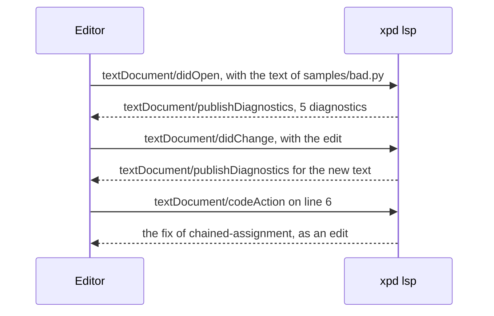

# Language server

Run `xpd lsp` from your editor to see xpd's issues while you type, apply its fixes, and read the
documentation of each rule on hover. The server is part of the xpd binary, so it needs no Python
and no other install. It speaks the
[Language Server Protocol](https://microsoft.github.io/language-server-protocol/) (LSP) on stdin
and stdout.

```text
xpd lsp
├── diagnostics     the issues of the text in the editor, saved or not
├── code actions    one quick fix for each fixable issue, and one action that applies every fix
├── hover           the documentation of the rule that reports the place under the cursor
└── settings        unsafeFixes
```

To set it up, go to [Set up an editor](#set-up-an-editor).

## What the editor gets

The editor gets the issues that [`xpd check`](commands.md#check) prints for the text in the
editor, with the same messages, because the server lints with the same code and the same rules.



For example, `xpd check samples/bad.py` prints the line below.

```text
samples/bad.py:6:5: error [pandas/chained-assignment] Chained assignment writes to a copy under copy-on-write, so the frame keeps its old values. Assign to df.loc[i, "a"] instead.
```

The server sends the diagnostic below for the same place. Lines and characters count from 0.

```json
{
  "code": "chained-assignment",
  "codeDescription": {
    "href": "https://bjoernaagaard.github.io/xpd/rules.html#chained-assignment"
  },
  "message": "Chained assignment writes to a copy under copy-on-write, so the frame keeps its old values. Assign to df.loc[i, \"a\"] instead.",
  "range": {
    "end": { "character": 14, "line": 5 },
    "start": { "character": 4, "line": 5 }
  },
  "severity": 1,
  "source": "xpd"
}
```

| Part of a diagnostic | Value |
| --- | --- |
| `range` | From the line and column that `xpd check` prints to the end of the match, or to the end of that line when the match is longer |
| `severity` | 1 for `error`, 2 for `warning`, 3 for `info` and 4 for `hint` |
| `code` | The rule, such as `chained-assignment` |
| `codeDescription` | The address of the rule's section on [Rules](rules.md), which an editor can open from the code |
| `source` | `xpd` |

A `# ast-grep-ignore: pandas/chained-assignment` comment silences the rule on the next line in
the editor too, as it does for `xpd check`.

### Diagnostics

The server sends the issues in the way the client asks for them, so the editor shows each issue
once.

| The client's `initialize` request | How the client gets the issues |
| --- | --- |
| Has the capability `textDocument.diagnostic` | The client asks with `textDocument/diagnostic`, and the server reads a file that is not open from disk. The server sends `textDocument/publishDiagnostics` only for package warnings |
| Lacks the capability | The server sends `textDocument/publishDiagnostics` when a document opens or changes, and after a save that changed the project's rules. It sends an empty list when the document closes |

A lint of a long file can take seconds, so the server lints only the newest text of a document,
and it lints that text once however many messages ask about it.

| The client sends | What the server does |
| --- | --- |
| Several `textDocument/didChange` while a lint runs | Applies all of them, then lints once and publishes the issues of the newest version |
| A hover, a code action or `textDocument/diagnostic` for text it has linted | Answers from the issues it kept, without a new lint |
| `$/cancelRequest` for a request that waits | Answers that request with the error `RequestCancelled`, -32800, and does no work for it |
| `$/cancelRequest` for a request that the server works on | Answers the request in full, because the server can't stop a lint that has started |
| A message whose `Content-Length` is over 1 GiB | Stops with exit code 1 and one line on stderr, as for any message it can't read |

For example, a client opened `samples/pandas/time-series.py` and sent ten changes while the
first lint ran. The server published the issues once, for the last version.

```text
published versions [11]
```

`xpd check` also warns about a package that the project's virtual environment (venv) lacks, such
as pyarrow. The warning is about the project and not about one file, so the server places it as
the tree shows.

```text
package warning
├── a pyproject.toml is in or above the project folder    line 1 of the nearest pyproject.toml
└── no pyproject.toml                                     not shown in the editor
```

### Code actions

Use a quick fix to fix one issue, or the `source.fixAll.xpd` action to fix every issue in the
document. The titles below are what the server sends for `samples/pandas/time-series.py` and
`samples/bad.py`.

| Title | Kind | Preferred | When the server offers it |
| --- | --- | --- | --- |
| `xpd: fix pandas/convert-then-drop-zone` | `quickfix` | Yes | The cursor or the selection touches an issue that has a safe fix |
| `xpd: fix pandas/chained-assignment (unsafe fix, may change behavior)` | `quickfix` | No | The cursor or the selection touches an issue that has an unsafe fix |
| `xpd: apply every safe fix` | `source.fixAll.xpd` | No | `unsafeFixes` is `false` and the document has a safe fix. The action writes what `xpd check --fix` writes |
| `xpd: apply every fix, also unsafe ones that may change behavior` | `source.fixAll.xpd` | No | `unsafeFixes` is `true` and the document has a fix. The action writes what `xpd check --fix --unsafe-fixes` writes |

A safe fix keeps what the code does, so an editor's key for the preferred fix applies it. An
unsafe fix has a title that says it may change what the code does, so read the code after you
apply it.

A client that asks only for `source.fixAll` also gets `source.fixAll.xpd`.

### Hover

Hover over an issue to read the documentation of its rule, with a link to the rule's section of
[Rules](rules.md). A hover over `df["a"][i]` on line 6 of `samples/bad.py` shows the text below.
A hover anywhere outside an issue shows nothing from xpd.

````markdown
#### chained-assignment

**Severity:** error. **Fix:** unsafe: `df.loc[i, "a"] = v`. A write through `.iloc` or `.iat` on a column, and `update` on a column, have no fix.

The rule reports `df["a"][i] = v`, `df[mask]["a"] = v`, `df.loc[mask]["a"] = v`, `df.a[mask] = v`, `df["a"].iloc[0] = v` and `df["a"].update(other)`, which write to a copy, so the frame keeps its old values. It also reports `df[col][mask] = v`, where a variable names the column.

Example:

```python
df["load"][row] = value
```

Use instead:

```python
df.loc[row, "load"] = value
```

The fix is unsafe, because xpd cannot see whether the value on the left is a frame. The table shows
which forms get a fix.

| Reported form | Fix |
| --- | --- |
| `df["a"][i] = v` and `df[col][mask] = v` | `df.loc[i, "a"] = v` and `df.loc[mask, col] = v` |
| `df[mask]["a"] = v` | `df.loc[mask, "a"] = v` |
| `df.loc[mask]["a"] = v` | `df.loc[mask, "a"] = v` |
| any other chain with a text label, such as `df.iloc[0]["a"] = v` | none |
| `df.a[mask] = v`, `df["a"].iloc[0] = v` and `df["a"].update(other)` | none |

A mask held in a name gets the fix when the enclosing function assigns only masks to the name, such
as a comparison or a call to `isin`. The rule reports `df.a[mask] = v` only when the mask reads the
same frame, so `self.items[i > 3] = v` is left alone. It reports `update` only on a name such as
`df` or `frame`, because `state["seen"].update(extra)` is how code updates a dict of dicts.

The rule leaves alone code that more often fills a list or a dict, as the table shows.

| Left alone | Reason |
| --- | --- |
| a dict, list or set assigned to `x["a"][key]` | the code fills a nested dict |
| two plain keys, as in `rows[0]["name"] = v` | the value is more often a list or a dict |
````

For a rule of the project, the hover shows the rule's `note`, or its `message` when it has no
note. The link goes to the rule's `url`, or to the rule file when it has no `url`.

### The project and its venv

The server finds the project and the venv of a document as `xpd check` does when you run it in
the project folder, so a rule for a newer library version than the one in the venv is skipped.

```text
project of a document
├── inside a workspace folder    that folder, or the innermost one when folders nest
└── otherwise                    the folder the document is in

venv of a project
├── VIRTUAL_ENV is set in the environment of the server    that venv
└── otherwise                                              the nearest .venv in or above the project folder
```

Save a file after `uv add` or `uv sync` to get the rules for the new versions, because the server
reads the venv again each time a document opens or is saved.

The `files` and `ignores` patterns of a rule match the path of the document relative to its
project folder.

### Project rules

A project with an `sgconfig.yml` gets its own rules in the editor, from the same files that
`xpd check` reads.

| Event | What the server does |
| --- | --- |
| A document of the project opens or is saved | Reads the project's rules again |
| A YAML file changes, and the client watches files for the server | Reads the rules of every open project again. The server asks the client to watch `**/*.{yml,yaml}` |
| The new rules have an error | Keeps the last rules that loaded, and shows the error on each open YAML file of the project |
| The editor sends `sgconfig.yml`, `xpd.yml`, a rule file or a utility file | Checks the text you edit, and shows an error as `xpd/invalid-rule` on line 1 |

The server picks the language of a file from its extension. A project rule for a language other
than Python works in the editor when the editor sends files of that language to xpd.

### Settings

Set `unsafeFixes` to `true` to make the `source.fixAll.xpd` action apply unsafe fixes too, as
`xpd check --fix --unsafe-fixes` does. The default is `false`, and the server has no other
setting.

| The client sends it in | Form | An invalid value shows |
| --- | --- | --- |
| `initializationOptions` | `{"unsafeFixes": true}` or `{"xpd": {"unsafeFixes": true}}` | A warning |
| `workspace/didChangeConfiguration` | The same form, as `settings` | An error |

For example, `{"xpd": {"unsafeFixes": "no"}}` in `initializationOptions` shows the warning
below, and the setting keeps its value.

```text
xpd: invalid settings. xpd reads {"unsafeFixes": true or false}: invalid type: string "no", expected a boolean
```

### Client capabilities

The server changes what it sends for each capability in the client's `initialize` request, as
the table shows. It asks for incremental document sync, so the client sends only the changed part
of a document with each change.

| The client's capability | What the server does |
| --- | --- |
| `general.positionEncodings` | Counts columns in the first encoding of the client's list that is `utf-8`, `utf-16` or `utf-32`. Without a list, it uses `utf-16`, as the protocol says |
| `textDocument.diagnostic` | Answers `textDocument/diagnostic`, and sends `textDocument/publishDiagnostics` only for package warnings |
| `workspace.diagnostics.refreshSupport` | Sends `workspace/diagnostic/refresh` when the rules of a project or the workspace folders change |
| `workspace.workspaceEdit.documentChanges` | Puts the document's version in each edit, so the editor refuses an edit for older text |
| `textDocument.hover.contentFormat` with `markdown` | Sends the hover as Markdown. Without it, the server sends the same text as plain text |
| `workspace.didChangeWatchedFiles.dynamicRegistration` | Asks the client to watch the YAML files, as in [Project rules](#project-rules) |

## What the server leaves out

The server offers only what `xpd check` has data for, and xpd reads one file at a time without
following names, types or imports across files.

| Not offered | Why |
| --- | --- |
| Completion, go to definition, references, rename, symbols, signature help | xpd does not resolve names |
| Formatting | xpd has no formatter. Use Ruff |
| Issues for files that are not open, without a request | Run `xpd check .` for the whole project |
| The findings of [`xpd graph`](commands.md#graph) | They come from another command, and the server reports what `xpd check` reports |
| Jupyter notebooks | `xpd check` reads `.py` files |
| Settings that pick rules, as `--rule` and `--severity` do | The server runs every rule. Use a `# ast-grep-ignore` comment to silence one rule on one line |

Any other request gets the error `MethodNotFound`, -32601, with a message such as
`xpd does not answer textDocument/completion`.

## Set up an editor

Install xpd on `PATH`, as [Install](index.md#install) shows, and then add the configuration for
your editor below.

| Editor | What starts xpd | Fix every issue |
| --- | --- | --- |
| Neovim 0.11 and later | `vim.lsp.config()` and `vim.lsp.enable()` | `vim.lsp.buf.code_action()` with `source.fixAll.xpd` |
| Helix | `languages.toml` | The code action menu |
| Zed | An extension of three files | The format action |
| VS Code | The Generic LSP Client extension | `editor.codeActionsOnSave` |
| Another editor | Its own LSP client | `source.fixAll.xpd` |

### Neovim

Add the following to `init.lua` to start xpd for Python buffers in Neovim 0.11 and later.

```lua
vim.lsp.config('xpd', {
  cmd = { 'xpd', 'lsp' },
  filetypes = { 'python' },
  root_markers = { 'pyproject.toml', '.git' },
  init_options = { unsafeFixes = false },
})
vim.lsp.enable('xpd')
```

You can then use the keys and commands below.

| Key or command | What it does |
| --- | --- |
| `:checkhealth vim.lsp` | Lists xpd under the enabled configurations |
| `K` | Shows the hover |
| `gra` | Opens the code actions |

The command below applies every safe fix of the buffer.

```vim
:lua vim.lsp.buf.code_action({ context = { only = { 'source.fixAll.xpd' } }, apply = true })
```

Neovim doesn't watch files on Linux by default, so save a buffer to make xpd read changed project
rules. See [`:help lsp-quickstart`](https://neovim.io/doc/user/lsp/#lsp-quickstart).

### Helix

Add the server to `languages.toml` in your Helix configuration folder, or in `.helix/` in the
project. `language-servers` replaces the list that Helix ships for Python, so name the servers
you already use as well. Helix 25.07.1 ships `ty`, `ruff`, `jedi` and `pylsp` for Python.

```toml
[language-server.xpd]
command = "xpd"
args = ["lsp"]
config = { unsafeFixes = false }

[[language]]
name = "python"
language-servers = ["ty", "ruff", "jedi", "pylsp", "xpd"]
```

Helix shows the diagnostics and the code actions of every server in the list. For a hover, it
asks only the first server in the list that supports hover, so put `xpd` first when you want the
rule documentation on hover. See
[Languages](https://docs.helix-editor.com/languages.html#configuring-language-servers-for-a-language).

### Zed

Install the extension of three files below with the `zed: install dev extension` action, because
xpd has no published Zed extension. Zed starts a language server only from an
[extension](https://zed.dev/docs/extensions/languages#language-servers), and it builds the
extension with Rust from [rustup](https://www.rust-lang.org/tools/install).

```text
xpd-zed/
├── extension.toml
├── Cargo.toml
└── src/lib.rs
```

```toml
# extension.toml
id = "xpd"
name = "xpd"
version = "0.0.1"
schema_version = 1
authors = ["Your Name <you@example.com>"]
description = "Starts the xpd language server for Python files"
repository = "https://github.com/bjoernaagaard/xpd"

[language_servers.xpd]
name = "xpd"
languages = ["Python"]
```

```toml
# Cargo.toml
[package]
name = "xpd-zed"
version = "0.0.1"
edition = "2021"

[lib]
crate-type = ["cdylib"]

[dependencies]
zed_extension_api = "0.7.0"
```

```rust
// src/lib.rs
use zed_extension_api::{self as zed, settings::LspSettings, LanguageServerId, Result};

struct Xpd;

impl zed::Extension for Xpd {
    fn new() -> Self {
        Self
    }

    fn language_server_command(
        &mut self,
        _id: &LanguageServerId,
        worktree: &zed::Worktree,
    ) -> Result<zed::Command> {
        let command = worktree
            .which("xpd")
            .ok_or("xpd is not on PATH. Install it with: uv tool install xpd")?;
        Ok(zed::Command {
            command,
            args: vec!["lsp".into()],
            env: worktree.shell_env(),
        })
    }

    fn language_server_initialization_options(
        &mut self,
        id: &LanguageServerId,
        worktree: &zed::Worktree,
    ) -> Result<Option<zed::serde_json::Value>> {
        Ok(LspSettings::for_worktree(id.as_ref(), worktree)?.initialization_options)
    }
}

zed::register_extension!(Xpd);
```

Zed then starts xpd beside its other Python servers. The settings below pass `unsafeFixes` and
make the format action apply every safe fix.

The `formatter` setting replaces the formatter you have for Python, so to keep yours, give
`formatter` a list with your formatter after the code action. Zed runs the list in order.

```json
{
  "lsp": {
    "xpd": {
      "initialization_options": { "unsafeFixes": false }
    }
  },
  "languages": {
    "Python": {
      "formatter": { "code_action": "source.fixAll.xpd" }
    }
  }
}
```

See [Configuring languages](https://zed.dev/docs/configuring-languages).

### VS Code and editors built on it

Install the
[Generic LSP Client](https://marketplace.visualstudio.com/items?itemName=llllvvuu.llllvvuu-glspc)
extension, because xpd has no extension for VS Code. The Generic LSP Client starts any language
server from settings, so add the following to `settings.json`.

```json
{
  "glspc.serverCommand": "xpd",
  "glspc.serverCommandArguments": ["lsp"],
  "glspc.languageId": "python",
  "glspc.initializationOptions": { "unsafeFixes": false },
  "editor.codeActionsOnSave": { "source.fixAll.xpd": "explicit" }
}
```

The `editor.codeActionsOnSave` line applies every safe fix when you save, so leave it out to apply
fixes by hand with the Quick Fix command.

The extension starts one server, so it can't run xpd beside another server that you also start
through it. When VS Code doesn't find `xpd`, start VS Code from a terminal that has `xpd` on
`PATH`, or set `PATH` in `glspc.environmentVariables`.

### Another editor

Configure any other LSP client with the values below.

| Setting | Value |
| --- | --- |
| Command | `xpd lsp` |
| Transport | stdio |
| Languages | Python, and each language that a project rule names |
| Initialization options | `{"unsafeFixes": false}` |
| Exit code | 0 after `shutdown` and `exit`, and 1 when the client goes away without them |
