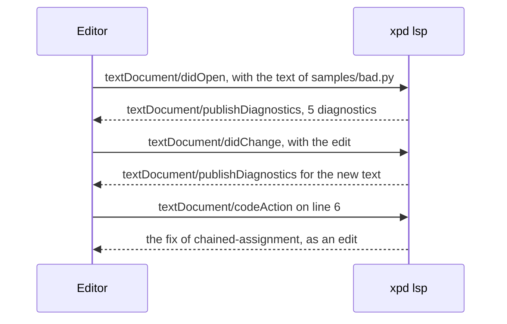

# Language server

`xpd lsp` starts a language server, so an editor shows xpd's issues while you type. It speaks
the [Language Server Protocol](https://microsoft.github.io/language-server-protocol/) on stdin
and stdout, and it is part of the xpd binary, so it needs no Python and no other install.

```text
xpd lsp
├── diagnostics     the issues of the text in the editor, saved or not
├── code actions    one quick fix per fixable issue, and one action that applies every fix
├── hover           the documentation of the rule that reports the place under the cursor
└── settings        unsafeFixes
```

## What the editor gets

The server lints the text the editor holds with the same code as [`xpd check`](commands.md#check).
It has no rules of its own, so a document gets the issues that `xpd check` prints for a file with
that text, with the same messages.



`xpd check samples/bad.py` prints the line below, and the server sends the diagnostic after it
for the same place.

```text
samples/bad.py:6:5: error [pandas/chained-assignment] Chained assignment writes to a copy under copy-on-write, so the frame keeps its old values. Assign to df.loc[i, "a"] instead.
```

```json
{
  "range": { "start": { "line": 5, "character": 4 }, "end": { "line": 5, "character": 14 } },
  "severity": 1,
  "code": "chained-assignment",
  "codeDescription": { "href": "https://bjoernaagaard.github.io/xpd/rules/#chained-assignment" },
  "source": "xpd",
  "message": "Chained assignment writes to a copy under copy-on-write, so the frame keeps its old values. Assign to df.loc[i, \"a\"] instead."
}
```

| Part of a diagnostic | Value |
| --- | --- |
| `range` | From the line and column that `xpd check` prints to the end of the match, or to the end of that line when the match is longer |
| `severity` | 1 for `error`, 2 for `warning`, 3 for `info` and 4 for `hint` |
| `code` | The rule, such as `chained-assignment` |
| `codeDescription` | The address of the rule's section on [Rules](rules.md), which an editor can open from the code |
| `source` | `xpd` |

### Diagnostics

A client that supports pull diagnostics asks with `textDocument/diagnostic`, and the server
answers with the issues of the document. Every other client gets
`textDocument/publishDiagnostics` when a document opens, changes or is saved. The server never
does both for one client, because the editor would show each issue twice.

`xpd check` also warns about a package the project's venv lacks, such as pyarrow. Such a
warning is about the project, so the server puts it on the first line of the project's
`pyproject.toml`, which is the file that `xpd check` names for it. A project without a
`pyproject.toml` gets no package warnings in the editor.

### Code actions

| Action | Kind | When the server offers it |
| --- | --- | --- |
| `xpd: fix pandas/no-inplace` | `quickfix`, preferred | The issue has a safe fix |
| `xpd: fix pandas/chained-assignment (unsafe fix, may change behavior)` | `quickfix` | The issue has an unsafe fix |
| `xpd: apply every safe fix` | `source.fixAll.xpd` | The document has a safe fix. It writes what `xpd check --fix` writes |

A safe fix keeps what the code does, so it is the preferred fix that an editor's auto fix key
applies. An unsafe fix may change what the code does, so its title says so and it is never
preferred. Read the result after you apply one.

### Hover

A hover inside the range of a diagnostic shows the rule's section of [Rules](rules.md) as
Markdown, with a link to the page. A hover anywhere else shows nothing from xpd.

### The project and its venv

A rule for a newer library version than the one in the project's venv is skipped, as in
`xpd check`. The server finds the project of a document from the workspace folders of the
editor.

```text
project of a document
├── inside a workspace folder    that folder, or the innermost one when folders nest
└── otherwise                    the folder the document is in

venv of a project
├── VIRTUAL_ENV is set in the environment of the server    that venv
└── otherwise                                              the nearest .venv in or above the project folder
```

The `files` and `ignores` globs of a rule match the path of the document below its project
folder. That is the path you give `xpd check` when you run it in that folder. The server reads
the venv again each time a document opens or is saved, so save a file after `uv add` or
`uv sync` to get the rules for the new versions.

### Settings

The server has one setting, for the one flag of `xpd check` that changes what an editor shows.

| Setting | Default | Effect |
| --- | --- | --- |
| `unsafeFixes` | `false` | `true` makes the `source.fixAll.xpd` action also apply unsafe fixes, as `xpd check --fix --unsafe-fixes` does. Its title then says so |

Send it in `initializationOptions`, or later in `workspace/didChangeConfiguration`. Both take
`{"unsafeFixes": true}` or `{"xpd": {"unsafeFixes": true}}`. The server shows a warning for a
value that is not `true` or `false`.

### Positions

The server counts columns in the first position encoding of the client's `positionEncodings`
that it knows. It knows `utf-8`, `utf-16` and `utf-32`, and it uses `utf-16` for a client that
names none, as the protocol says. The document sync is incremental.

## What the server leaves out

xpd reads one file at a time and knows nothing about names, types or imports across files. The
server offers only what it has data for.

| Not offered | Why |
| --- | --- |
| Completion, go to definition, references, rename, symbols, signature help | xpd does not resolve names |
| Formatting | xpd has no formatter. Use Ruff |
| Diagnostics for files that are not open | Run `xpd check .` for the whole project |
| The findings of [`xpd graph`](commands.md#graph) | They come from another command, and the server reports what `xpd check` reports |
| Jupyter notebooks | `xpd check` reads `.py` files |
| Settings to turn a rule off | `xpd check` has none |

## Set up an editor

Install xpd first, so the editor finds `xpd` on `PATH`. See [Install](index.md#install).

### Neovim

Neovim 0.11 and later configure a server with `vim.lsp.config()` and start it with
`vim.lsp.enable()`. Add the following to `init.lua`.

```lua
vim.lsp.config('xpd', {
  cmd = { 'xpd', 'lsp' },
  filetypes = { 'python' },
  root_markers = { 'pyproject.toml', '.git' },
  init_options = { unsafeFixes = false },
})
vim.lsp.enable('xpd')
```

`:checkhealth vim.lsp` lists xpd under the enabled configurations. `K` shows the hover and
`gra` opens the code actions. The command below applies every safe fix of the buffer.

```vim
:lua vim.lsp.buf.code_action({ context = { only = { 'source.fixAll.xpd' } }, apply = true })
```

See [`:help lsp-quickstart`](https://neovim.io/doc/user/lsp.html#lsp-quickstart).

### Helix

Add the server to `languages.toml` in your Helix configuration folder, or in `.helix/` in the
project. `language-servers` replaces the list that Helix ships for Python in its
[`languages.toml`](https://github.com/helix-editor/helix/blob/master/languages.toml), so name
the servers you already use as well.

```toml
[language-server.xpd]
command = "xpd"
args = ["lsp"]
config = { unsafeFixes = false }

[[language]]
name = "python"
language-servers = ["ruff", "jedi", "xpd"]
```

Helix merges the diagnostics and the code actions of every server in the list. It asks only the
first server that supports hover for a hover, so put `xpd` first when you want the rule
documentation on hover, and last when another server should answer. See
[Languages](https://docs.helix-editor.com/languages.html#language-server-configuration).

### Zed

Zed starts a language server only from an
[extension](https://zed.dev/docs/extensions/languages#language-servers). xpd has no published
extension. The three files below are a complete one, which you install with the
`zed: install dev extension` action. Zed builds it with Rust from
[rustup](https://www.rust-lang.org/tools/install).

```text
xpd-zed/
├── extension.toml
├── Cargo.toml
└── src/lib.rs
```

```toml
# extension.toml
id = "xpd"
name = "xpd"
version = "0.0.1"
schema_version = 1
authors = ["Your Name <you@example.com>"]
description = "Starts the xpd language server for Python files"
repository = "https://github.com/bjoernaagaard/xpd"

[language_servers.xpd]
name = "xpd"
languages = ["Python"]
```

```toml
# Cargo.toml
[package]
name = "xpd-zed"
version = "0.0.1"
edition = "2021"

[lib]
crate-type = ["cdylib"]

[dependencies]
zed_extension_api = "0.7.0"
```

```rust
// src/lib.rs
use zed_extension_api::{self as zed, settings::LspSettings, LanguageServerId, Result};

struct Xpd;

impl zed::Extension for Xpd {
    fn new() -> Self {
        Self
    }

    fn language_server_command(
        &mut self,
        _id: &LanguageServerId,
        worktree: &zed::Worktree,
    ) -> Result<zed::Command> {
        let command = worktree
            .which("xpd")
            .ok_or("xpd is not on PATH. Install it with: uv tool install xpd")?;
        Ok(zed::Command {
            command,
            args: vec!["lsp".into()],
            env: worktree.shell_env(),
        })
    }

    fn language_server_initialization_options(
        &mut self,
        id: &LanguageServerId,
        worktree: &zed::Worktree,
    ) -> Result<Option<zed::serde_json::Value>> {
        Ok(LspSettings::for_worktree(id.as_ref(), worktree)?.initialization_options)
    }
}

zed::register_extension!(Xpd);
```

Zed then starts xpd beside its other Python servers. The settings below pass `unsafeFixes`,
and make the format action apply every safe fix. `formatter` replaces the formatter you have for
Python, and it also takes a list that runs in order, so put your formatter after the code action
there.

```json
{
  "lsp": {
    "xpd": {
      "initialization_options": { "unsafeFixes": false }
    }
  },
  "languages": {
    "Python": {
      "formatter": { "code_action": "source.fixAll.xpd" }
    }
  }
}
```

See [Configuring languages](https://zed.dev/docs/configuring-languages).

### VS Code and editors built on it

xpd has no extension for VS Code. The
[Generic LSP Client](https://marketplace.visualstudio.com/items?itemName=llllvvuu.llllvvuu-glspc)
extension starts any language server from settings. Install it, and add the following to
`settings.json`.

```json
{
  "glspc.serverCommand": "xpd",
  "glspc.serverCommandArguments": ["lsp"],
  "glspc.languageId": "python",
  "glspc.initializationOptions": { "unsafeFixes": false },
  "editor.codeActionsOnSave": { "source.fixAll.xpd": "explicit" }
}
```

The last line applies every safe fix when you save, so leave it out to apply fixes by hand with
the Quick Fix command. The extension starts one server, so it cannot run xpd beside another
server that you also start through it. When VS Code does not find `xpd`, start VS Code from a
terminal that has it on `PATH`, or set `PATH` in `glspc.environmentVariables`.

### Another editor

Any LSP client works with three facts: the command is `xpd lsp`, the transport is stdio, and
the language is Python. The server exits with 0 after `shutdown` and `exit`, and with 1 when the
client goes away without them.
