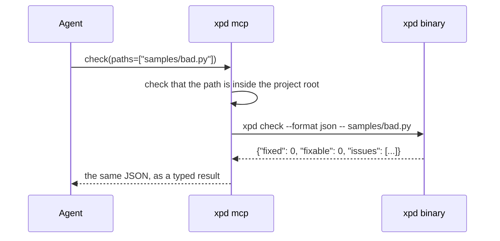

# MCP server

`xpd mcp` starts an [MCP](https://modelcontextprotocol.io) server, so an agent can run xpd
through tools instead of a shell. It gets every rule and every result from the xpd binary, so
it always matches the installed version. The server is built on
[FastMCP](https://gofastmcp.com), which installs with xpd.

```text
xpd mcp
├── tools        lint, fix, read the dataflow, profile data, compare two scripts, read the rules,
│                and judge a run from a data file to a saved model
├── resources    every rule with its section of the Rules page, and the three agent skills
├── prompts      the workflows of the xpd skill
└── apps         tables and a dataflow chart, in hosts that render MCP Apps
```

## How a call runs

The server holds no rules and no results of its own. It loads the rules and the skills from the
xpd binary when it starts. A tool that reads project files first checks its paths, and then runs
the binary in the project root. The data tools return the JSON that the binary prints as a typed
result, and the `show_` tools also return a table or a chart. `contract` and `gates` are the
exception. They run no binary: `contract` reads a JSON file of the project, and `gates` holds
its own requirements and judges results that the other tools returned.



The result of the check includes the following issue.

```json
{
  "package": "pandas",
  "rule": "merge-without-validate",
  "file": "samples/bad.py",
  "line": 8,
  "column": 5,
  "severity": "warning",
  "message": "merge without validate= can silently duplicate rows.",
  "fix": null
}
```

## Install

Run the following command to add the server to Claude Code.

```sh
claude mcp add xpd -- uvx xpd mcp
```

For another client, add the server to the `mcpServers` setting of the client.

```json
{
  "mcpServers": {
    "xpd": {
      "command": "uvx",
      "args": ["xpd", "mcp"]
    }
  }
}
```

The server uses its working directory as the project root, unless `--root` or `XPD_MCP_ROOT`
names another folder. Set the root when your client starts servers in another folder.

A client that loads xpd as an [agent plugin](claude-code.md#agent-plugin) starts the server in
the plugin's folder and sets `PLUGIN_ROOT`. There the server asks the client for its
[roots](https://modelcontextprotocol.io/specification/2025-06-18/client/roots) on each call and
uses the first one that is a folder on the machine as the project root. A tool fails with a
message when such a client names no such root.

```text
project root of a call
├── --root or XPD_MCP_ROOT is set    that folder
├── PLUGIN_ROOT is set               the first folder the client names as a root
└── otherwise                        the working directory
```

An xpd binary built with `cargo` has no Python package, so its `xpd mcp` prints `uvx xpd mcp`
and exits 2.

## Tools

Every path is relative to the project root, and a path outside it is refused.

| Tool | Arguments | What it does | Changes files |
| --- | --- | --- | --- |
| `find` | `task`, optional `package`, `kind`, `limit` | Searches the binary's index, including libraries not installed | No |
| `api` | `name` | Reads one indexed name, its parameter names and guarding rules | No |
| `discovery_gate` | `paths`, `discovery` | Checks direct imported calls against `api` before execution | No |
| `check` | `paths` (default: the root), `unsafe_fixes` (default: `false`) | Lints files and folders, as [`xpd check`](commands.md#check). `unsafe_fixes` counts unsafe fixes in `fixable` too | No |
| `fix` | `paths` (default: the root), `unsafe` (default: `false`) | Writes the safe fixes, then lints what is left. With `unsafe`, it writes unsafe fixes too, after the user confirms | Yes |
| `graph` | `paths` | Reads the dataflow of step code and Hamilton modules, as [`xpd graph`](commands.md#graph) | No |
| `profile` | `file` | Profiles a data file, as [`xpd profile`](commands.md#profile) | No |
| `equiv` | `old`, `new` | Runs two scripts, each in its own Python process, and compares their `result`, as [`xpd equiv`](commands.md#equiv) | Whatever the scripts do |
| `rules` | `package`, `severity`, `fixable`, `query`, all optional | Lists the rules that match every filter given. `package` is a module name, such as `numpy` or `sklearn` | No |
| `rule` | `package`, `rule` | Shows one rule with its documentation and examples | No |
| `refit` | `file` | Fits a clone of the saved Pipeline on raw training rows and compares outputs and scores, as [`xpd refit`](commands.md#refit) | Runs model code |
| `contract` | `file` | Reads the contract that a training script saved beside its model, as [Code mode](code-mode.md#the-stages) describes | No |
| `gates` | `profile`, `contract`, `proof` | Judges a run from a data file to a saved model, from the results of the other tools. See [the gates](code-mode.md#the-gates) | No |
| `show_issues` | `paths` (default: the root) | Shows what `check` finds as a table | No |
| `show_dataflow` | `paths` | Shows what `graph` reads as a chart and a table | No |
| `show_columns` | `file` | Shows what `profile` reads as a table | No |

`profile`, `refit` and `equiv` run the project's Python, which is the Python of `VIRTUAL_ENV`, then of the
nearest `.venv` above the project root, then `python3` on `PATH`. Install pandas there. Both
scripts that `equiv` runs must assign their output to `result`.

The tools from `check` to `gates` return structured results with an output schema. The `show_` tools return a UI
for hosts that render [MCP Apps](https://modelcontextprotocol.io/docs/extensions/apps), and the
same JSON as text for hosts that do not.

### Confirmation of unsafe fixes

An unsafe fix may change what the code does, so the user has to confirm it. With `unsafe`,
`fix` counts the unsafe fixes before it writes any file, and then asks for confirmation.

```text
fix(paths, unsafe=true)
  lint paths and count the issues whose fix is "unsafe"
  if the count is above zero
    ask the user "Apply 2 unsafe fixes in samples?"
    if the client has to collect the answer first
      return the question and write no file
    if the user declines
      write the safe fixes only and return what is left
  write the safe and the unsafe fixes and return what is left
```

A client on the older protocol is asked during the call. A client on the 2026-07-28 protocol,
and any background task, gets the question back as the result, and then calls `fix` again with
the answer. A client that cannot ask its user gets an error, and no file is written.

### Background tasks

`check`, `fix`, `profile`, `refit` and `equiv` can run as background tasks for clients that ask for one.
They report progress and log what they run.

## Resources

| URI | Content |
| --- | --- |
| `xpd://rules` | Every rule as JSON, without its documentation |
| `xpd://rules/{package}` | The rules of one pack, such as `xpd://rules/pandas` |
| `xpd://rules/{package}/{rule}` | One rule's documentation as Markdown, such as `xpd://rules/pandas/chained-assignment` |
| `xpd://version` | The version of the xpd binary |
| `skill://xpd/SKILL.md` | The [xpd skill](claude-code.md#agent-skill) |
| `skill://python-best-practices/SKILL.md` | The Python style skill |
| `skill://python-review/SKILL.md` | The Python review skill |
| `skill://python-review/assets/review-template.md` | The template of the review report |

A client can complete the `package` and `rule` parts of a URI, and a rule is completed within
the package already chosen. Clients that support the Skills extension also list the skills.

## Prompts

| Prompt | Arguments | What the agent does |
| --- | --- | --- |
| `lint_and_fix` | `path` | Lints, fixes, and lints again until only explained warnings are left |
| `review` | `target`, `package`, `rule` | Reviews a path or a git range with the review skill and `check` |
| `refactor_data_logic` | `path`, `goal` | Refactors a script and proves with `equiv` that its result did not change |
| `add_to_dataflow` | `path`, `change` | Adds a step or node, with `graph` before and after |
| `build_pipeline` | `data`, `target`, optional `task` | Builds a scikit-learn model from a data file, saves it with its contract, and runs the stages until `gates` passes |

`package` and `rule` complete as they do in resource URIs.

## Settings

Each flag has an environment setting, for clients that start the server without flags.

| Flag | Environment | Default | Effect |
| --- | --- | --- | --- |
| `--root PATH` | `XPD_MCP_ROOT` | The working directory, or the client's first root when xpd is a plugin | The project root. Every path must be inside it |
| `--code-mode` | `XPD_MCP_CODE_MODE=1` | Off | Shows the tools through FastMCP's [code mode](https://gofastmcp.com/docs/servers/transforms/code-mode) as `search`, `get_schema` and `execute`. [Code mode](code-mode.md) shows a run. |
| `--transport stdio\|http` | `FASTMCP_TRANSPORT` | `stdio` | How clients connect |
| `--host HOST` | `FASTMCP_HOST` | `127.0.0.1` | The address to bind for HTTP |
| `--port PORT` | `FASTMCP_PORT` | `8000` | The port for HTTP |

`xpd mcp -h` lists the flags. Set the environment settings in the `env`
setting of the client, because a client may not pass on the variables of your shell.

## HTTP

To serve several clients, or a client on another machine, start the server over HTTP:

```sh
uvx xpd mcp --transport http --port 8000
```

Clients connect to `http://127.0.0.1:8000/mcp`. The server binds `127.0.0.1` unless `--host`
says otherwise. The server has no authentication. Bind another address only on a network you trust.

## Other ways to run it

FastMCP's own commands work with the server. `fastmcp run -m xpd.mcp` starts it as a module,
configured from the environment settings above, and the client commands start `xpd mcp`:

```sh
fastmcp list --command 'xpd mcp' --resources --prompts
fastmcp call --command 'xpd mcp' --target rule --input-json '{"package": "pandas", "rule": "row-loop"}'
```

## Library discovery

Call `find(task, package=None, kind=None, limit=None)` before selecting a library, even if the project has
not installed it. The result has separately ranked `symbols`, `rules` and `recipes` lists, with default
limits of five, three and three. `limit` overrides the maximum per kind. Excluded or
unmatched kinds have empty lists. `package`
is a Python import name. Read each entry's `kind`, which can include `symbol`, `rule` and
`recipe`. The server preserves entry fields added by the binary. Call `api(name)` with a returned
name to read its parameter names, docstring summary, own class members and possible guarding
rules. Both tools call the installed binary. The server holds no symbol index. In code mode, `find` returns this object directly.
`api` returns an object directly. Both include `signature`, a display of indexed parameter
names only. This display has no defaults, parameter kinds or type annotations, and it is
null for entries that are not callable symbols.

`DiscoveryQuestion` holds `task`. `DiscoveryEntry` holds each candidate's `kind`, `name`,
`signature`, `summary`, `parameters`, `members` and guarding `rules`. `DiscoveryChoice`
holds the chosen `name`, a `reason` and the callable `symbols` the written code must use.
For a recipe, list the indexed symbols its example uses. `Discovery` combines those three
parts, with candidates grouped as `{"symbols": [...], "rules": [...], "recipes": [...]}`.
Entries inspected directly through `api` count as candidates when recorded in these lists.
This record is the planning input for the pipeline stages, and the training script saves
it in `Contract.discovery`. The server neither chooses a candidate nor installs a package.

`discovery_gate` reads the Python files named in `paths` inside the project root. It resolves
import spellings, including aliases, and asks the binary's `api` about direct calls in the
modules containing `choice.symbols`. It requires a call to every chosen symbol and checks
literal keyword names against the index's parameter names. An unknown callable, an unlisted
keyword or `**` argument fails `indexed-api-calls`. It returns `DiscoveryProof` with the
record, paths and `Gate`. It imports no library and runs no project code.

This gate checks source spellings. It cannot resolve shadowed imports, instance methods,
runtime aliases, required arguments, positional binding, argument values or types. An
indexed name may be absent from the installed library. A valid inherited or variadic
parameter may be absent from the index. Calls in other modules are outside its scope.
A recipe's association with its chosen symbols is the agent's account.

Pass `DiscoveryProof` as `Proof.discovery` to `gates`. When either the proof or the contract
has discovery, `gates` requires both records to match and includes `indexed-api-calls` and
`discovery-is-recorded`. Contracts and proofs with neither retain the original eleven
gates. These are supplied results, so `gates` does not prove that the files are unchanged
or that a supplied report is authentic.

`build_pipeline` tells the agent to find, inspect, choose, explain missing dependencies,
write files, run `discovery_gate`, run `check`, then run the remaining stages. It tells the
agent to get permission before adding a missing library through the project's dependency
manager. The default sandbox only calls tools. The agent writes files before the single
`execute` call, which repeats discovery and checks the written choice. See the runnable
[discovery examples](code-mode.md#discovery-before-execution).

The branch wheel was run through a real FastMCP 4.2.0 code mode client. The grouped discovery
scripts in [code mode](code-mode.md#run-the-scripts-through-the-server) returned these results.

| Call | Real result |
| --- | --- |
| `find(task="rounded bars", kind="recipe")`, then `api` | `plotly/recipe/rounded-bars`, MIT, 498 bytes of code, source ending `bar-charts.md#L746` |
| Grouped model `execute` | `passed: true`, one API call checked, no lint issues, `equivalent: true` |
| Bootstrap `execute` | `passed: true`, five API calls checked, no lint issues, `equivalent: true` |
| Plotly `execute` | `passed: true`, one API call checked, no lint issues, `equivalent: true` |
| Invented API `execute` | `passed: false`, `ran: false`, unknown `group_by` and `ImaginaryPredictor` |

Recipe API output retains `recipe`
with its title, symbols, source path and line, code, license, attribution and modification flag.
