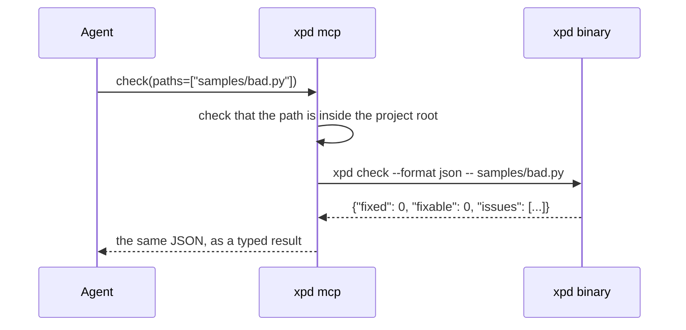

# MCP server

`xpd mcp` starts an [MCP](https://modelcontextprotocol.io) server, so an agent can lint, fix,
search and check Python through tools instead of a shell. The server gets every rule and every
result from the xpd binary, so it always matches the installed version. It is built on
[FastMCP](https://gofastmcp.com) 4.2, which installs with xpd.

```text
xpd mcp
├── 21 tools     lint and fix, structural search, dataflow, data files, rules,
│                library discovery, pipeline gates, and three views for MCP Apps
├── resources    every rule, the binary's version, and the three agent skills
└── prompts      lint_and_fix, review, refactor_data_logic, add_to_dataflow, build_pipeline
```

## Install

Run the following command to add the server to Claude Code.

```sh
claude mcp add xpd -- uvx xpd mcp
```

For another client, add the server to the `mcpServers` setting of the client.

```json
{
  "mcpServers": {
    "xpd": {
      "command": "uvx",
      "args": ["xpd", "mcp"]
    }
  }
}
```

The server uses its working directory as the project root, unless `--root` or `XPD_MCP_ROOT`
names another folder, so set the root when your client starts servers in another folder. A
client that loads xpd as an [agent plugin](claude-code.md#agent-plugin) sets `PLUGIN_ROOT`, and
then the server asks the client for its
[roots](https://modelcontextprotocol.io/specification/2025-06-18/client/roots) on each call.

```text
project root of a call
├── --root or XPD_MCP_ROOT is set    that folder
├── PLUGIN_ROOT is set               the first root of the client that is a folder on this machine
└── otherwise                        the working directory
```

A tool fails with a message that names `--root` and `XPD_MCP_ROOT` when a plugin client names no
such root. An xpd binary that you build with `cargo` has no Python package beside it, so its
`xpd mcp` prints the command to use instead and exits 2.

```console
$ target/debug/xpd mcp
xpd: xpd mcp needs xpd installed as a Python package. Run it as: uvx xpd mcp
```

## How a call runs

A tool checks that each path is inside the project root, and then it runs the xpd binary in
the project root and returns the JSON that the binary prints as a typed result.



The call above returns five issues, and the following is one of them.

```json
{
  "package": "pandas",
  "rule": "merge-without-validate",
  "file": "samples/bad.py",
  "line": 8,
  "column": 5,
  "severity": "warning",
  "message": "merge without validate= can silently duplicate rows.",
  "fix": null
}
```

The server holds no rules and no results of its own. It reads the built-in rules and skills from
the binary when it starts, and it reads the project's own rules again for each rule call and
each completion. Some tools differ from the pattern above, as the table shows.

| Tool | How it differs |
| --- | --- |
| `find`, `api` | Run the binary in the server's working directory, because they read the index and no project file |
| `discovery_gate` | Parses the project's files in Python and asks the binary's `api` about each call |
| `contract` | Reads a JSON file of the project and runs no binary |
| `gates` | Judges results that the other tools returned, and reads no file |
| `show_issues`, `show_dataflow`, `show_columns` | Return a table or a chart as well as the JSON |

## Tools

Every path is relative to the project root, and the server refuses a path outside it.

| Tool | Arguments | What it does | Changes files |
| --- | --- | --- | --- |
| `check` | `paths` (default: the root), `unsafe_fixes` (default: `false`), `options` | Lints files and folders, as [`xpd check`](commands.md#check). With `unsafe_fixes`, `fixable` counts unsafe fixes too | No |
| `fix` | `paths` (default: the root), `unsafe` (default: `false`), `options` | Writes the safe fixes, and then lints what is left. With `unsafe`, it also writes the unsafe fixes after the user confirms | Yes |
| `query` | `query`, `paths` (default: the root) | Finds a code pattern or a syntax kind, and previews a replacement, as [`xpd run`](commands.md#run) | No |
| `rewrite` | `query` with a `rewrite` template, `paths` (default: the root) | Shows the matches, asks the user to confirm, and then writes the replacement | Yes |
| `outline` | `paths` (default: the root), `options` | Lists the symbols, signatures, imports and members of the files, as [`xpd outline`](commands.md#outline) | No |
| `new` | `item` | Creates a rule project, a rule, an empty test case or a shared utility, with the options of [`xpd new`](commands.md#new) | Yes |
| `test` | `options` | Checks the valid and invalid examples of the project's rules and compares the snapshots, as [`xpd test`](commands.md#test) | Only with `update_snapshots` |
| `graph` | `paths` | Reads the dataflow of step code and Hamilton modules, as [`xpd graph`](commands.md#graph) | No |
| `profile` | `file` | Profiles a data file, as [`xpd profile`](commands.md#profile) | No |
| `equiv` | `old`, `new` | Runs two scripts, each in its own Python process, and compares their `result`, as [`xpd equiv`](commands.md#equiv) | Whatever the scripts do |
| `refit` | `file` | Fits a clone of the saved Pipeline on the raw training rows and compares the outputs and scores, as [`xpd refit`](commands.md#refit) | Runs model code |
| `rules` | `package`, `severity`, `fixable`, `query`, all optional | Lists the rules that match every filter you give. `package` is a module name, such as `numpy` or `sklearn` | No |
| `rule` | `package`, `rule` | Shows one rule with its documentation and examples | No |
| `find` | `task`, and optional `package`, `kind`, `limit` | Searches the binary's index, which includes libraries the project has not installed | No |
| `api` | `name` | Reads one indexed name, or a method or property of an indexed class, with its parameters as the source writes them and the rules that guard it | No |
| `discovery_gate` | `paths`, `discovery` | Checks the direct calls to imported names against the index, before any code runs | No |
| `contract` | `file` | Reads the contract that a training script saved beside its model, as [Code mode](code-mode.md#the-stages) describes | No |
| `gates` | `profile`, `contract`, `proof` | Judges a run from a data file to a saved model, from the results of the other tools, as [the gates](code-mode.md#the-gates) describe | No |
| `show_issues` | `paths` (default: the root) | Shows what `check` finds as a table | No |
| `show_dataflow` | `paths` | Shows what `graph` reads as a chart and a table | No |
| `show_columns` | `file` | Shows what `profile` reads as a table | No |

The `options` argument of `check` and `fix` holds `rules`, `severity` and a project-relative
`config`. `fix` uses the same options for the count of unsafe fixes as for the write.

```text
options of check and fix      rules: ["pandas", "pandas/chained-assignment"], severity, config
query of query and rewrite    exactly one of pattern or kind, and language, selector, rewrite
options of outline            language, items (all, structure, imports or exports), rules
item of new                   entity (project, rule, test or util), name, directory, pattern, ...
options of test               config, test_dir, filter, skip_snapshots or update_snapshots
```

`profile`, `refit` and `equiv` run the project's Python. The binary takes the Python of
`VIRTUAL_ENV`, then of the nearest `.venv` in or above the project root, and then `python3` on
`PATH`, so install pandas there. Both scripts that `equiv` runs must assign their output to
`result`.

Every tool except the three `show_` tools returns a structured result with an output schema.
The `show_` tools return a UI for hosts that render
[MCP Apps](https://modelcontextprotocol.io/docs/extensions/apps), and the same JSON as text for
hosts that don't.

### Confirmation of unsafe fixes

`fix` with `unsafe` asks the user before it writes an unsafe fix, because an unsafe fix may
change what the code does. `rewrite` asks the same way before it writes a replacement.

```text
fix(paths, unsafe=true)
  lint paths and count the issues whose fix is "unsafe"
  if the count is above zero
    ask the user "Apply 2 unsafe fixes in samples? An unsafe fix may change what the code does."
    if the client has to collect the answer first
      return the question and write no file
    if the user declines
      write the safe fixes only and return what is left
  write the safe and the unsafe fixes and return what is left
```

A client on an older protocol gets the question during the call. A client on the 2026-07-28
protocol, and any background task, gets the question back as the result, and then it calls
`fix` again with the answer. A client that can't ask its user gets an error, and the server
writes no file.

### Background tasks

A client can run `check`, `fix`, `query`, `rewrite`, `outline`, `new`, `test`, `profile`,
`refit` and `equiv` as background tasks. Each of them reports progress and logs the xpd
command it runs.

## Resources

An agent can read every rule and every skill of xpd as a resource.

| URI | Content |
| --- | --- |
| `xpd://rules` | Every rule as JSON, without its documentation |
| `xpd://rules/{package}` | The rules of one pack, such as `xpd://rules/pandas` |
| `xpd://rules/{package}/{rule}` | One rule's documentation as Markdown, such as `xpd://rules/pandas/chained-assignment` |
| `xpd://version` | The version of the xpd binary |
| `skill://xpd/SKILL.md` | The [xpd skill](claude-code.md#agent-skill) |
| `skill://python-best-practices/SKILL.md` | The Python style skill |
| `skill://python-review/SKILL.md` | The Python review skill |
| `skill://python-review/assets/review-template.md` | The template of the review report |

Each skill also has a `skill://<name>/_manifest` resource that lists its files, and clients that
support the Skills extension list the skills. A client can complete the `package` and `rule`
parts of a URI, and the server completes a rule within the package already chosen.

## Prompts

Each prompt gives the agent the steps of one workflow of the xpd skill, with the tools to call
and the result that ends it.

| Prompt | Arguments | What the agent does |
| --- | --- | --- |
| `lint_and_fix` | optional `path` (default: `.`) | Lints, fixes, and lints again until only explained warnings are left |
| `review` | `target`, and optional `package`, `rule` | Reviews a path or a git range with the review skill and `check` |
| `refactor_data_logic` | `path`, `goal` | Refactors a script and proves with `equiv` that its result did not change |
| `add_to_dataflow` | `path`, `change` | Adds or changes a step or a node, with `graph` before and after |
| `build_pipeline` | `data`, `target`, and optional `task` | Builds a scikit-learn model from a data file, saves it with its contract, and runs the stages until `gates` passes |

The `package` and `rule` arguments complete as they do in resource URIs.

## Settings

Each flag has an environment setting, for clients that start the server without flags.

| Flag | Environment | Default | Effect |
| --- | --- | --- | --- |
| `--root PATH` | `XPD_MCP_ROOT` | The working directory, or the client's first root when xpd is a plugin | The project root. Every path must be inside it |
| `--code-mode` | `XPD_MCP_CODE_MODE=1` | Off | Shows the tools through FastMCP's [code mode](https://gofastmcp.com/docs/servers/transforms/code-mode) as `search`, `get_schema` and `execute`. [Code mode](code-mode.md) shows a run |
| `--transport stdio\|http` | `FASTMCP_TRANSPORT` | `stdio` | How clients connect |
| `--host HOST` | `FASTMCP_HOST` | `127.0.0.1` | The address to bind for HTTP |
| `--port PORT` | `FASTMCP_PORT` | `8000` | The port for HTTP |

`XPD_MCP_CODE_MODE` also accepts `true`, `yes` and `on`, and `--no-code-mode` turns code mode off
again. Set the environment settings in the `env` setting of the client, because a client may
not pass on the variables of your shell. `xpd mcp -h` prints the flags.

```console
$ xpd mcp -h
usage: xpd mcp [-h] [--root ROOT] [--code-mode | --no-code-mode]
               [--transport {stdio,http}] [--host HOST] [--port PORT]
```

## HTTP

Start the server over HTTP to serve several clients, or a client on another machine.

```sh
uvx xpd mcp --transport http --port 8000
```

Clients connect to `http://127.0.0.1:8000/mcp`. The server binds `127.0.0.1` unless `--host`
names another address, and it has no authentication, so bind another address only on a network
you trust.

## Other ways to run it

FastMCP's own commands work with the server. `fastmcp run -m xpd.mcp` starts it as a module with
the environment settings above, and the client commands below start `xpd mcp` and call it.

```sh
fastmcp list --command 'xpd mcp' --resources --prompts
fastmcp call --command 'xpd mcp' --target rule --input-json '{"package": "pandas", "rule": "row-loop"}'
```

## Library discovery

Call `find` with the task before you choose a library, and then call `api` with a returned name,
also when the project has not installed the library. Both tools ask the installed binary, and
the server holds no index of its own.

```text
find(task, package=None, kind=None, limit=None)
  package    a Python import name, such as sklearn
  kind       symbol, rule or recipe, and the other kinds come back empty
  limit      the most entries of each kind, by default 5 symbols, 3 rules and 3 recipes
  returns    {"symbols": [...], "rules": [...], "recipes": [...]}, each ranked on its own

api(name)
  name       a name that find returned, or Class.member for a method or property
  returns    kind, package, name, callable, parameters, parameters_written, summary,
             members, rules, signature, and recipe for a recipe
```

The first `find` downloads the 333 MB embedding model that ranks by meaning, as the
[commands page](commands.md#find) explains, so the first call can take a few minutes.
`parameters_written` holds the parameter list as the source writes it, so each parameter has its
type annotation and its default, and a `*` or `/` that stands alone is an item of its own. Read
it before you write a call. A stub file writes `...` for a default, which says only that the
parameter is optional. `parameters_written` is empty in the results of `find`, and for a
function that exists only as overloads in a stub file, as the
[commands page](commands.md#api) explains.
`api` adds `signature`, which shows the indexed parameter names only. `signature` is `null`
for an entry that is not a callable symbol. The server keeps any field that the binary adds to
an entry.

```console
$ xpd api --format json numpy.zeros | jq -c '.[0] | {name, kind, callable, parameters, rules}'
{"name":"numpy.zeros","kind":"symbol","callable":"function","parameters":["shape","dtype","order","device","like"],"rules":["numpy/array-default-argument"]}
$ xpd api --format json mapie.regression.TimeSeriesRegressor.update | jq -c '.[0] | {name, callable, parameters_written}'
{"name":"mapie.regression.TimeSeriesRegressor.update","callable":"method","parameters_written":["X: ArrayLike","y: ArrayLike","ensemble: bool = False","confidence_level: Optional[Union[float, Iterable[float]]] = None","gamma: float = 0.0","optimize_beta: bool = False"]}
```

A recipe entry adds `recipe` with the title, the symbols its code uses, the source URL with its
line, the code, the license name and whether xpd changed the code. It also has `attribution`
when the source file states its own copyright, and it has no code when the license is
`pointer only`.

```console
$ xpd api --format json plotly/recipe/rounded-bars | jq '.[0].recipe | del(.code)'
{
  "title": "Rounded Bars",
  "symbols": [
    "plotly.data.medals_wide",
    "plotly.graph_objects.Bar",
    "plotly.subplots.make_subplots"
  ],
  "source": "https://github.com/plotly/plotly.py/blob/v7.1.0/doc/python/bar-charts.md#L746",
  "license": "MIT",
  "modified": false
}
$ xpd api --format json numpy/recipe/returns-array-of-indices-of-the-maximum-values | jq '.[0].recipe | {license, attribution}'
{
  "license": "BSD-3-Clause",
  "attribution": "Copyright 1999, 2000, 2001 Regents of the University of California."
}
```

### The discovery record

The agent writes down what it searched, what it read and what it chose as a `Discovery` record,
and the training script saves the same record in `Contract.discovery`. The server doesn't choose
a candidate and doesn't install a package.

| Model | Fields |
| --- | --- |
| `DiscoveryQuestion` | `task` |
| `DiscoveryEntry` | `kind`, `name`, `signature`, `summary`, `parameters`, `parameters_written`, `members` and the guarding `rules` of one candidate |
| `DiscoveryChoice` | the chosen `name`, a `reason`, and the callable `symbols` that the code must call, which for a recipe are the indexed symbols its code uses |
| `Discovery` | `question`, `candidates` as `{"symbols": [...], "rules": [...], "recipes": [...]}`, and `choice` |
| `DiscoveryProof` | the `discovery` record, the checked `paths`, and the `gate` |

An entry that the agent read with `api` counts as a candidate when the agent puts it in these
lists.

### The discovery gate

`discovery_gate` reads the Python files in `paths` and checks each direct call to a name from
the modules of `choice.symbols` against the index. It imports no library and runs no project
code.

```text
discovery_gate(paths, discovery)
  fail if choice.name is not among the candidates
  fail if the choice is a symbol and choice.symbols leaves it out
  for each call such as np.zeros(...) in the files
    resolve the import spelling, aliases included, to numpy.zeros
    skip the call unless its module holds a chosen symbol
    ask api about numpy.zeros
    fail if api does not know it as a callable symbol
    fail on a keyword that is not among its indexed parameters, and on ** arguments
  fail for each chosen symbol that no call uses
  return DiscoveryProof with the gate indexed-api-calls
```

The gate checks how the source spells each call, and it can miss a call or fail a valid one.

| The gate can't see | Example |
| --- | --- |
| Names that Python resolves at run time | Shadowed imports, instance methods and runtime aliases |
| Arguments | Required arguments, positional binding, argument values and types |
| Calls in other modules | A call in a module that `paths` doesn't name |
| Names the index leaves out | A NumPy universal function such as `numpy.add`, a compiled function without a stub file, and some inherited or variadic parameters |
| Other paths to one name | `numpy.zeros` passes, and a longer path to the same function fails, because the index gives each name one public path |
| What is installed | An indexed name may be absent from the installed library |

[`xpd index`](commands.md#index) explains which names the index holds. The link between a
recipe and its chosen symbols is the agent's own account.

Pass the `DiscoveryProof` as `proof.discovery` to `gates`. Without discovery in the contract or
the proof, `gates` judges 13 gates. With discovery in either of them, it adds
`indexed-api-calls` from the proof and `discovery-is-recorded`, which requires the record of
the contract to match the record of the proof. `gates` judges the results you pass, so it does
not prove that the files are unchanged or that a result is genuine.

The `build_pipeline` prompt tells the agent to find, read and choose a library, and to say when
a chosen library is missing. The agent asks the user before it adds a library with the
project's dependency manager. The agent then writes the files and runs `discovery_gate`,
`check` and the other stages. In code mode, the sandbox can only call tools, so the agent
writes the files before the one `execute` call. The
[discovery examples](code-mode.md#discovery-before-execution) show complete runs.
