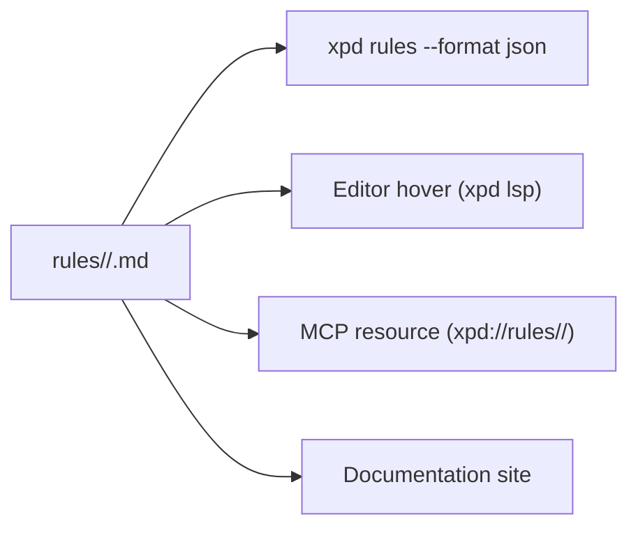

# Rules

Open any rule by its bracketed ID (such as `pandas/chained-assignment`) to read what goes wrong, what to write instead, and whether `xpd` can fix it automatically. Every library pack runs only on files that import that library, while the Python and xpd packs run on every file.

| Fix level | Meaning | Command |
| --- | --- | --- |
| `safe` | Preserves runtime behavior | `xpd check --fix` |
| `unsafe` | May change runtime behavior, review the diff | `xpd check --fix --unsafe-fixes` |
| `none` | Requires a manual edit | Edit by hand |

House style rules report as `info` by default and become `warning` when `style = "strict"` is set in `[tool.xpd]` of `pyproject.toml` or `~/.config/xpd/config.toml`. See [`xpd check`](https://bjoernaagaard.github.io/xpd/commands/check/#house-style).
