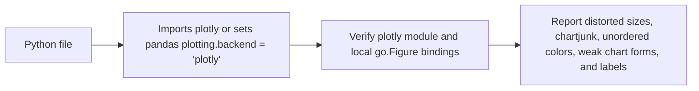

# plotly

The plotly pack applies Edward Tufte's "The Visual Display of Quantitative Information" (second edition) to files that import `plotly` or set pandas's plotting backend to `"plotly"`. Pair the pack with [`xpd chart-review`](../../guides/chart-review/) to check principles that require inspecting rendered data and layout.

## Sizes that do not follow the numbers

- marker-size-diameter
- bar-axis-without-zero
- area-axis-without-zero
- polar-bar-area
- three-d-for-two-d
- dual-y-axis
- free-facet-scales

## Ink that shows no data

- default-template
- explicit-grid
- boxed-axis-frame
- box-plot-ink
- redundant-color
- pattern-fill
- gauge-indicator

## Color without an order

- rainbow-colorscale

## Chart forms the book argues against

- pie-chart
- sunburst-as-pie
- spline-line
- animation-frame
- heatmap-smoothing
- table-for-small-data

## Words on the figure

- all-caps-title
- legend-instead-of-labels
- rotated-tick-labels
- axis-title-column-name
