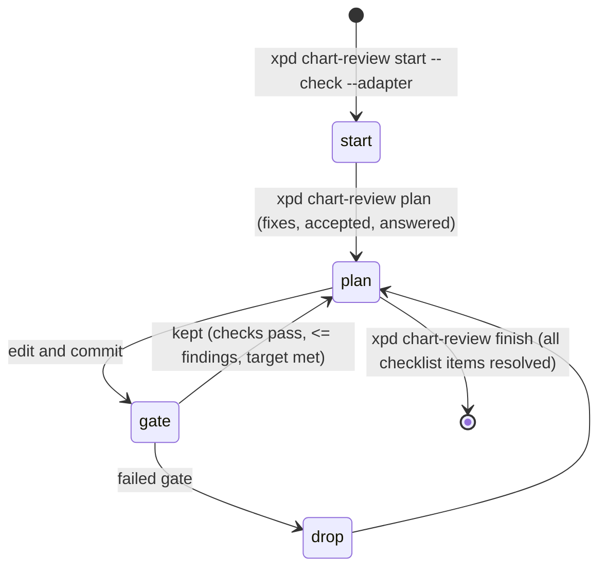

Use `xpd chart-review` when you make, change, or review a chart or presentation table in Python (Plotly, Dash, Dash AG Grid, Matplotlib, Seaborn, pandas) or React/TypeScript (`react-plotly.js`, `plotly.js`, `ag-grid-react`, `ag-grid-community`). It produces a mechanical finding ledger grouped across five pillars from Edward Tufte's "The Visual Display of Quantitative Information" (second edition) plus a per-figure checklist across all 57 principles. The [chart review guide](../../guides/chart-review/) shows how to run static audits, runtime adapters, and recorded review loops.

| Group | What it measures | Example kinds |
| --- | --- | --- |
| Graphical integrity | Distortions of scale, baseline, dimensions, money, or context (VDQI Ch. 2 to 3) | `non-zero-baseline`, `dual-axis`, `undeflated-money`, `missing-context`, `extra-dimensions`, `distorted-size` |
| Data-ink and chartjunk | Non-data frames, grids, patterns, and software chrome (VDQI Ch. 4 to 6) | `default-template`, `boxed-frame`, `heavy-grid`, `redundant-color`, `pattern-fill`, `decorative-gauge` |
| Encoding and form | Weak chart types, unordered palettes, smoothing, and ordering (VDQI Ch. 1, 7, 8) | `pie-chart`, `small-data-chart`, `rainbow-colorscale`, `red-green-only`, `stacked-area`, `unsorted-categories` |
| Words and layout | Legends, labels, typography, aspect ratio, and slope banking (VDQI Ch. 1, 7, 9) | `legend-instead-of-labels`, `column-name-axis-title`, `all-caps-text`, `rotated-ticks`, `vertical-aspect-ratio`, `poor-banking` |
| Tabular presentation | Borders, striping, alignment, formatting, grouping, and headers (VDQI pp. 33, 178 to 183) | `table-vertical-rules`, `table-zebra-striping`, `table-unformatted-numbers`, `table-raw-header`, `table-centered-numbers`, `table-unaligned-decimals` |

## Examples

```python title="report.py"
import matplotlib.pyplot as plt
import seaborn as sns


def revenue(frame):
    fig, ax = plt.subplots()
    sns.barplot(frame, x="region", y="revenue", ax=ax)
    return fig
```

```console
$ xpd chart-review report.py --format json | jq -c '{libraries: .read.libraries, figures: [.read.figures[] | {call, kind, library, line}], checklist: (.checklist | length)}'
{"libraries":["matplotlib","seaborn"],"figures":[{"call":"sns.barplot","kind":"bar","library":"seaborn","line":7}],"checklist":33}
```

`--adapter <adapter.py or command>` adds runtime measurements of rendered figures and tables. A Python adapter defines `figures()`, which returns a dict of name to figure (`go.Figure`, Matplotlib `Figure`, Dash `AgGrid`, or normalized spec dict), and runs in the project's Python. A shell command adapter prints `{"figures": [...]}` JSON on stdout for React/TypeScript Plotly or AG Grid specs.

```python title="report_figures.py"
import pandas as pd

from report import revenue


def figures():
    frame = pd.DataFrame({"region": ["North", "South", "West"], "revenue": [9.0, 6.0, 4.0]})
    return {"revenue": revenue(frame)}
```

```console
$ xpd chart-review report.py --adapter report_figures.py --format json | jq -c '[.findings[] | select(.places[0].path == "report_figures.py") | {kind, evidence}]'
[{"kind":"undeflated-money","evidence":"[revenue] Figure shows money (`revenue`) without nominal, real, or constant basis (VDQI p. 68)."},{"kind":"small-data-chart","evidence":"[revenue] Figure draws only 3 values (20 or fewer), which a table or sentence shows better (VDQI p. 33)."}]
```

With `--questions`, it prints all 10 runtime facts and all 57 Tufte principles.

```console
$ xpd chart-review --questions --format json | jq '{facts: (.facts | length), questions: (.questions | length)}'
{
  "facts": 10,
  "questions": 57
}
```

## A recorded run

Record review rounds in `.git/xpd-chart-review.json` (or `.git/xpd-ledger.sqlite` in durable mode) so `xpd` gates every commit on checks, mechanical finding counts, and per-figure checklist completion.



Judgment-based improvements with no mechanical finding ID may set `"goal": "design"` with `"questions": ["<figure-id>/<question-id>"]` in the plan. Use [`start`](./start/), [`plan`](./plan/), [`approve`](./approve/), [`gate`](./gate/), [`drop`](./drop/), [`status`](./status/), and [`finish`](./finish/) to drive each stage.

## Exit status

| Exit code | Meaning |
| --- | --- |
| `0` | Ledger printed or run stage succeeded |
| `1` | Gate rejected a change or `finish` blocked on open fixes, new findings, or unanswered checklist items |
| `2` | Command could not run (for example, missing file or invalid `--since` commit) |
