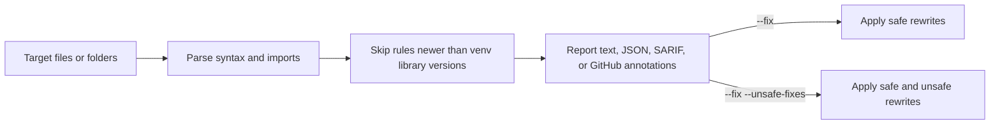

Run `xpd check` after editing Python files to report slow or wrong library calls and optionally rewrite them. `xpd` skips `.gitignore` paths and activates each library pack only on files that import that library.



## Examples

```console
$ xpd check samples/bad.py --unsafe-fixes --format text
samples/bad.py:5:15: warning [pandas/row-loop] iterrows() builds a Series for every row. Compute on whole columns instead, such as df["a"] * df["w"]. When each row has to become a Python object, loop over itertuples() or to_dict("records").
samples/bad.py:6:5: error [pandas/chained-assignment] [*] Chained assignment writes to a copy under copy-on-write, so the frame keeps its old values. Assign to df.loc[i, "a"] instead.
...
xpd: 5 issues, 2 fixable with --fix --unsafe-fixes
```

```console
$ xpd check samples/bad.py --format json | jq -c '{fixed, fixable, issue: .issues[1]}'
{"fixed":0,"fixable":0,"issue":{"column":5,"file":"samples/bad.py","fix":"unsafe","line":6,"message":"Chained assignment writes to a copy under copy-on-write, so the frame keeps its old values. Assign to df.loc[i, \"a\"] instead.","package":"pandas","rule":"chained-assignment","severity":"error"}}
```

`[*]` marks issues fixable under the current flags. Use `--format sarif` for code scanning tools and `--format github` for pull request annotations.

## Fix modes

| Flags | Behavior |
| --- | --- |
| None | Report issues (`[*]` marks safe fixes) |
| `--fix` | Apply safe fixes, then report remaining issues |
| `--unsafe-fixes` | Report issues (`[*]` marks safe and unsafe fixes) |
| `--fix --unsafe-fixes` | Apply safe and unsafe fixes, then report remaining issues |
| `--fix --review` | Prompt interactively before writing each fix |

## Project rules

`xpd` loads local rules from the nearest `sgconfig.yml` or `sgconfig.yaml` (or `--config`). Scaffold a rule project with [`xpd rules new project`](../rules/new/project/).

| File or key | Contents |
| --- | --- |
| `ruleDirs` in `sgconfig.yml` | Plain ast-grep rules for any language |
| `utilDirs` in `sgconfig.yml` | Shared utility rules referenced via `matches:` |
| `xpd.yml` beside `sgconfig.yml` | Library-scoped packs with `since`, `until`, `aliases`, and `members` |

## House style

House style rules report as `info` by default. Set `style = "strict"` to promote them to `warning` across `xpd check`, [`xpd hook`](../hook/), `xpd lsp`, and `xpd mcp`.

| Priority | File | Key |
| --- | --- | --- |
| 1 | Nearest `pyproject.toml` with `[tool.xpd]` | `style = "strict"` or `"default"` |
| 2 | `$XDG_CONFIG_HOME/xpd/config.toml` (`%APPDATA%\xpd\config.toml` on Windows) | Top-level `style = "strict"` or `"default"` |

```python title="script.py"
import pandas as pd

df = pd.read_csv("orders.csv")
df = df[df["price"] > 0]
df = df[df["qty"] >= 2]
df = df[df["city"] != "Oslo"]
```

```console
$ xpd check script.py --format text
script.py:4:1: info [pandas/filter-ladder] df is filtered three or more times in a row, each time into itself, so every line leaves a half-filtered frame under the final name. Write one chain, as in df = df.loc[lambda d: ...].loc[lambda d: ...].loc[lambda d: ...].
xpd: 1 issue
$ printf '[tool.xpd]\nstyle = "strict"\n' > pyproject.toml
$ xpd check script.py --format text
script.py:4:1: warning [pandas/filter-ladder] df is filtered three or more times in a row, each time into itself, so every line leaves a half-filtered frame under the final name. Write one chain, as in df = df.loc[lambda d: ...].loc[lambda d: ...].loc[lambda d: ...].
xpd: 1 issue
```

## Suppress an issue

Add `# ast-grep-ignore: <pack>/<rule>` on the line above (or inline after code) to silence one rule. Unused suppressions report as [`xpd/unused-suppression`](../../rules/xpd/unused-suppression/) unless `--rule` or `--severity` filtered the run.

## Exit status

| Exit code | Meaning |
| --- | --- |
| `0` | No issue at or above `--fail-on` severity remains after fixes |
| `1` | At least one issue at or above `--fail-on` severity remains (default: `error`) |
| `2` | Invalid configuration or unreadable file (other readable files are still checked) |
