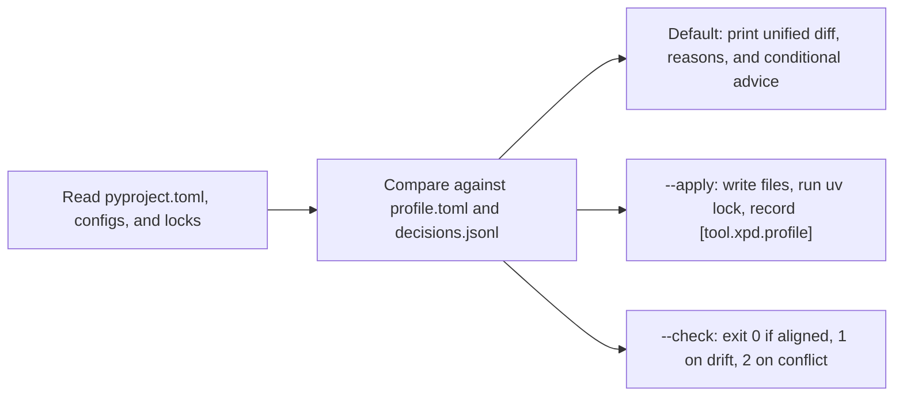

Run `xpd doctor` at a Python project root to diff `pyproject.toml`, tool configs, and lock files against xpd's strict Ruff, ty, pytest, packaging, and CI profile. Add `--apply` to write the changes and lock files, or `--check` to exit `1` on drift in CI and the agent `Stop` hook.



## What the profile manages

Every setting in the profile has a pinned release, rationale, and upstream source in [src/doctor/profile.toml](https://github.com/bjoernaagaard/xpd/blob/main/src/doctor/profile.toml) and [src/doctor/decisions.jsonl](https://github.com/bjoernaagaard/xpd/blob/main/src/doctor/decisions.jsonl).

| Area | What the profile enforces |
| --- | --- |
| Ruff | `select = ["ALL"]`, `preview = true`, `required-version = "==0.17.4"`, curated ignore list, banned mock and skip APIs |
| ty | `error` on blanket ignores, unused ignores, disjoint casts, and missing direct dependencies |
| pytest | `strict = true`, `timeout = "60"`, `-ra --import-mode=importlib -p no:doctest`, `filterwarnings = ["error"]`, no reruns |
| Packaging and locks | `requires-python`, pinned dev tools in `[dependency-groups]`, `exclude-newer`, and up-to-date `uv.lock` |
| Non-Python and CI | Owned templates for `.editorconfig`, `.gitattributes`, `.gitignore`, `lefthook.yml`, `rumdl`, `tombi`, `yamllint`, and GitHub workflows |

Pass `--tools ruff,ty,pytest` to manage only tool settings without packaging or CI templates, or pass `--kind` to select a project layout (`library`, `application`, `pipeline`, or `script`).

## Privacy and redaction

Doctor prints only the tables and files it owns, replacing unrelated lines in `pyproject.toml` (such as `[tool.uv.index]` or `[tool.uv.sources]`) with `<hidden>` in diffs. Credentials, queries, and fragments in URLs are replaced with `****` across text, JSON, and hook output.

## Example

```toml title="pyproject.toml"
[project]
name = "example"
version = "0.1.0"
description = "An example project."
readme = "README.md"
requires-python = ">=3.12"

[project.urls]
Repository = "https://example.com/example"

[dependency-groups]
dev = [
    "pytest>=9.2.0",
    "pytest-rerunfailures",
    "pytest-timeout",
]

[tool.pytest.ini_options]
addopts = "--reruns 2 --strict-markers"
```

```console
$ xpd doctor --format text
Profile revision 7, kind application, suggested because [project] has no [build-system], so uv runs it without building it
  A program that runs from its checkout or as an installed command, locked in uv.lock.
pyproject.toml records no profile yet.
...
--- pyproject.toml
+++ pyproject.toml
...
+[tool.ruff.lint]
+select = ["ALL"]
...
+[tool.xpd.profile]
+revision = 7
+kind = "application"
...
Changes
  ruff lint.select: unset -> ["ALL"], tool.ruff.lint.select
...
Locks
  uv.lock is missing. --apply runs uv lock.
...
xpd doctor --apply --kind application writes these changes.
...
```

## Record an exception or read JSON

Add an entry under `[tool.xpd.profile.exceptions]` in `pyproject.toml` with a `reason` when a project intentionally differs from a profile setting. Doctor keeps valid exceptions and reports stale ones.

```toml
[[tool.xpd.profile.exceptions]]
tool = "ruff"
id = "T201"
reason = "CLI commands print directly to stdout."
```

Run `xpd doctor --format json` for machine-readable output containing `profile` (`revision`, `applied`, `kind`, `tools`, `changes`, `conflicts`, `exceptions`, `unverified`, `locks`, `diff`), `tools`, `suggestions`, `policies`, and `notes`.

## Exit status

| Exit code | Meaning |
| --- | --- |
| `0` | Report printed, `--check` matched the profile, or `--apply` succeeded |
| `1` | `--check` found drift, an out-of-date lock, a conflict, or an invalid exception |
| `2` | Unreadable project, unsupported layout (such as a uv workspace or duplicate pytest tables), missing Ruff 0.17.4 check, or blocked `--apply` |
