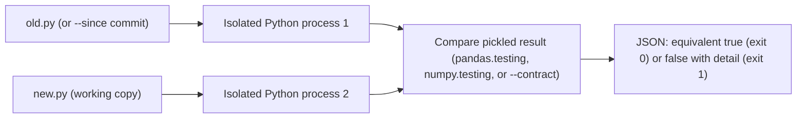

Run `xpd equiv old.py new.py` (or `xpd equiv script.py --since HEAD` for an in-place edit) to prove two Python scripts leave an equal `result` variable. Each script executes in an isolated Python process using the project's environment, and DataFrames and Series are compared with `pandas.testing` (other values with `numpy.testing`).



## Examples

```console
$ xpd equiv samples/equiv/old.py samples/equiv/new.py
{"equivalent": true}
$ xpd equiv samples/equiv/old.py samples/equiv/wrong.py
{"equivalent": false, "detail": "DataFrame.iloc[:, 2] (column name=\"w\") are different\n\nDataFrame.iloc[:, 2] (column name=\"w\") values are different (100.0 %)\n[index]: [0, 1, 2]\n[left]:  [2, 4, 6]\n[right]: [3, 6, 9]"}
```

Compare an edited file directly against a git commit with `--since`:

```console
$ git init -q work && cp samples/equiv/old.py work/report.py && git -C work add report.py
$ git -C work -c user.name=xpd -c user.email=xpd@example.com -c commit.gpgsign=false commit -qm "Add the report"
$ cp samples/equiv/new.py work/report.py
$ xpd equiv work/report.py --since HEAD
{"equivalent": true}
```

## Compare pandas and Polars with `--contract`

Pass `--contract migration.json` when the old script returns a pandas DataFrame (unnamed default `RangeIndex`) and the new script returns a materialized native Polars DataFrame. Supported logical dtypes are `Boolean`, `Float64`, `Int64`, and `String`.

```json
{
  "input_schema": [{"name": "grams", "dtype": "Float64"}],
  "output_schema": [
    {"name": "grams", "dtype": "Float64"},
    {"name": "kg", "dtype": "Float64"}
  ],
  "row_identity": "position",
  "materialization": "lazy",
  "float_atol": {"kg": 1e-12},
  "missing_float_columns": ["grams", "kg"]
}
```

Column order, types, row order, and signed infinities stay strict. Optional `float_atol` sets finite absolute tolerances per column, and `missing_float_columns` equates null and NaN in named float columns.

## Exit status

| Exit code | Meaning |
| --- | --- |
| `0` | `{"equivalent": true}` |
| `1` | Results differ (mismatch shown in `detail`) |
| `2` | Script failed, missing `result`, invalid contract, missing library, or unknown `--since` commit |
| `3` | Unsupported result type or pandas index under `--contract` |
