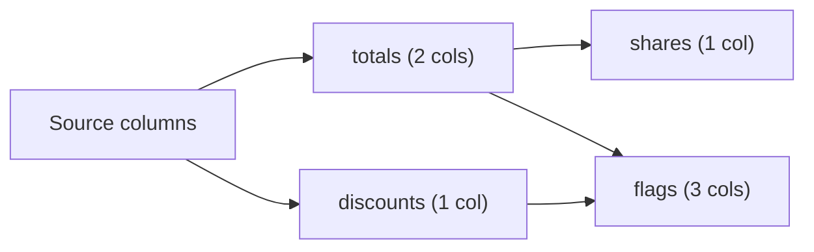

Run `xpd graph` after adding, moving, or renaming a pandas pipeline step or an [Apache Hamilton](https://hamilton.apache.org/) node to inspect dataflow and catch ordering or wiring errors without running Python.



## Examples

```console
$ xpd graph samples/graph/steps.py --format text
samples/graph/steps.py:50: features: 4 steps, 7 columns
samples/graph/steps.py:18:   (source columns) -> totals  [2 columns]
samples/graph/steps.py:28:   totals -> shares  [1 column]
samples/graph/steps.py:33:   (source columns) -> discounts  [1 column]
samples/graph/steps.py:40:   totals + discounts -> flags  [3 columns]
samples/graph/steps.py:50:   reads from its source: columns=["customer","discount","quantity","unit_price"]
...
xpd: 1 pipeline with 4 steps in 1 file, 4 warnings
```

```console
$ xpd graph samples/graph/steps_wrong_order.py --format text
...
samples/graph/steps_wrong_order.py:11: error: margin() reads the column total_cost, which costs() adds later in report(). The read raises KeyError. Move margin() after costs().
...
xpd: 1 pipeline with 3 steps in 1 file, 2 errors
```

```console
$ xpd graph samples/graph/features.py --format text
samples/graph/features.py:10: (no input) -> uk
samples/graph/features.py:14: (no input) -> dk
samples/graph/features.py:18: uk + dk -> spread
samples/graph/features.py:22: spraed -> spread_sq
inputs: spraed
read by no node: spread, spread_sq
...
xpd: 4 nodes from 4 functions in 1 file, 1 input, 1 warning
```

```console
$ xpd graph samples/graph/steps.py --format json | jq -c 'keys, (.pipelines[0] | keys), (.pipelines[0].steps[0] | keys)'
["inputs","nodes","pipelines","problems","unread"]
["file","free","line","links","name","source","source_complete","steps"]
["columns","computed","kind","line","name","reads"]
```

## Findings

| Finding | Severity | Runtime failure avoided |
| --- | --- | --- |
| Step reads a column added by a later step | `error` | `KeyError` |
| Step joins a column already added earlier | `error` | Overlapping column error |
| Duplicate Hamilton function or node name | `error` | Silent overwrite or Driver error |
| Missing type hint on a Hamilton node | `error` | Driver missing type hint error |
| Duplicated column formula across steps | `warning` | Drift between copied formulas |
| Step mutates input frame (`frame["x"] = ...`) | `warning` | Caller frame mutated in place |
| Module docstring tree mismatches pipeline | `warning` | Stale documentation |
| Hamilton input one edit from a node name | `warning` | Missing required input at execute |

## Exit status

| Exit code | Meaning |
| --- | --- |
| `0` | No error |
| `1` | At least one error |
| `2` | Invalid arguments or unreadable file |
