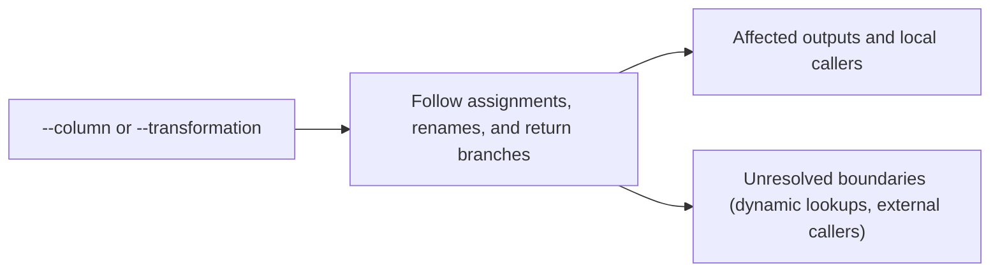

Run `xpd graph impact` to trace which pipeline outputs and local callers depend on a column (`--column`) or step (`--transformation`) inside a named `--entry` function without executing Python.



## Examples

```console
$ xpd graph impact samples/graph/impact.py --entry features --column net_amount --format text
samples/graph/impact.py:19: impact of column "net_amount" in features()
...
Output "share": totals [net_amount] (samples/graph/impact.py:7) -> shares [customer_share] (samples/graph/impact.py:12) -> publish_names [share] (samples/graph/impact.py:16)
samples/graph/impact.py:24: dashboard calls features(orders)
samples/graph/impact.py:27: uses share
...
samples/graph/impact.py:26: unresolved [dynamic-lookup] Resolve how result[[column]] uses the pipeline result.
```

```console
$ xpd graph impact samples/graph/impact.py --entry inline_features --column net_amount --format text
samples/graph/impact.py:34: impact of column "net_amount" in inline_features()
samples/graph/impact.py:36: producer .assign(net_amount) [net_amount]
Output "renamed": .assign(net_amount) [net_amount] (samples/graph/impact.py:36) -> .rename [renamed] (samples/graph/impact.py:37)
Output "share": .assign(net_amount) [net_amount] (samples/graph/impact.py:36) -> .rename [renamed] (samples/graph/impact.py:37) -> .assign(share) [share] (samples/graph/impact.py:38)
...
```

Renames across multiple return branches trace back to the original input column.

```python title="branch_rename.py"
def publish(orders, alternate=False):
    if alternate:
        return orders.rename(columns={"net_amount": "share"})
    return orders.rename(columns={"net_amount": "share"})


def dashboard(orders):
    return publish(orders)[["share"]]
```

```console
$ xpd graph impact branch_rename.py --entry publish --transformation publish --format text
branch_rename.py:1: impact of transformation "publish" in publish()
branch_rename.py:3: producer publish [share]
Output "share": publish [share] (branch_rename.py:3)
branch_rename.py:8: dashboard calls publish(orders)
branch_rename.py:8: uses share
...
```

## Exit status

| Exit code | Meaning |
| --- | --- |
| `0` | Impact report generated (may list unresolved boundaries) |
| `2` | Invalid arguments or source could not be analyzed |
