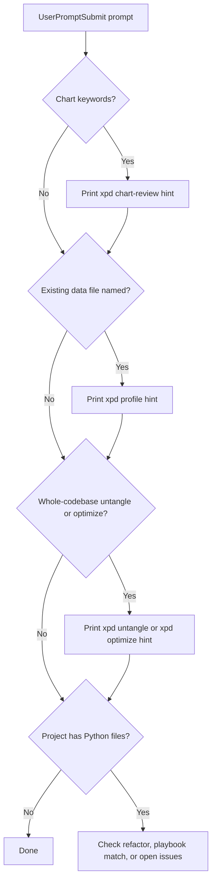

Use `xpd hook` as the hook command for Claude Code, Codex, or any Agent Plugins 1.1.0 client. `xpd` reads the hook event JSON from stdin and responds according to `hook_event_name`. See the [Claude Code guide](../../guides/claude-code/) for plugin installation.

| Event | Action |
| --- | --- |
| `SessionStart` | Saves HEAD, uncommitted blob IDs, and profile baseline, then prints a short project brief |
| `UserPromptSubmit` | Routes matching prompts to `chart-review`, `data-prep`, `ts-review`, `feature-review`, `model-review`, `opt-review`, `profile`, `untangle`, `harden`, `optimize`, `equiv`, a playbook, or open issues |
| `PostToolUse` | Lints edited files (plus single-file `xpd graph` checks) and reports issues immediately |
| `Stop` | Lints every Python file changed in the session and blocks the turn while errors, warnings, or new profile drift remain |

## When a session starts

`SessionStart` records git ownership state and prints the active rule packs, style setting, `xpd graph` pipelines, and key commands.

```console
$ mkdir -p brief && cp samples/graph/steps.py brief/
$ echo '{"session_id":"s0","cwd":"/tmp/project/brief","hook_event_name":"SessionStart"}' | xpd hook
xpd read 1 Python file of this project.
Rule packs that apply: pandas (1 file), python (1 file).
...
```

## On each prompt

`UserPromptSubmit` inspects the prompt text and emits short hints only when a rule or workflow matches.



| Sample prompt | Output |
| --- | --- |
| `"prepare this csv for a model"` | `xpd data-prep` hint |
| `"improve my charts"` | `xpd chart-review` hint |
| `"what is in sales.csv?"` | `xpd profile sales.csv` hint |
| `"untangle this codebase"` | `xpd untangle` and `xpd-untangle` hint |
| `"build a pandas pipeline for feature engineering"` | Matching [playbook](../find/#playbooks) (`xpd/recipe/pandas-pipeline`) |
| `"what should I improve?"` | Open issue counts by pack and severity |
| `"rename this variable"` | Nothing |

## After edits and on stop

`PostToolUse` lints edited `.py` files (and files matched by project rules in `sgconfig.yml`). `Stop` checks every Python file changed since `SessionStart` (ignoring files untouched since session start and changes introduced only by pull, merge, rebase, or checkout) plus `uv lock --check --offline` when `[tool.xpd.profile]` is configured.

`Stop` returns `{"decision": "block", "reason": ...}` when errors, warnings, or new profile drift remain. Set [`style = "strict"`](../check/#house-style) so house style rules count as warnings. If the client retries with `stop_hook_active: true` and the exact same issue list, `xpd` lets the turn end and prints the remaining list as `systemMessage`.

## Examples

```console
$ echo '{"hook_event_name":"PostToolUse","tool_name":"Edit","tool_input":{"file_path":"samples/bad.py"}}' | xpd hook 2>&1 | head -2
samples/bad.py:5:15: warning [pandas/row-loop] iterrows() builds a Series for every row. Compute on whole columns instead, such as df["a"] * df["w"]. When each row has to become a Python object, loop over itertuples() or to_dict("records").
samples/bad.py:6:5: error [pandas/chained-assignment] Chained assignment writes to a copy under copy-on-write, so the frame keeps its old values. Assign to df.loc[i, "a"] instead.
```

```console
$ echo '{"cwd":"/tmp/project","hook_event_name":"UserPromptSubmit","prompt":"improve my charts"}' | xpd hook
Chart or table task: run `xpd chart-review <paths>` on the files that draw charts or presentation tables in Python or React/TypeScript (Plotly, Dash, AG Grid, Matplotlib, Seaborn, pandas). It lists mechanical Tufte findings and a per-figure checklist across all 57 principles from Tufte's book. Add `--adapter <adapter.py or command>` to measure rendered figures, and `xpd chart-review start` to record a gated review run. The `xpd-chart-review` skill holds the steps, and `xpd api xpd/recipe/plotly-chart` prints the plotly-chart playbook.
```

```console
$ echo '{"cwd":"/tmp/project","hook_event_name":"UserPromptSubmit","prompt":"build a pandas pipeline for feature engineering"}' | xpd hook
Model feature task: run `xpd feature-review <paths>` to list cutoff findings and domain questions. Use `xpd feature-review start` to record the review, follow the `xpd-feature-review` skill, and read `xpd api xpd/recipe/feature-module`.
xpd has a playbook for this prompt: xpd/recipe/pandas-pipeline, "A pandas pipeline of step functions".
...
```

```console
$ echo '{"session_id":"s1","cwd":"/tmp/project","hook_event_name":"PostToolUse","tool_name":"Edit","tool_input":{"file_path":"samples/bad.py"}}' | xpd hook 2> /dev/null
$ echo '{"session_id":"s1","cwd":"/tmp/project","hook_event_name":"Stop","stop_hook_active":false}' | xpd hook
{"decision":"block","reason":"xpd holds this turn, because the Python files that this session changed have errors or warnings. Fix each line below. When the code is right as it is, write `# ast-grep-ignore: <pack>/<rule>` on the line above it, with the reason after the rule.\nsamples/bad.py:5:15: warning [pandas/row-loop] iterrows() builds a Series for every row. Compute on whole columns instead, such as df[\"a\"] * df[\"w\"]. When each row has to become a Python object, loop over itertuples() or to_dict(\"records\").\nsamples/bad.py:6:5: error [pandas/chained-assignment] Chained assignment writes to a copy under copy-on-write, so the frame keeps its old values. Assign to df.loc[i, \"a\"] instead.\nsamples/bad.py:8:5: warning [pandas/merge-without-validate] merge without validate= can silently duplicate rows.\nsamples/bad.py:11:5: warning [pandas/concat-in-loop] out grows by one concat per pass, and each concat copies every earlier row. Collect the frames in a list and concat once after the loop.\nThe lines below are advice, and they do not hold the turn.\nsamples/bad.py:7:1: info [pandas/no-inplace] inplace=True gives no speedup and blocks chaining. Reassign instead."}
```

## Exit status

| Exit code | Meaning |
| --- | --- |
| `0` | Clean edit, Agent Plugins JSON response, or any `SessionStart`, `UserPromptSubmit`, or `Stop` event |
| `1` | Hook failed to run or stdin was not valid hook JSON |
| `2` | Claude Code `PostToolUse` found issues (printed on stderr) |
