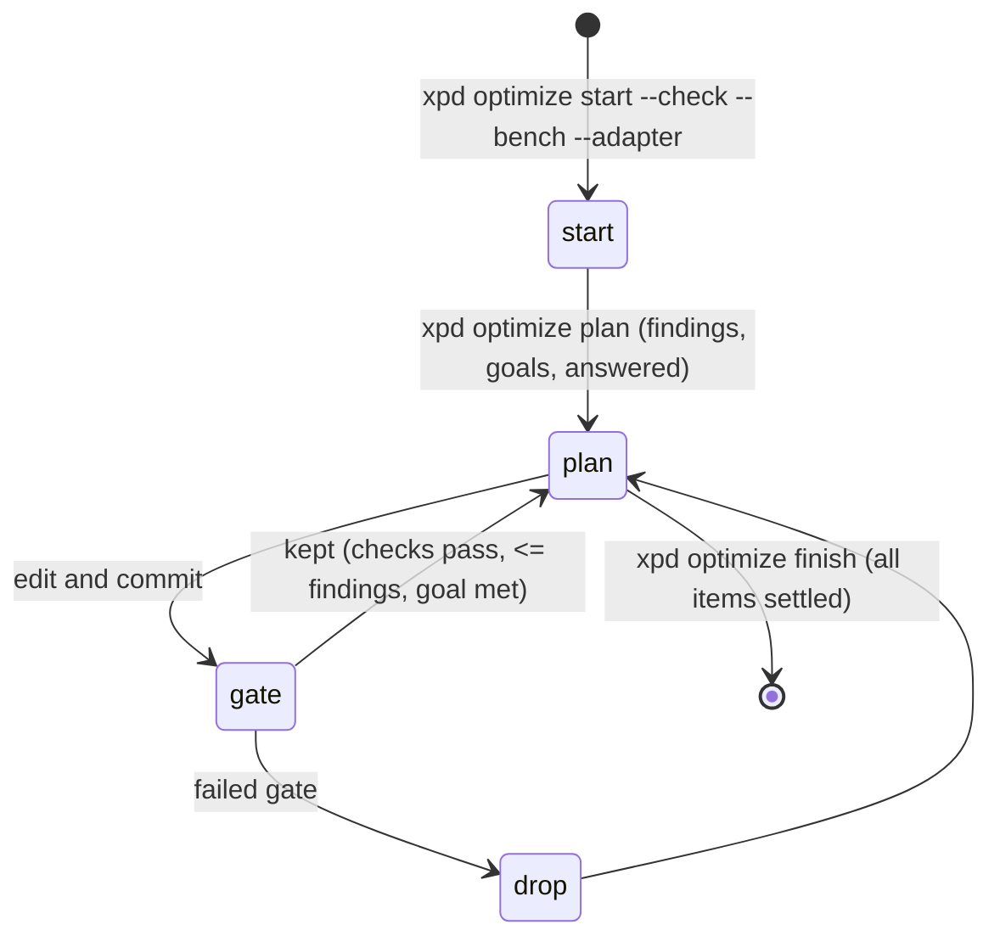

Run `xpd optimize` to find CPU, memory, and I/O work that the result does not need, and gate every change on real workload measurements.

| Group | Finding kinds |
| --- | --- |
| Performance rules | `rule-issue` |
| Repeated work | `repeated-call`, `repeated-mask`, `loop-invariant-call` |
| Oversized intermediates and scans | `matrix-reduced`, `materialized-for-one`, `linear-scan-in-loop` |

A function with a finding or at least 5 percent of a workload's CPU time gets six checklist items. Run `xpd optimize --questions` to read the questions and the facts that inform them. The supported fix goals are `faster`, `both`, and `design`.

Pass a representative workload with `xpd optimize start --bench` to time the whole command. Use `--adapter perf.py` on a list or start to measure individual workloads. The adapter defines `workloads()`, which returns a mapping from names to zero-argument callables. A shell adapter emits a JSON object with a `workloads` array where each workload holds `name`, `median_ms`, `peak_bytes`, and `functions` (`file`, `name`, `line`, `cpu_ms`, `cumulative_cpu_ms`, `cpu_share`, and `calls`, using project-relative paths and fractional shares).

## Recorded run



1. **Start**: record the current commit, paths, project checks, and workload from a clean tracked tree with `xpd optimize start . --check "your-project-check"`.
2. **List**: read stable finding IDs, hotspots, and checklist item IDs with `xpd optimize . --format json`.
3. **Plan**: record ordered fixes, accepted findings, and checklist verdicts (`pass`, `na`, or `accepted`) with reasons using `xpd optimize plan plan.json`.
4. **Approve**: record approval for an interface change with `xpd optimize approve fix-id`.
5. **Gate**: commit one fix and run `xpd optimize gate fix-id`. A `design` fix must edit a file that owns a cited checklist item.
6. **Drop**: return to the run's current commit and record a reason with `xpd optimize drop fix-id --reason "reason"`.
7. **Status**: show the current run, its recorded answers, and the next stage with `xpd optimize status`.
8. **Finish**: compare against the starting commit with `xpd optimize finish`. An open fix, a new finding without an accepted reason, or an unanswered checklist item causes exit 1.

## Example

```console
$ xpd optimize --questions --format json | jq -c '{facts: (.facts | length), questions: (.questions | length)}'
{"facts":4,"questions":6}
```

## Exit status

A successful list or recorded stage exits 0. A rejected gate or a finish blocked by findings or checklist items exits 1. Invalid input exits 2.
