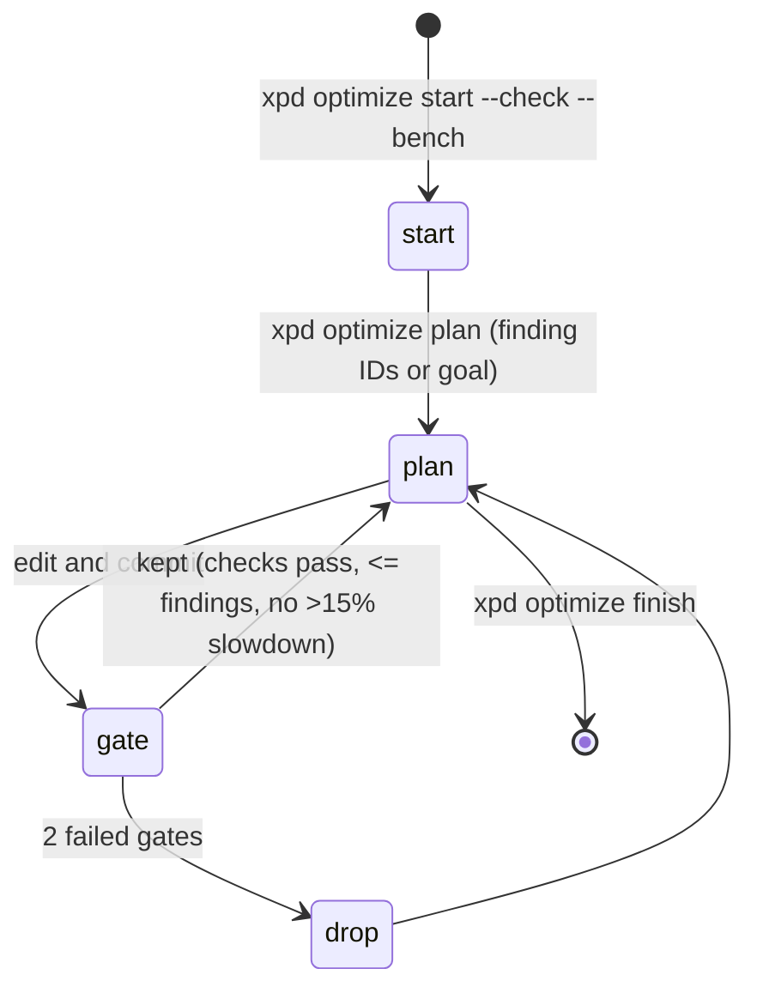

Run `xpd optimize` to find duplicate logic, redundant work, default arguments, and avoidable allocations across a codebase without executing it. `xpd` combines [`xpd check`](../check/) (including project rules) with whole-function and cross-file analysis. `near-copy` works on every language ast-grep parses, and the remaining kinds analyze Python.

| Group | Redundant work | Kinds |
| --- | --- | --- |
| Rulekit | Built-in or project lint rule fires | `rule-issue` |
| Written twice | Structurally identical stretches differing in a few names | `near-copy` |
| Done again | Repeated call, mask, or loop-invariant call | `repeated-call`, `repeated-mask`, `loop-invariant-call` |
| Already guaranteed | Keyword argument repeats the library default | `default-argument` |
| Larger than the answer | Pairwise matrix reduced, full sort for one item, or linear scan in a loop | `matrix-reduced`, `materialized-for-one`, `linear-scan-in-loop` |

## Examples

```python title="shop/prices.py"
import numpy as np
import pandas as pd


def retail_total(orders):
    """The total of the retail orders, with tax."""
    kept = orders[orders["kind"] == "retail"]
    amounts = kept["price"].to_numpy() * kept["count"].to_numpy()
    taxed = amounts * 1.25
    return float(np.round(taxed.sum(), 2))


def wholesale_total(orders):
    """The total of the wholesale orders, with tax."""
    kept = orders[orders["kind"] == "wholesale"]
    amounts = kept["price"].to_numpy() * kept["count"].to_numpy()
    taxed = amounts * 1.25
    return float(np.round(taxed.sum(), 2))


def report(orders, rates):
    rows = []
    for rate in rates:
        means = orders.groupby("kind")["price"].mean()
        rows.append(means * rate)
    spread = orders["price"].to_numpy().max() - orders["price"].to_numpy().min()
    return rows, spread, pd.concat([orders, orders], axis=0)


def nearest(prices, levels):
    gaps = np.abs(prices[:, None] - levels)
    return gaps.min(axis=1)
```

```console
$ xpd optimize shop --format text
xpd optimize: 5 findings in 1 file (32 lines), 1 of them Python
...
  near-copy: 1
    d0d923d9  shop/prices.py:5-10, shop/prices.py:13-18  These 2 stretches of 6 lines are the same code but for `retail` and `wholesale`, `retail_total` and `wholesale_total`.
...
$ xpd optimize shop --kind near-copy,matrix-reduced --format json | jq -c '.findings[] | {kind, places: [.places[] | "\(.path):\(.line)"]}'
{"kind":"near-copy","places":["shop/prices.py:5","shop/prices.py:13"]}
{"kind":"matrix-reduced","places":["shop/prices.py:31","shop/prices.py:32"]}
```

## What each kind measures

| Kind | Signal |
| --- | --- |
| `rule-issue` | Any issue from `xpd check` or project rule packs |
| `near-copy` | Two blocks of at least 5 lines and 60 tokens differing in at most 4 name or value pairs (25% of tokens max) |
| `repeated-call` | Identical pure call evaluated more than once in one function with no intervening write |
| `repeated-mask` | Identical boolean mask or masked slice evaluated more than once in one function |
| `loop-invariant-call` | Call inside a `for` loop or comprehension whose inputs never change in the loop |
| `default-argument` | Literal keyword argument matching the indexed default from [`xpd api`](../api/) |
| `matrix-reduced` | Outer broadcast (`None` or `np.newaxis`) immediately reduced or contracted |
| `materialized-for-one` | Full `diff`, `sort`, `argsort`, `cumsum`, or `sort_values` built only to read one element or a small `.head(k)` |
| `linear-scan-in-loop` | List membership test or full DataFrame filter repeated inside a loop |

Pass `--since <commit>` to diff findings and line counts against an earlier commit.

## A recorded run

Record simplification rounds in `.git/xpd-optimize.json` with optional `xpd optimize start --bench` timing so `xpd` gates every commit on checks, finding counts, line count, and speed.



Fixes without static finding IDs may set `"goal"` to `"shorter"`, `"faster"`, or `"both"` in the plan. Use [`start`](./start/), [`plan`](./plan/), [`approve`](./approve/), [`gate`](./gate/), [`drop`](./drop/), [`status`](./status/), and [`finish`](./finish/) to drive each stage.

## Exit status

| Exit code | Meaning |
| --- | --- |
| `0` | Ledger printed or run stage succeeded |
| `1` | Gate rejected a change or `finish` blocked on open fixes or unexplained new findings |
| `2` | Command failed to run (for example, invalid `--since` commit) |
