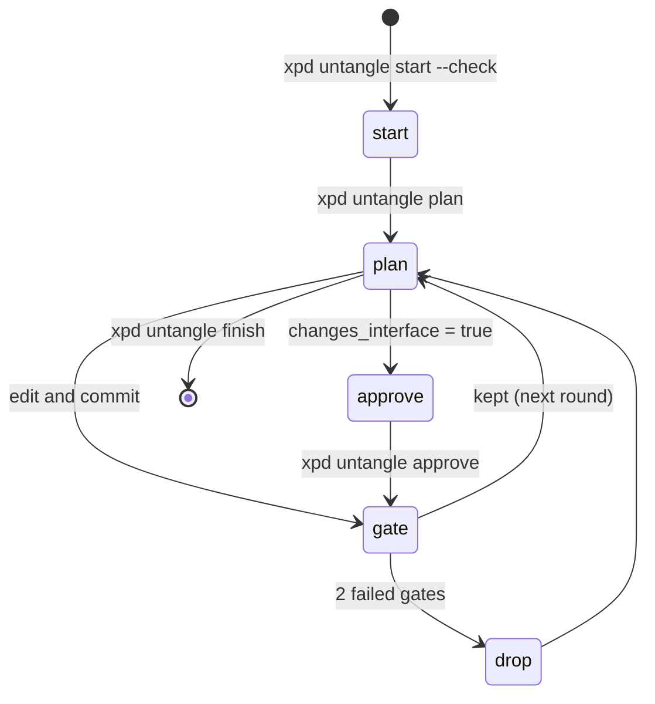

Run `xpd untangle` to find structural coupling across a codebase before and after refactoring. `xpd` reads source files and git history without executing project code. `copy` and `changes-together` work across every language ast-grep parses, and the remaining 13 kinds analyze Python.

| Group | Structural problem | Kinds |
| --- | --- | --- |
| Hidden link | Pieces change together without a visible link | `copy`, `changes-together`, `shared-state` |
| Needless link | Pieces are coupled despite changing for different reasons | `volatile-import`, `import-cycle`, `private-reach`, `vague-module` |
| Surplus | Code has no independent reason to change | `pass-through`, `unreferenced`, `constant-parameter` |
| Special case | One-off logic outside the core design | `one-value-branch`, `one-caller-parameter`, `swallowed-exception`, `sleep-or-retry`, `disabled-test` |

## Examples

```python title="shop/orders.py"
import time

from shop import pricing


def load(path, strict=False):
    with open(path) as handle:
        return [row for row in handle if row or not strict]


def summarize(rows, kind):
    if kind == "wholesale":
        rows = rows[:10]
    pricing.RATE = 0.2
    try:
        value = pricing.total(rows)
    except ValueError:
        pass
    time.sleep(1)
    return value


def first():
    return load("a.csv")


def second():
    return load("b.csv")
```

```python title="shop/pricing.py"
from shop import orders

RATE = 0.25


def total(rows):
    return sum(float(row) for row in rows) * RATE


def report():
    return total(orders.first()), orders.second(), orders.summarize([], "retail")
```

```console
$ touch shop/__init__.py
$ xpd untangle shop --format text
xpd untangle: 7 findings in 3 files, 3 of them Python, with 0 commits of history
...
Hidden links: pieces that must change together, where the code does not show it: 1
  shared-state: 1
    e09d695c  shop/orders.py:14  This writes RATE of the module pricing from outside it.
...
$ xpd untangle shop --kind import-cycle,shared-state --format json | jq -c '.findings[] | {kind, places: [.places[] | "\(.path):\(.line)"]}'
{"kind":"shared-state","places":["shop/orders.py:14"]}
{"kind":"import-cycle","places":["shop/orders.py:3","shop/pricing.py:1"]}
```

## What each kind measures

| Kind | Signal |
| --- | --- |
| `copy` | Identical block of at least 5 lines and 60 tokens in two or more places |
| `changes-together` | Two files co-changed in at least 5 commits (50%+ of the quieter file, non-bulk commits, unlinked in Python) |
| `shared-state` | Write to another module's attribute or via `global` |
| `volatile-import` | Module importing another module with at least 2x as many commits (minimum 8) |
| `import-cycle` | Circular import chain between Python modules |
| `private-reach` | Import or attribute read of another module's `_name` |
| `vague-module` | Matches [`python/vague-module-name`](../../rules/python/vague-module-name/) |
| `pass-through` | Matches [`python/pass-through-function`](../../rules/python/pass-through-function/) |
| `unreferenced` | Top-level function or class with no Python references outside its definition |
| `constant-parameter` | Parameter never passed or always passed the same literal across calls |
| `one-value-branch` | `if` without `elif` comparing to one string literal |
| `one-caller-parameter` | Default parameter passed by only one of three or more callers |
| `swallowed-exception` | `except` with only `pass` or `continue`, or `contextlib.suppress` |
| `sleep-or-retry` | `time.sleep`, `asyncio.sleep`, retry decorator, or test sleep and rerun rules |
| `disabled-test` | Matches [`python/test-skip`](../../rules/python/test-skip/) |

Pass `--since <commit>` to compare counts against an earlier commit. Finding IDs stay stable when code moves inside a file.

## A recorded run

Record multi-commit refactors in `.git/xpd-untangle.json` so `xpd` gates every fix against your project checks and finding counts.



| Stage | Subcommand | Action |
| --- | --- | --- |
| Start | [`start`](./start/) | Record baseline commit, paths, and passing checks |
| Plan | [`plan`](./plan/) | Register ordered fixes and accepted finding IDs |
| Approve | [`approve`](./approve/) | Confirm a fix marked `changes_interface: true` |
| Gate | [`gate`](./gate/) | Run checks and keep the commit only if findings drop with zero regressions |
| Drop | [`drop`](./drop/) | Record why a fix was abandoned after resetting |
| Status | [`status`](./status/) | Print current journal state and next stage |
| Finish | [`finish`](./finish/) | Compare HEAD with start commit and close the run |

```json title="plan.json"
{
  "fixes": [{"id": "no-fixed-wait", "title": "Remove the fixed wait in summarize", "findings": ["SLEEP"]}],
  "accepted": []
}
```

```console
$ git init -q && git add -A && git -c user.name=xpd -c user.email=xpd@example.com commit -qm start
$ xpd untangle start shop --check "python3 -c 'import shop.orders'" --format json | jq -c '{findings: .run.was, checks: [.run.checks[].passed], next: .next.stage}'
{"findings":7,"checks":[true],"next":"plan"}
$ sed -i "s/SLEEP/$(xpd untangle shop --kind sleep-or-retry --format json | jq -r '.findings[0].id')/" plan.json
$ xpd untangle plan plan.json --format json | jq -c '.next.stage'
"fix"
$ sed -i '/time.sleep(1)/d' shop/orders.py && git -c user.name=xpd -c user.email=xpd@example.com commit -qam "Remove the fixed wait"
$ xpd untangle gate no-fixed-wait --format json | jq -c '.run.rounds[0][0] | {id, outcome, fixed: (.fixed | length), added: (.added | length)}'
{"id":"no-fixed-wait","outcome":"kept","fixed":1,"added":0}
$ xpd untangle finish --format json | jq -c '{finished: .run.finished}'
xpd: 7 findings at the start, 6 now: 1 fixed, 0 added, 6 left without a reason; lines 39 -> 38
{"finished":true}
```

## Exit status

| Exit code | Meaning |
| --- | --- |
| `0` | Ledger printed or run stage succeeded |
| `1` | Gate rejected a fix or `finish` blocked on open fixes or unexplained new findings |
| `2` | Command failed to run (for example, invalid `--since` commit) |
