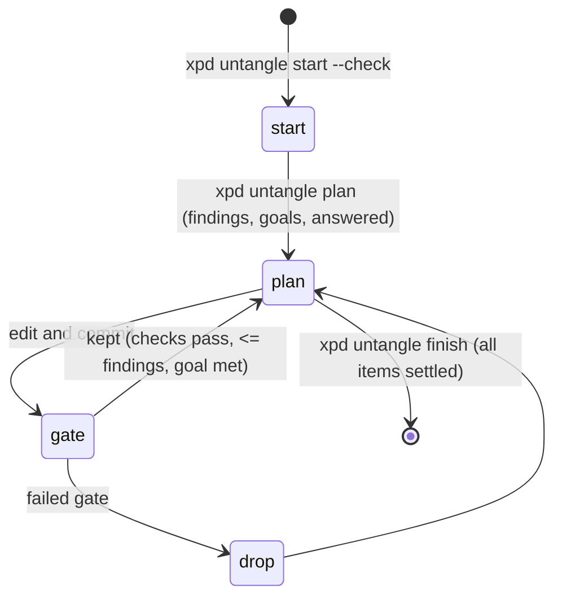

Run `xpd untangle` to find pieces that change together in separate modules, needless links between modules, and dead weight across a codebase.

| Group | Finding kinds |
| --- | --- |
| Hidden links | `copy`, `near-copy`, `changes-together`, `shared-state` |
| Needless links | `volatile-import`, `import-cycle`, `private-reach`, `vague-module`, `mixed-responsibilities` |
| Surplus | `pass-through`, `default-argument`, `unreferenced`, `constant-parameter`, `orphaned-module`, `facade-module`, `single-use-module` |
| Special cases | `one-value-branch`, `one-caller-parameter` |

A module with a finding gets six structural checklist items. Run `xpd untangle --questions` to read the questions and the facts that inform them, or `xpd untangle <paths> --map` to print a Mermaid module coupling and health map (add `--format json` for structured nodes, edges, and hidden links). The supported fix goals are `shorter` and `design`.

A `shorter` fix requires a lower line count. For a data script refactor, run `xpd equiv` on the old and new versions and record the result in the fix commit.

## Recorded run



1. **Start**: record the current commit, paths, and project checks from a clean tracked tree with `xpd untangle start . --check "your-project-check"`.
2. **List**: read stable finding IDs and checklist item IDs with `xpd untangle . --format json`.
3. **Plan**: record ordered fixes, accepted findings, and checklist verdicts (`pass`, `na`, or `accepted`) with reasons using `xpd untangle plan plan.json`.
4. **Approve**: record approval for an interface change with `xpd untangle approve fix-id`.
5. **Gate**: commit one fix and run `xpd untangle gate fix-id`. A `design` fix must edit a file that owns a cited checklist item.
6. **Drop**: return to the run's current commit and record a reason with `xpd untangle drop fix-id --reason "reason"`.
7. **Status**: show the current run, its recorded answers, and the next stage with `xpd untangle status`.
8. **Finish**: compare against the starting commit with `xpd untangle finish`. An open fix, a new finding without an accepted reason, or an unanswered checklist item causes exit 1.

## Example

```console
$ xpd untangle --questions --format json | jq -c '{facts: (.facts | length), questions: (.questions | length)}'
{"facts":2,"questions":6}
```

## Exit status

A successful list or recorded stage exits 0. A rejected gate or a finish blocked by findings or checklist items exits 1. Invalid input exits 2.
