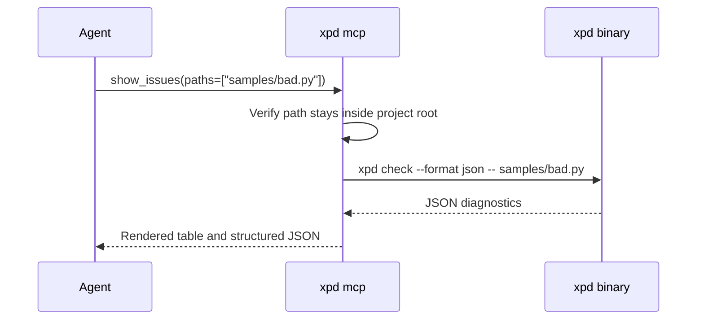

Start `xpd mcp` to expose xpd's visual views, model training gates, and Manim animation tools over the [Model Context Protocol](https://modelcontextprotocol.io) (FastMCP 4.2). Every tool delegates to the matching `xpd` binary, and agents continue to run lint and search commands in their shell. See [`xpd mcp`](../commands/mcp/) for server flags.

```sh
claude mcp add xpd -- uvx xpd mcp
```

## How a call runs

Each tool validates that every file path stays inside the project root (`--root`, `XPD_MCP_ROOT`, client MCP roots when `PLUGIN_ROOT` is set, or the working directory), executes the matching `xpd` command, and returns typed JSON plus optional UI views.



## Errors and background tasks

Paths outside the project root and non-result binary failures return MCP tool errors with the command message. Lint issues, dataflow findings, and failing gates return as normal structured results. Clients can run `gates` and `animate_render` as background tasks with progress updates.
