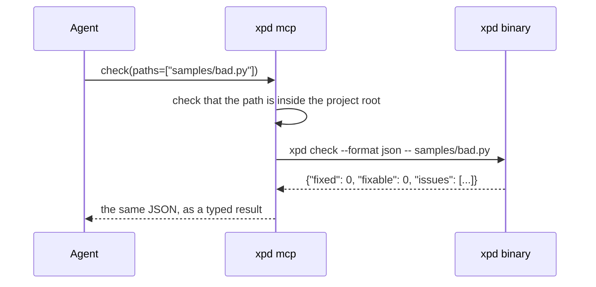

`xpd mcp` starts a [Model Context Protocol](https://modelcontextprotocol.io) server, so an agent
can lint, fix, search and check Python through tools instead of a shell. The server is built on
[FastMCP](https://gofastmcp.com) 4.2 and gets every rule and result from the xpd binary, so it
matches the installed version. This page and the pages below list what the server registers, as
the site's build read it from the running server. [`xpd mcp`](../commands/mcp/) lists the
server's flags.

```sh
claude mcp add xpd -- uvx xpd mcp
```

## How a call runs

A tool checks that each path is inside the project root, runs the xpd binary there and returns
the binary's JSON as a typed result. `find` and `api` run in the server's working folder,
because they read no project file. `discovery_gate` parses the files in Python, `contract` reads
a JSON file, and `gates` only judges the results it is given.



The project root is `--root` or `XPD_MCP_ROOT` when one is set. A client that loads xpd as an
agent plugin sets `PLUGIN_ROOT`, and then the root is the first root of the client that is a
folder on the machine. Otherwise it is the server's working folder.

## Errors

A tool that cannot finish returns a tool error with a message, and the agent sees it as the
result of the call. A path outside the project root fails before xpd runs. When the binary
exits with a code that carries no result, the error names the command and its message, such as
`xpd api -- no.such.name exited with 2: xpd: no entry named no.such.name`. Issues, problems in
a dataflow and failed gates are results, not errors.

## Background tasks

A client can run `check`, `fix`, `query`, `rewrite`, `outline`, `new`, `test`, `profile`,
`refit` and `equiv` as background tasks, so it gets a task at once and fetches the result when
the tool is done. Each of them reports progress and logs the xpd command it runs.
