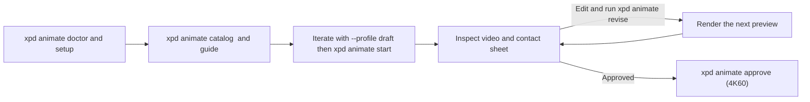

Run `xpd animate` to render and revise an editable Manim video from a built-in starter recipe or your own scene using rootless Podman on x86-64 Linux. If you use the xpd agent plugin, ask the agent in plain language to animate any concept in your project.



## Browse sibling Manim primitives offline

Before writing scene code, inspect the bundled Manim Community 0.22.1 module catalog to compare sibling primitives deliberately instead of reaching for the first familiar class.

```sh
xpd animate catalog
xpd animate catalog indication --json
xpd animate catalog transform
```

## Set up the renderer once

Container rendering requires x86-64 Linux and rootless Podman with cgroups v2. Starter recipes and guides work offline.

```sh
xpd animate doctor
xpd animate setup
xpd animate doctor --json
```

## Render and revise a scene

Start a run with a scene and its assets. Inspect the preview video and contact sheet.

```sh
xpd animate guide sequence > cache_miss.py
xpd animate start cache_miss.py CacheMiss --json
```

Use the returned run ID in place of `RUN`. Approve revision 1 if the first preview is ready.
After editing, submit a new revision and inspect its preview before approving it.

```sh
xpd animate revise RUN --revision 1 --note "Hold the last frame longer" --json
xpd animate status RUN --json
xpd animate approve RUN --revision 2 --json
```

The project holds source bundles and render artifacts under `.xpd-animate/`. Duroxide stores
review history in SQLite under `$XDG_STATE_HOME/xpd/animate`, defaulting to
`~/.local/state/xpd/animate`. Run commands from the same project directory so xpd can find its history.

Approval renders the saved revision even if the working files have changed. Use
`xpd animate resume RUN` to recover an interrupted render. For a standalone render, use
`xpd animate render` with one of the following profiles.

| Profile | Manim preset | Output | Resolution |
| --- | --- | --- | --- |
| `draft` | `-ql` | Fast layout MP4 and contact sheet | 854 by 480 at 15 fps |
| `preview` | `-qh` | MP4 and contact sheet | 1920 by 1080 at 60 fps |
| `final` | `-qk` | MP4 and contact sheet | 3840 by 2160 at 60 fps |
| `still` | `-qm` | PNG of the last frame | 1280 by 720 |

Unchanged partial movie segments are cached per scene and profile so single-line edits reuse untouched beats. Default to installed `Noto Sans`, `Noto Serif`, or `Noto Mono` fonts to keep render logs clean. Pass `--asset <path>` (relative to the project root) for any helper module, data file, or `manim.cfg`, and resolve assets inside Python via `Path(__file__).parent`.

```sh
xpd animate render scenes/chart.py SalesChart --profile draft \
  --asset scenes/data/monthly.csv --asset manim.cfg --json
```

For scenes you trust and run without Podman, install [Manim Community](https://docs.manim.community/en/stable/installation.html) locally and run `manim render --renderer cairo --format mp4 -qh --seed 0 cache_miss.py CacheMiss`.

## Render from local MCP

Start `xpd mcp --root .` and call the six `animate_` tools over stdio.

| MCP tool | Purpose |
| --- | --- |
| `animate_status` | Check Podman and image readiness |
| `animate_guide` | Return the animation guide or one of the six starter recipes |
| `animate_catalog` | Browse sibling Manim 0.22.1 primitives by module family offline |
| `animate_render` | Render a file path, inline `source.files` map, or `from_job` revision with `draft`, `preview`, `final`, or `still` |
| `animate_artifact` | Retrieve `contact_sheet` (default), `video`, `source`, `manifest`, or `log` by `job_id` |
| `animate_source` | Read saved scene files from a completed `job_id` before editing |

Clients without filesystem access can submit inline source text directly to `animate_render`.

```json
{
  "scene": "CircleDemo",
  "profile": "preview",
  "source": {
    "entry": "circle.py",
    "files": {
      "circle.py": "from manim import Circle, Create, Scene\n\nclass CircleDemo(Scene):\n    def construct(self):\n        self.play(Create(Circle()))\n"
    }
  }
}
```
