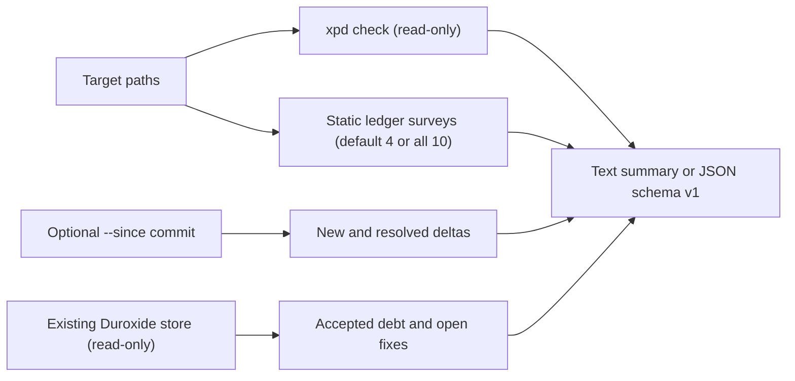

Run `xpd audit` to combine `xpd check`, static ledger workflows, `--since` regression counts, and recorded ledger debt into one read-only report without executing project code.



## Run a default audit

Without `--workflows`, `xpd audit` runs `xpd check` together with the four general-purpose static workflows (`untangle`, `harden`, `optimize`, and `discover`). Terminal runs print a summary table, and piped runs print versioned JSON (`schema_version: 1`).

```sh
xpd audit src/
xpd audit src/ --format json
```

Pass `--workflows all` to audit all ten registered static workflows, or pass a comma-separated subset.

```sh
xpd audit src/ --workflows all --format json
xpd audit src/ --workflows untangle,harden,data-prep
```

| Flag | Purpose |
| --- | --- |
| `--since <commit>` | Compare current issues and workflow findings against an earlier Git commit |
| `--workflows <list>` | Select specific workflows or `all` (default is `untangle,harden,optimize,discover`) |
| `--fail-on-regression` | Exit `1` when `--since` finds net new issues or findings, or when `check` reports errors |
| `--format text` or `--format json` | Select human summary text or machine-readable JSON |

## Gate pull requests against regressions

Use `--since` with `--fail-on-regression` in CI or local pre-push checks to block newly introduced issues while leaving pre-existing technical debt visible without breaking builds.

```sh
xpd audit src/ --since origin/main --fail-on-regression
```

`xpd audit` checks out the baseline commit once into a temporary index, compares linter issue multisets and stable workflow finding IDs, and reports both `new` and `resolved` counts.

## Roll up recorded ledger debt

When a worktree already holds recorded ledger runs in its Duroxide store, `xpd audit` reads each workflow's latest snapshot without creating or modifying the database. Each audited workflow entry includes its ledger status (`running`, `completed`, or `failed`), accepted findings count, accepted checklist exceptions, and open fixes.

See [`xpd audit`](../../commands/audit/) for the full flag list and exit status.
