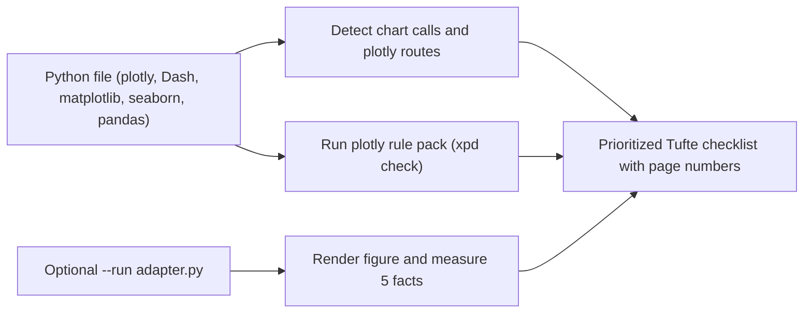

Run `xpd chart-review <file>` to audit every chart in a Python file against the 46 principles in Edward Tufte's "The Visual Display of Quantitative Information" (second edition), and add `--run <adapter.py>` to measure the rendered figure directly.



## Review workflow

With the [xpd plugin](../claude-code/), any chart prompt triggers a hook hint pointing to `xpd chart-review`.

```console
$ echo '{"cwd":"/tmp/project","hook_event_name":"UserPromptSubmit","prompt":"review the charts in my dashboard"}' | xpd hook
Chart task: run `xpd chart-review <file>` on each file that draws the chart. It lists the plotly rules that fire and the questions from Tufte's book for each chart, in plotly or any other library, with the plotly route. Add `--run <adapter.py>` to measure the drawn figure. For a new chart, `xpd api xpd/recipe/plotly-chart` prints the plotly-chart playbook, which names the same command.
```

1. Run `xpd chart-review <file>` and fix every firing plotly rule.
2. Answer each applicable question from the data and chart, rewriting any failing chart.
3. Add `--run <adapter.py>` when the code can execute so rendered measurements catch faults invisible in source.
4. Re-run `xpd chart-review <file>` until no plotly rule fires and every question passes.

## Review static plotly code

```python title="sales.py"
import plotly.express as px


def sales_pie():
    return px.pie(
        names=["North", "South", "East", "West"],
        values=[40, 30, 20, 10],
        title="SALES BY REGION",
    )


def price_line(years, prices):
    return px.line(x=years, y=prices, labels={"x": "Year", "y": "Price in euro"})
```

```console
$ xpd chart-review sales.py --format text
Chart review of sales.py
Libraries: plotly
Charts:
  line 5: px.pie draws a pie chart in plotly. Plotly route: go.Table, or px.bar sorted by value
  line 13: px.line draws a line chart in plotly. Plotly route: px.line
Plotly rules that fire:
...
  sales.py:5:12 warning [plotly/pie-chart] A pie chart puts no numbers along a common scale, so the reader compares angles. Tufte writes that pie charts should never be used and that a table is nearly always better. Show the shares as a sorted px.bar, or as a go.Table when they are few.
...
Questions from Edward Tufte, "The Visual Display of Quantitative Information", second edition, 39 of 46:
...
deflate-money (page 68): Deflated money
  If the chart shows money over time, is it in deflated and standardized units, such as constant euro per person, and does a label say whether it is nominal or real?
...
```

## Measure rendered figures with `--run`

Create a small adapter exposing `figures() -> dict[str, Figure]` and pass `--run <adapter.py>`. `xpd` executes the adapter in the project's Python (Agg for matplotlib and seaborn, Kaleido plus Chrome for plotly when available) and attaches five measured facts to the matching questions.

```python title="prices.py"
import matplotlib.pyplot as plt


def price_chart():
    fig, ax = plt.subplots(figsize=(4, 9))
    ax.plot([2019, 2021], [20.0, 35.0], color="red", label="North")
    ax.plot([2019, 2021], [18.0, 30.0], color="green", label="South")
    ax.set_title("PRICE BEFORE AND AFTER THE 2020 POLICY")
    ax.set_ylabel("Price in euro")
    ax.legend()
    return fig
```

```python title="figures.py"
from prices import price_chart


def figures():
    return {"prices": price_chart()}
```

```console
$ xpd chart-review prices.py --run figures.py --format text
Chart review of prices.py
Libraries: matplotlib
Charts:
  line 6: ax.plot draws a line chart in matplotlib. Plotly route: px.line
  line 7: ax.plot draws a line chart in matplotlib. Plotly route: px.line
...
The run of figures.py measured 1 figure: prices
...
  Measured in prices (colors): North red -, South green -; no direct labels, a legend. North and South are told apart only by red against green, with the same line style and no direct labels
...
  Measured in prices (canvas): 400 by 900 pixels, 1 panel. one panel 400 by 900 pixels is taller than wide
...
```

| Measured fact | Checks | Flags |
| --- | --- | --- |
| `canvas` | Pixel width, height, and panel count | Single panel taller than wide |
| `values` | Plotted value count and density | 20 or fewer values, pie slices |
| `colors` | Trace colors, dashes, legends, direct labels | Red and green only distinction |
| `x-values` | Plotted x values and year span | Two isolated points with no baseline context |
| `text` | Titles, axis labels, tick angles, annotations | All-caps titles, rotated ticks, undeflated currency |

## List all 46 questions

Run `xpd chart-review --questions --format json` to inspect the full question catalog (`rules/xpd/chart-review.yml`) with page numbers, chart kinds, measured facts, and linked [plotly rules](../../rules/plotly/).

```console
$ xpd chart-review --questions --format json | jq -r '.questions[] | "page \(.page), \(.id), \(.principle): \(.text)"'
page 13, show-the-data, Show the data: Does the chart show the observations themselves, so a reader sees what a summary statistic or a fitted line would hide?
...
page 57, lie-factor, The Lie Factor: Is the size of each mark proportional to its number? Divide the size of an effect in the chart by its size in the data; a Lie Factor outside 0.95 to 1.05 is a distortion.
...
page 191, judgment, Judgment: Where the chart breaks one of these principles, does the exception show the data better?
```
