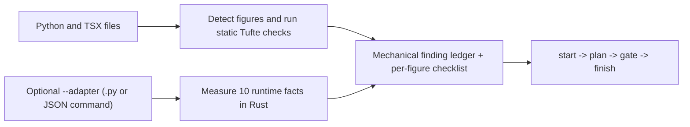

Run `xpd chart-review <paths>` to audit charts and presentation tables in Python (Plotly, Dash, Dash AG Grid, Matplotlib, Seaborn, pandas) and React/TypeScript (`react-plotly.js`, `plotly.js`, `ag-grid-react`, `ag-grid-community`) against all 57 principles from Edward Tufte's "The Visual Display of Quantitative Information" (second edition). Add `--adapter` to measure rendered figures and `xpd chart-review start` to run a gated review ledger.

The [Tufte examples](../tufte-examples/) compare Plotly charts before and after applying each principle.



## Review workflow

With the [xpd plugin](../claude-code/), any chart or presentation table prompt triggers a hook hint pointing to `xpd chart-review`.

```console
$ echo '{"cwd":"/tmp/project","hook_event_name":"UserPromptSubmit","prompt":"review the charts in my dashboard"}' | xpd hook
Chart or table task: run `xpd chart-review <paths>` on the files that draw charts or presentation tables in Python or React/TypeScript (Plotly, Dash, AG Grid, Matplotlib, Seaborn, pandas). It lists mechanical Tufte findings and a per-figure checklist across all 57 principles from Tufte's book. Add `--adapter <adapter.py or command>` to measure rendered figures, and `xpd chart-review start` to record a gated review run. The `xpd-chart-review` skill holds the steps, and `xpd api xpd/recipe/plotly-chart` prints the plotly-chart playbook.
```

1. Start a recorded review with `xpd chart-review start <paths> --check "<tests>" [--adapter "<adapter>"]`.
2. Inspect mechanical findings and remaining per-figure checklist items with `xpd chart-review <paths> [--adapter "<adapter>"] --format json`.
3. Plan ordered fixes (mechanical finding IDs or `"goal": "design"` with `"questions"`), `"accepted"` exceptions, and `"answered"` checklist verdicts with `xpd chart-review plan plan.json`.
4. Commit one fix at a time and verify each commit with `xpd chart-review gate <fix-id>`.
5. Close the run with `xpd chart-review finish` once no open fix, unexplained new finding, or unanswered checklist item remains.

## Review static code

```python title="sales.py"
import plotly.express as px


def sales_pie():
    return px.pie(
        names=["North", "South", "East", "West"],
        values=[40, 30, 20, 10],
        title="SALES BY REGION",
    )


def price_line(years, prices):
    return px.line(x=years, y=prices, labels={"x": "Year", "y": "Price in euro"})
```

```console
$ xpd chart-review sales.py --format text
xpd chart-review: 4 findings in 1 file (1 Python, 0 JS/TS), 2 figures, 63 checklist items
Libraries: plotly
Figures:
  93105f40  sales.py:5  px.pie (pie in plotly, route: go.Table, or px.bar sorted by value)
  601c5b7b  sales.py:13  px.line (line in plotly, route: px.line)
...
  pie-chart: 1
    ac99a33d  sales.py:5  `plotly/pie-chart`: A pie chart puts no numbers along a common scale, so the reader compares angles. Tufte writes that pie charts should never be used and that a table is nearly always better. Show the shares as a sorted px.bar, or as a go.Table when they are few.
...
Checklist: 63 items
  93105f40/show-the-data  sales.py:5 (pie in plotly) (Show the data, page 13)  Does the chart show the observations themselves, so a reader sees what a summary statistic or a fitted line would hide?
...
```

## Measure rendered figures with `--adapter`

Create a Python adapter exposing `figures() -> dict[str, object]` (or a shell command printing `{"figures": [...]}` JSON for React/TypeScript Plotly and AG Grid components) and pass `--adapter`. `xpd` extracts specs for Plotly, AG Grid, and Matplotlib and runs all 10 runtime fact analyzers in Rust.

```python title="prices.py"
import matplotlib.pyplot as plt


def price_chart():
    fig, ax = plt.subplots(figsize=(4, 9))
    ax.plot([2019, 2021], [20.0, 35.0], color="red", label="North")
    ax.plot([2019, 2021], [18.0, 30.0], color="green", label="South")
    ax.set_title("PRICE BEFORE AND AFTER THE 2020 POLICY")
    ax.set_ylabel("Price in euro")
    ax.legend()
    return fig
```

```python title="figures.py"
from prices import price_chart


def figures():
    return {"prices": price_chart()}
```

```console
$ xpd chart-review prices.py --adapter figures.py --format text
xpd chart-review: 9 findings in 1 file (1 Python, 0 JS/TS), 2 figures, 70 checklist items
Libraries: matplotlib
Figures:
  7be371d4  prices.py:6  ax.plot (line in matplotlib, route: px.line)
  83fe2393  prices.py:7  ax.plot (line in matplotlib, route: px.line)
Adapter `figures.py` measured 1 figure: prices
...
  red-green-only: 1
    8d0ad56e  figures.py  [prices] `North` and `South` differ only by red against green with no direct labels (VDQI p. 183).
...
  vertical-aspect-ratio: 2
    ec016cc1  figures.py  [prices] Single-panel canvas 400 by 900 px is taller than wide (VDQI p. 186).
...
```

| Runtime fact | What it measures | Mechanical defects flagged |
| --- | --- | --- |
| `canvas` | Pixel width, height, and panel count | Single panel taller than wide |
| `values` | Plotted value count, pie slices, and bar/category ordering | 20 or fewer values, pie charts, alphabetical category ordering |
| `colors` | Trace colors, dashes, rainbow scales, and direct labels | Red against green only, rainbow scales, redundant color |
| `x-values` | Plotted x values, year span, and irregular step spacing | Two isolated points with no context, irregular time spacing |
| `text` | Titles, axis labels, tick angles, and annotations | All-caps titles, rotated ticks, undeflated currency, raw column names |
| `slopes` | Median absolute visual slope of line segments | Aspect ratios far from banking to 45 degrees |
| `axes` | Axis ranges, secondary axes, explicit ticks, grids, and frames | Non-zero bar or area baselines, dual axes, excess ticks, heavy grids |
| `legend` | Legend box visibility versus direct series annotations | Separate legend where direct labels fit |
| `table` | `go.Table` headers, cell fills, alignment, decimals, and row count | Zebra fills, vertical rules, centered numbers, unaligned decimals, raw headers |
| `grid` | AG Grid `columnDefs`, `rowData`, and theme params | Vertical `columnBorder`, `oddRowBackgroundColor`, unformatted numeric columns, ungrouped flat rows |

## List all 57 principles

Run `xpd chart-review --questions --format json` to inspect the full catalog (`rules/xpd/chart-review.yml`) with page numbers, check modes (`mechanical`, `hybrid`, `judgment`), figure kinds, runtime facts, and linked [plotly rules](../../rules/plotly/).

```console
$ xpd chart-review --questions --format json | jq -r '.questions[] | "page \(.page), \(.id), \(.principle): \(.text)"'
page 13, show-the-data, Show the data: Does the chart show the observations themselves, so a reader sees what a summary statistic or a fitted line would hide?
...
page 57, lie-factor, The Lie Factor: Is the size of each mark proportional to its number? Divide the size of an effect in the chart by its size in the data; a Lie Factor outside 0.95 to 1.05 is a distortion.
...
page 191, judgment, Judgment: Where the chart breaks one of these principles, does the exception show the data better?
```
