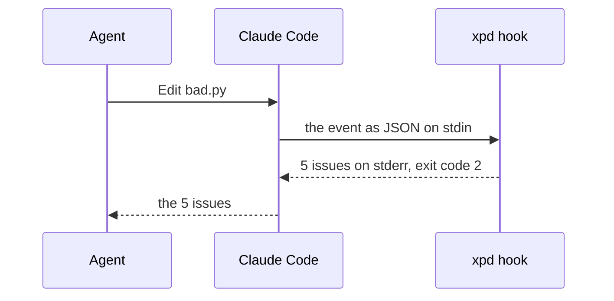

Add `xpd hook` to your Claude Code settings, and the agent sees xpd's issues for each Python file
in the same turn as its edit. You can also give the agent xpd's MCP tools and skills, or load the
whole repository as an agent plugin in a client that supports plugins.

| You want the agent to | Set up | What it needs |
| --- | --- | --- |
| See the issues of each file it edits | [The hook](#lint-each-edit-with-the-hook) | `xpd` on `PATH` |
| Call xpd itself, to fix, search or check a refactor | [The MCP server](../mcp/) | [uv](https://docs.astral.sh/uv/) |
| Know when to run each xpd command | [The skills](#agent-skill) | Nothing |
| Get the MCP server and the skills in one step | [The plugin](#agent-plugin) | A client that loads Agent Plugins, and uv |

## Lint each edit with the hook

Install xpd as [Get started](../../#install) shows, and add the following to
`.claude/settings.json` in your project.

```json title=".claude/settings.json"
{
  "hooks": {
    "PostToolUse": [
      {
        "matcher": "Edit|Write",
        "hooks": [{ "type": "command", "command": "xpd hook" }]
      }
    ]
  }
}
```

After each edit, Claude Code sends the event to `xpd hook` on stdin. xpd lints the file named in
`tool_input.file_path`, prints the issues on stderr and exits with 2, and Claude Code shows the
issues to the agent.



You can run the hook by hand with the event that Claude Code sends. With the `bad.py` from
[Get started](../../#check-a-sample-file) in the current folder, the hook prints the five issues
and exits with 2.

```console
$ echo '{"hook_event_name":"PostToolUse","tool_name":"Edit","tool_input":{"file_path":"bad.py"}}' | xpd hook
bad.py:5:15: warning [pandas/row-loop] iterrows() builds a Series for every row. Compute on whole columns instead, such as df["a"] * df["w"]. When each row has to become a Python object, loop over itertuples() or to_dict("records").
bad.py:6:5: error [pandas/chained-assignment] Chained assignment writes to a copy under copy-on-write, so the frame keeps its old values. Assign to df.loc[i, "a"] instead.
bad.py:7:1: info [pandas/no-inplace] inplace=True gives no speedup and blocks chaining. Reassign instead.
bad.py:8:5: warning [pandas/merge-without-validate] merge without validate= can silently duplicate rows.
bad.py:11:5: warning [pandas/concat-in-loop] out grows by one concat per pass, and each concat copies every earlier row. Collect the frames in a list and concat once after the loop.
$ echo $?
2
```

The hook reports issues and writes no fix, so the agent decides how to change the code. Claude
Code acts on the exit code as the table shows.

| Exit code | When | What Claude Code does |
| --- | --- | --- |
| 0 | The file has no issue, or it is not a file that xpd lints | Nothing |
| 1 | xpd could not run, for example because stdin was not hook JSON | Shows the message to you, and not to the agent |
| 2 | xpd found issues | Shows the issues to the agent |

A file with a pipeline of steps also gets the errors and warnings of
[`xpd graph`](../../commands/graph/), such as a step that reads a column that a later step adds. In a
project with its own rules and an `sgconfig.yml`, the hook also runs those rules on an edited file
in another language that xpd parses. [`xpd hook`](../../commands/hook/) lists the details.

## Agent skill

A skill tells the agent which xpd command to run and when, for example `xpd profile` before it
picks methods for a data file and `xpd equiv` after it refactors data logic. Save the skill of
your installed xpd in the project with the following command.

```sh
mkdir -p .claude/skills/xpd && xpd skill > .claude/skills/xpd/SKILL.md
```

The repository holds two more skills about Python, which work without xpd and run it when it is
installed. Install all three with the skills command of your agent tools.

```sh
npx skills add bjoernaagaard/xpd
```

| Skill | What it gives the agent |
| --- | --- |
| `xpd` | When to run each xpd command. `xpd skill` prints it for the installed version |
| `python-best-practices` | The rules to follow when it writes or changes Python |
| `python-review` | How to review a file, package or diff, with a rule cited for each finding |

The MCP server also offers each skill as a resource, such as `skill://xpd/SKILL.md`, as
[MCP resources](../../mcp/resources/) lists.

## Agent plugin

A client that loads plugins in the [Agent Plugins](https://github.com/agentplugins/agent-plugins-spec)
format, version 1.0.0, can load the xpd repository and get the MCP server and the three skills
with no settings to write. The plugin starts the server with `uvx`, so the machine needs
[uv](https://docs.astral.sh/uv/). Install it in Codex with the following commands.

```sh
codex plugin marketplace add bjoernaagaard/xpd
codex plugin add xpd@xpd
```

The plugin is made of the files below, at the root of the repository.

```text
xpd repository, loaded as a plugin
├── plugin.json                         the name and version of the plugin
├── mcp.json                            starts the server of the same version, with uvx xpd@<version> mcp
├── skills/                             xpd, python-best-practices and python-review
└── .agents/plugins/marketplace.json    lists the plugin for Codex
```

Version 1.0.0 of the format has no hooks, so the plugin ships none, and you add the
[hook](#lint-each-edit-with-the-hook) yourself in Claude Code. The 1.1.0 draft of the format adds
hooks, and `xpd hook` already answers such a client. xpd tells the two kinds of client apart by
the field that holds the result of the tool call.

| Client | Field in the event | Files that xpd lints | How the agent gets the issues |
| --- | --- | --- | --- |
| A hook in the Claude Code settings | `tool_response` | `tool_input.file_path` | On stderr, with exit code 2 |
| A client of the Agent Plugins 1.1.0 draft | `tool_result` | The `path` of each `edit` and `write`, and the `to` of each `move` | As `additional_context` in JSON on stdout, with exit code 0 |

A client of the draft runs the hook in the plugin's folder, so xpd first moves to the `cwd` that
the event names, and it finds the project's virtual environment from there.
