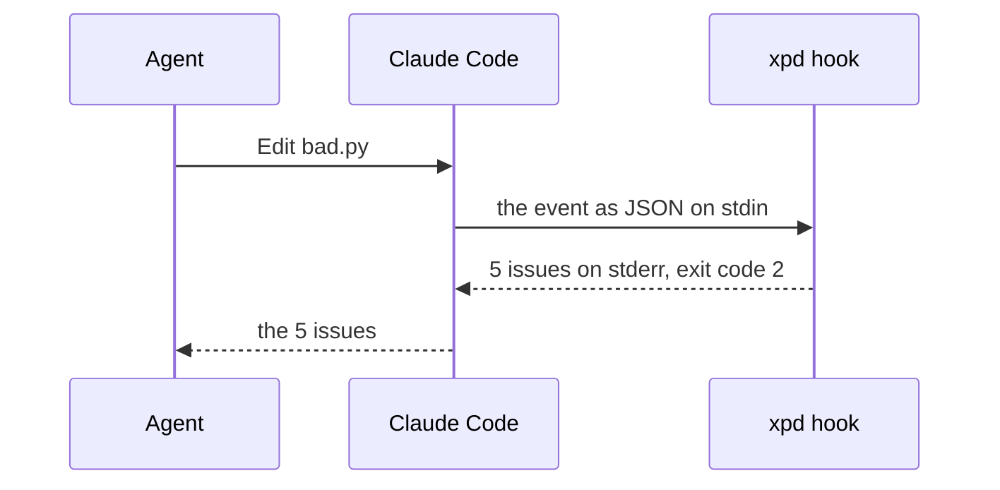
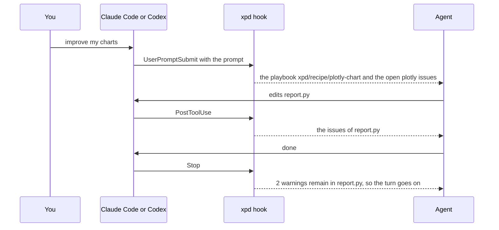

Install the xpd plugin in Claude Code or Codex, and the agent sees xpd's issues for each Python
file it changes, calls xpd's MCP tools and loads its skills. You can also set up each of the three
parts by hand.

| You want the agent to | Set up | What it needs |
| --- | --- | --- |
| Get the hook, the MCP server and the skills in one step | [The plugin](#agent-plugin) | Claude Code or Codex, `xpd` on `PATH`, and [uv](https://docs.astral.sh/uv/) |
| See the issues of each file it edits | [The hook](#lint-each-edit-with-the-hook) | `xpd` on `PATH` |
| Call xpd itself, to fix, search or check a refactor | [The MCP server](../mcp/) | uv |
| Know when to run each xpd command | [The skills](#agent-skill) | Nothing |

## Lint each edit with the hook

The [plugin](#agent-plugin) adds this hook for you. To add it by hand, install xpd as
[Get started](../../#install) shows, and add the following to `.claude/settings.json` in your
project.

```json title=".claude/settings.json"
{
  "hooks": {
    "PostToolUse": [
      {
        "matcher": "Edit|Write",
        "hooks": [{ "type": "command", "command": "xpd hook" }]
      }
    ]
  }
}
```

After each edit, Claude Code sends the event to `xpd hook` on stdin. xpd lints the file named in
`tool_input.file_path`, prints the issues on stderr and exits with 2, and Claude Code shows the
issues to the agent.



You can run the hook by hand with the event that Claude Code sends. With the `bad.py` from
[Get started](../../#check-a-sample-file) in the current folder, the hook prints the five issues
and exits with 2.

```python title="bad.py"
import pandas as pd

df = pd.DataFrame({"a": [1, 2], "k": [1, 2]})
other = df.copy()
for i, row in df.iterrows():
    df["a"][i] = row["a"] * 2
df.dropna(inplace=True)
m = pd.merge(df, other, on="k")
out = pd.DataFrame()
for f in ["x.csv"]:
    out = pd.concat([out, pd.read_csv(f)])
```

```console
$ echo '{"hook_event_name":"PostToolUse","tool_name":"Edit","tool_input":{"file_path":"bad.py"}}' | xpd hook
bad.py:5:15: warning [pandas/row-loop] iterrows() builds a Series for every row. Compute on whole columns instead, such as df["a"] * df["w"]. When each row has to become a Python object, loop over itertuples() or to_dict("records").
bad.py:6:5: error [pandas/chained-assignment] Chained assignment writes to a copy under copy-on-write, so the frame keeps its old values. Assign to df.loc[i, "a"] instead.
bad.py:7:1: info [pandas/no-inplace] inplace=True gives no speedup and blocks chaining. Reassign instead.
bad.py:8:5: warning [pandas/merge-without-validate] merge without validate= can silently duplicate rows.
bad.py:11:5: warning [pandas/concat-in-loop] out grows by one concat per pass, and each concat copies every earlier row. Collect the frames in a list and concat once after the loop.
$ echo $?
2
```

The hook reports issues and writes no fix, so the agent decides how to change the code. Claude
Code acts on the exit code as the table shows.

| Exit code | When | What Claude Code does |
| --- | --- | --- |
| 0 | The file has no issue, or it is not a file that xpd lints | Nothing |
| 1 | xpd could not run, for example because stdin was not hook JSON | Shows the message to you, and not to the agent |
| 2 | xpd found issues | Shows the issues to the agent |

A file with a pipeline of steps also gets the errors and warnings of
[`xpd graph`](../../commands/graph/), such as a step that reads a column that a later step adds. In a
project with its own rules and an `sgconfig.yml`, the hook also runs those rules on an edited file
in another language that xpd parses. [`xpd hook`](../../commands/hook/) lists the details.

## Agent skill

A skill tells the agent which xpd command to run and when, for example `xpd profile` before it
picks methods for a data file and `xpd equiv` after it refactors data logic. Save the skill of
your installed xpd in the project with the following command.

```sh
mkdir -p .claude/skills/xpd && xpd skill > .claude/skills/xpd/SKILL.md
```

The repository holds two more skills about Python, which work without xpd and run it when it is
installed. Install all three with the skills command of your agent tools.

```sh
npx skills add bjoernaagaard/xpd
```

| Skill | What it gives the agent |
| --- | --- |
| `xpd` | When to run each xpd command. `xpd skill` prints it for the installed version |
| `python-best-practices` | The rules to follow when it writes or changes Python |
| `python-review` | How to review a file, package or diff, with a rule cited for each finding |

The MCP server also offers each skill as a resource, such as `skill://xpd/SKILL.md`, as
[MCP resources](../../mcp/resources/) lists.

## Agent plugin

The xpd repository is a plugin for Claude Code and for Codex. One install gives the agent the
hook, the MCP server and the bundled skills, with no settings to write. The hook runs the `xpd` on
your `PATH`, so install xpd as [Get started](../../#install) shows. The plugin starts the MCP
server with `uvx`, so the machine also needs [uv](https://docs.astral.sh/uv/).

Install the plugin in Claude Code with the following commands.

```sh
claude plugin marketplace add bjoernaagaard/xpd
claude plugin install xpd@xpd
```

Install the plugin in Codex with the following commands.

```sh
codex plugin marketplace add bjoernaagaard/xpd
codex plugin add xpd@xpd
```

Codex skips the hooks of a plugin until you trust them. Start Codex, type `/hooks`, and trust the
four `xpd hook` entries. Codex asks you again when a later version of the plugin changes a hook.
Claude Code runs the hooks of an installed plugin without this step.

The plugin is made of the files below.

```text
xpd repository, loaded as a plugin
├── .claude-plugin/
│   ├── plugin.json                     the name and version of the plugin, which both clients read
│   └── marketplace.json                lists the plugin for Claude Code
├── .agents/plugins/marketplace.json    lists the plugin for Codex
├── hooks/hooks.json                    runs xpd hook on four events, in both clients
├── mcp.json                            starts the server of the same version, with uvx xpd@<version> mcp
└── skills/                             xpd, xpd-animate, python-best-practices and python-review
```

Codex 0.170.0 loads the hooks of a plugin only when the plugin has no `plugin.json` at its root,
so the manifest is in `.claude-plugin/`, where both clients read it.

The client runs `xpd hook` on the four events below, and [`xpd hook`](../../commands/hook/)
describes each answer.

| Event | What xpd does |
| --- | --- |
| `SessionStart` | Records the commit that is checked out, and prints a brief of the project for the agent |
| `UserPromptSubmit` | Points the agent to the [animation guide](../animate/) for rendered animation requests. For Python projects it can also supply a matching playbook or report open issues |
| `PostToolUse`, after an `Edit` or a `Write` | Lints the edited file, so the agent sees its issues |
| `Stop` | Lints the Python files that the session changed, and holds the turn while one has an error or a warning |

In both clients, the agent sees the issues of a file right after its edit. In Codex, an edit is an
`apply_patch` call, and xpd reads the names of the files from the text of the patch. An edit that
a shell command makes sends no such event, and the `Stop` check covers it, because that check
lints every Python file the session changed.

### What the agent reads without asking

In a project with a Python file, the agent gets two texts from xpd that nobody asked for. Both
state what xpd found, and a prompt about other work gets no text.

| Event | What xpd prints | Example |
| --- | --- | --- |
| `SessionStart` | A brief with the rule packs that apply, the style setting, the pipelines and Hamilton nodes that `xpd graph` reads, and three commands | `Rule packs that apply: python (13 files), numpy (9 files), scipy (6 files), pandas (4 files).` |
| `UserPromptSubmit`, for a prompt that a playbook answers | The playbook with its name, its commands in order and its rules | `xpd has a playbook for this prompt: xpd/recipe/plotly-chart` |
| `UserPromptSubmit`, for a prompt that asks what to make or improve | The open issues of the project, counted by pack and severity | `plotly: 11 warnings` |

A playbook is one of xpd's own recipes, which holds the house style for a kind of task.
[`xpd find`](../../commands/find/#playbooks) lists the four of them. You type "improve my charts"
and name no rule and no command, and the turn goes as follows.



[`xpd hook`](../../commands/hook/#on-each-prompt) describes when a prompt gets a playbook.

### Hold a turn on the house style

The `Stop` check holds a turn on an error or a warning. A rule of the house style is `info`, so
the agent may leave code that works and is not in the style. Set `style = "strict"` to make those
rules warnings, and the agent then keeps working until the code is in the style. The
[`xpd check` page](../../commands/check/#house-style) lists the two files that xpd reads the
setting from.

```toml
# pyproject.toml, for one project
[tool.xpd]
style = "strict"
```

```toml
# ~/.config/xpd/config.toml, for every project of one user
style = "strict"
```

The agent below wrote three row filters in a row. The first run has no setting, and the second
has `style = "strict"`.

```text
agent wants to stop
  no setting    xpd lists the info issue for the user, and the turn ends
  strict        xpd answers {"decision": "block"} with the line below, and the turn goes on

orders.py:4:1: warning [pandas/filter-ladder] df is filtered three or more times in a row, ...
```

`xpd hook` also answers a client of the 1.1.0 draft of the
[Agent Plugins](https://github.com/agentplugins/agent-plugins-spec) format, which sends another
event after an edit. xpd tells the two kinds of client apart by the field that holds the result of
the tool call.

| Client | Field in the event | Files that xpd lints | How the agent gets the issues |
| --- | --- | --- | --- |
| Claude Code | `tool_response` | `tool_input.file_path` | On stderr, with exit code 2 |
| A client of the Agent Plugins 1.1.0 draft | `tool_result` | The `path` of each `edit` and `write`, and the `to` of each `move` | As `additional_context` in JSON on stdout, with exit code 0 |

A client of the draft runs the hook in the plugin's folder, so xpd first moves to the `cwd` that
the event names, and it finds the project's virtual environment from there.
