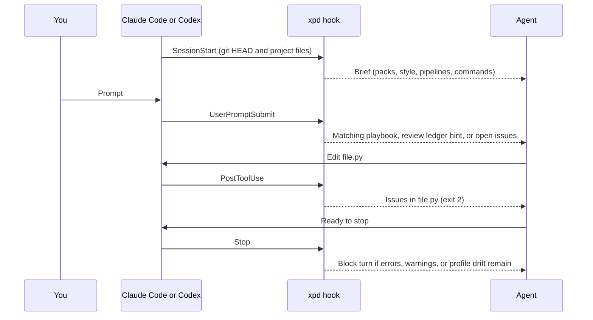

Install the xpd plugin in Claude Code or Codex to lint every edit automatically, block turns that leave errors or warnings, and expose xpd's MCP tools and skills in one step. You can also install the hook, MCP server, or skills individually.



| Setup option | What the agent gets | Requires |
| --- | --- | --- |
| [Agent plugin](#agent-plugin) | Hook, 14-tool MCP server, and all 14 bundled skills | Claude Code or Codex, `xpd` on `PATH`, and [uv](https://docs.astral.sh/uv/) |
| [Edit hook only](#lint-each-edit-with-the-hook) | Issues after every edit | `xpd` on `PATH` |
| [MCP server](../mcp/) | Visual tables, coupling maps, ledger views, model gates, and animation tools | `uv` |
| [Agent skill](#agent-skill) | Lean instructions for `xpd audit`, `xpd library`, all 10 ledgers, and Python style | Nothing |

## Agent plugin

Install `xpd` on `PATH` as [Get started](../../#install) shows, then install the plugin in your client.

```sh
# Claude Code
claude plugin marketplace add bjoernaagaard/xpd
claude plugin install xpd@xpd

# Codex
codex plugin marketplace add bjoernaagaard/xpd
codex plugin add xpd@xpd
```

Codex skips plugin hooks until you approve them. Start Codex, run `/hooks`, and trust the four `xpd hook` entries. Claude Code enables plugin hooks automatically.

```text
xpd repository (loaded as a plugin)
├── .claude-plugin/
│   ├── plugin.json                     plugin name and version
│   └── marketplace.json                Claude Code marketplace listing
├── .agents/plugins/marketplace.json    Codex marketplace listing
├── hooks/hooks.json                    runs xpd hook on SessionStart, UserPromptSubmit, PostToolUse, and Stop
├── mcp.json                            starts uvx xpd@<version> mcp
└── skills/                             xpd, xpd-animate, xpd-chart-review, xpd-data-prep, xpd-ts-review, xpd-feature-review, xpd-model-review, xpd-opt-review, xpd-untangle, xpd-optimize, xpd-harden, xpd-discover, python-best-practices, python-review
```

| Hook event | What `xpd hook` does |
| --- | --- |
| `SessionStart` | Records HEAD and profile baseline, then prints a short project brief |
| `UserPromptSubmit` | Routes chart, data preparation, time series, feature engineering, model validation, numerical optimization, data file, untangle, harden, optimize, refactor, or animation prompts to the right command or playbook |
| `PostToolUse` | Lints the edited file (`Edit`, `Write`, or Codex `apply_patch`) and returns issues immediately |
| `Stop` | Lints every Python file changed in the session and holds the turn if errors, warnings, or profile drift remain |

See [`xpd hook`](../../commands/hook/#on-each-prompt) for the full prompt routing flowchart and [`xpd find`](../../commands/find/#playbooks) for the seven playbooks.

## Hold turns on house style

By default, house style rules report as `info`, so `Stop` lets the turn finish. Set `style = "strict"` in `pyproject.toml` (`[tool.xpd]`) or `~/.config/xpd/config.toml` to promote house style rules to warnings and hold the turn until they pass. See [`xpd check`](../../commands/check/#house-style) for settings precedence.

```toml
[tool.xpd]
style = "strict"
```

## Lint each edit with the hook

To wire the edit hook manually without the plugin, add `xpd hook` to `.claude/settings.json`.

```json title=".claude/settings.json"
{
  "hooks": {
    "PostToolUse": [
      {
        "matcher": "Edit|Write",
        "hooks": [{ "type": "command", "command": "xpd hook" }]
      }
    ]
  }
}
```

Test the hook directly on `bad.py` from [Get started](../../#check-a-sample-file).

```python title="bad.py"
import pandas as pd

df = pd.DataFrame({"a": [1, 2], "k": [1, 2]})
other = df.copy()
for i, row in df.iterrows():
    df["a"][i] = row["a"] * 2
df.dropna(inplace=True)
m = pd.merge(df, other, on="k")
out = pd.DataFrame()
for f in ["x.csv"]:
    out = pd.concat([out, pd.read_csv(f)])
```

```console
$ echo '{"hook_event_name":"PostToolUse","tool_name":"Edit","tool_input":{"file_path":"bad.py"}}' | xpd hook
bad.py:5:15: warning [pandas/row-loop] iterrows() builds a Series for every row. Compute on whole columns instead, such as df["a"] * df["w"]. When each row has to become a Python object, loop over itertuples() or to_dict("records").
...
$ echo $?
2
```

| Client format | Detection field | How issues return |
| --- | --- | --- |
| Claude Code | `tool_response` | Plain text on stderr, exit code `2` (`0` clean, `1` hook error) |
| Agent Plugins 1.1.0 draft | `tool_result` | JSON `additional_context` on stdout, exit code `0` |

## Agent skill

Install all bundled skills with `npx skills add bjoernaagaard/xpd`, or export the version-matched core skill into a single project with `xpd skill`.

```sh
npx skills add bjoernaagaard/xpd
mkdir -p .claude/skills/xpd && xpd skill > .claude/skills/xpd/SKILL.md
```

| Skill | Purpose |
| --- | --- |
| `xpd` | When to run each `xpd` command |
| `xpd-chart-review` | Recorded chart and table review workflow against Tufte's book driven by `xpd chart-review` |
| `xpd-data-prep` | Recorded data preparation, split, and scaling review driven by `xpd data-prep` |
| `xpd-ts-review` | Recorded time series structure, seasonality, and grouping review driven by `xpd ts-review` |
| `xpd-feature-review` | Recorded feature mechanism, cutoff, and fold-lift review driven by `xpd feature-review` |
| `xpd-model-review` | Recorded model validation, baseline, calibration, and coverage review driven by `xpd model-review` |
| `xpd-opt-review` | Recorded numerical optimization and portfolio review driven by `xpd opt-review` |
| `xpd-untangle` | Whole-codebase decoupling workflow driven by `xpd untangle` |
| `xpd-optimize` | Measured performance workflow driven by `xpd optimize` |
| `xpd-harden` | Reliability review and determinism gate driven by `xpd harden` |
| `xpd-discover` | Search-friendly names and strings, gated by `xpd discover` |
| `xpd-animate` | Creating and revising Manim animations with `xpd animate` |
| `python-best-practices` | Idiomatic Python rules for writing new code |
| `python-review` | Structured Python code review with cited rules |

Every skill is also served as an MCP resource under `skill://`. See [MCP resources](../../mcp/resources/).
