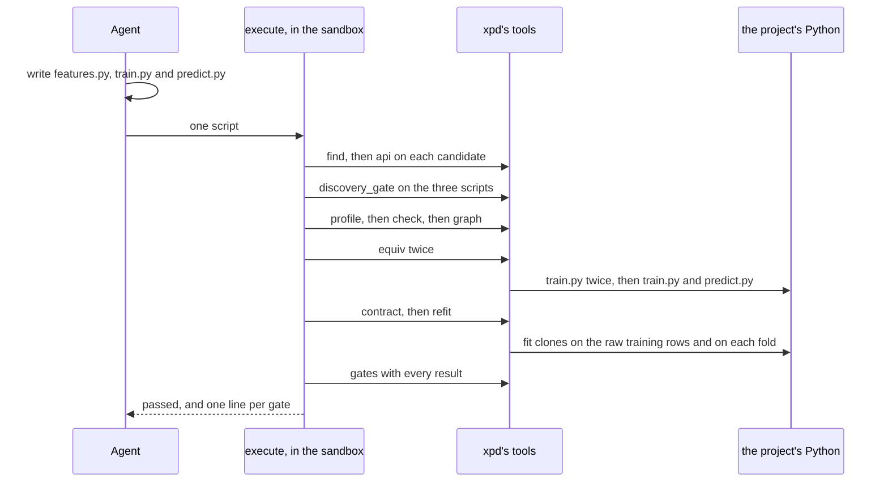

Start xpd's MCP server with `--code-mode`, and an agent can train, check and save a scikit-learn
model from a data file in one `execute` call. The `gates` tool then says whether the run is done,
with one line of evidence for each check. On this page you run the sample project in
`samples/pipeline/` of the xpd repository, which passes all 15 gates.

With `--code-mode`, the server lists FastMCP's three
[code mode](https://gofastmcp.com/docs/servers/transforms/code-mode) tools, `search`,
`get_schema` and `execute`, in place of its own. The agent sends a short Python script to
`execute`, the script calls xpd's tools in order, and only what the script returns goes back to
the agent.



## Before you start

You need a checkout of the xpd repository, xpd installed as a Python package, and a Python
environment with pandas and scikit-learn for the project's scripts. `equiv` and `refit` run the
scripts with the Python of `VIRTUAL_ENV`, or else with the Python of the nearest `.venv`.

```sh
git clone https://github.com/bjoernaagaard/xpd
cd xpd
uv tool install xpd
uv venv /tmp/penguins
uv pip install --python /tmp/penguins pandas scikit-learn fastmcp
export VIRTUAL_ENV=/tmp/penguins
```

The sample holds the scripts that an agent writes before it calls `execute`, and the training
script writes the model and its contract.

```text
samples/pipeline/
├── penguins.csv      the raw rows, 344 penguins with nulls in five columns
├── discovery.json    the library choice, which train.py copies into the contract
├── features.py       two feature steps, as step code that graph reads
├── train.py          the split, one Pipeline, cross-validation, the saved model and its contract
├── predict.py        loads the saved model and gives the class probabilities of the held out rows
├── leaky.py          train.py with one leak
└── model/            what train.py writes, which Git ignores
```

Run the training script once, so the model and the contract exist.

```sh
cd samples/pipeline && $VIRTUAL_ENV/bin/python train.py && cd ../..
```

The table is the [Palmer penguins](https://github.com/allisonhorst/palmerpenguins) data, under the
CC0 license.

## Run the stages in one call

The `build_pipeline` prompt takes `data`, `target` and an optional `task`, and it tells the agent
how to work.

1. Before it calls `execute`, the agent calls `find` with the task and `api` on each candidate,
   and it chooses one and states the reason. It calls `profile` on the data file, and it writes
   `features.py`, `train.py` and `predict.py`. It asks you before it adds a library to the
   project.
2. It calls `execute` once with the script that the prompt returns.
3. It is done when `gates` returns `passed: true`. For a gate that fails, it reads the gate's
   `detail`, fixes the scripts and calls `execute` again, and it never edits the contract by hand.

The client below plays the agent's part. It starts the server with code mode on and sends the
script that `build_pipeline` returns for `penguins.csv`, the target `species` and the task
`classify penguin species with a logistic regression pipeline`. Save it as `run_pipeline.py` and
run it from the root of the repository with `$VIRTUAL_ENV/bin/python run_pipeline.py`.
FastMCP's stdio client passes on only a few environment variables, so the client passes
`VIRTUAL_ENV` to the server itself.

```python title="run_pipeline.py"
import asyncio
import json
import sys

from fastmcp import Client
from fastmcp.client.transports import StdioTransport

STAGES = """
DATA = "penguins.csv"
FEATURES = "features.py"
TRAIN = "train.py"
PREDICT = "predict.py"
CONTRACT = "model/contract.json"
TASK = "classify penguin species with a logistic regression pipeline"
CHOICE = "sklearn.linear_model.LogisticRegression"
REASON = "Class probabilities for the species target."
SYMBOLS = [CHOICE]
found = await call_tool("find", {"task": TASK})
inspected = {
    kind: [await call_tool("api", {"name": item["name"]}) for item in found[kind]]
    for kind in ("symbols", "rules", "recipes")
}
discovery = {
    "question": {"task": TASK}, "candidates": inspected,
    "choice": {"name": CHOICE, "reason": REASON, "symbols": SYMBOLS},
}
api_proof = await call_tool("discovery_gate", {
    "paths": [TRAIN, PREDICT, FEATURES], "discovery": discovery,
})
if not api_proof["gate"]["passed"]:
    return api_proof

profile = await call_tool("profile", {"file": DATA})
lint = await call_tool("check", {"paths": [TRAIN, PREDICT, FEATURES]})
if any(issue["severity"] == "error" for issue in lint["issues"]):
    return {"passed": False, "lint": lint, "discovery": api_proof}
dataflow = await call_tool("graph", {"paths": [FEATURES]})
reproducible = await call_tool("equiv", {"old": TRAIN, "new": TRAIN})
served = await call_tool("equiv", {"old": TRAIN, "new": PREDICT})
contract = await call_tool("contract", {"file": CONTRACT})
refitted = await call_tool("refit", {"file": CONTRACT})
proof = {
    "lint": lint, "dataflow": dataflow, "refit": refitted,
    "reproducible": reproducible,
    "served": served, "discovery": api_proof,
}
report = await call_tool("gates", {"profile": profile, "contract": contract, "proof": proof})
return {
    "passed": report["passed"],
    "gates": [
        {"name": gate["name"], "passed": gate["passed"], "detail": gate["detail"]}
        for gate in report["gates"]
    ],
    "refit": refitted,
    "validation": contract["validation"],
    "model": contract["model"],
}
"""


async def main() -> None:
    server = StdioTransport(
        "xpd",
        ["mcp", "--code-mode", "--root", "samples/pipeline"],
        env={"VIRTUAL_ENV": sys.prefix},
    )
    async with Client(server) as client:
        result = await client.call_tool("execute", {"code": STAGES})
        print(json.dumps(result.structured_content, indent=2))


asyncio.run(main())
```

The run took 7.5 seconds and returned `passed: true`, with the gates below. It ran with xpd 0.38.0,
FastMCP 4.2.2, Python 3.15.2, scikit-learn 1.9.1, pandas 3.1.1, NumPy 2.5.5 and joblib 1.6.0.

| Gate | Detail |
| --- | --- |
| `data-is-profiled` | penguins.csv has 344 rows, and the target species has no nulls. |
| `split-covers-every-row` | The contract counts 258 training rows and 86 held out rows. |
| `split-is-seeded` | The contract records the seed 0, and check reports no unseeded scikit-learn, scikit-lego, MAPIE, Category Encoders, arch or pymoo draw. |
| `inputs-are-file-columns` | The 6 inputs of the contract have the names and dtypes of columns of penguins.csv. |
| `dataflow-connects` | 2 feature steps read only input columns and columns of earlier steps. |
| `one-pipeline` | The contract lists one Pipeline of FunctionTransformer then ColumnTransformer then LogisticRegression. |
| `check-reports-no-error` | check reports no error. |
| `cross-validated` | The contract records accuracy 0.9803921568627451 to 1.0 on 5 folds, and 0.9883720930232558 as the held out score. |
| `reproducible` | Two runs of the training script, each in its own Python process, leave an equal `result`. |
| `refit-matches-model` | The raw training refit matches the saved model on predict_proba. |
| `refit-matches-scores` | The contract scores and row and fold counts match the raw training refit. |
| `saved-model-predicts` | The prediction script, in its own Python process, leaves the `result` that the training script left. |
| `versions-recorded` | The contract records python 3.15.2, scikit-learn 1.9.1, pandas 3.1.1, numpy 2.5.5, joblib 1.6.0. |
| `indexed-api-calls` | Checked 1 direct imported calls for indexed callable names and literal keyword names in api's parameter lists. No code was run. |
| `discovery-is-recorded` | The contract records the discovery question, candidates and reason of the proof. |

## The stages

Each stage of a run hands one result of a fixed shape to the next, and the training script
writes most of them into one JSON file, the contract. The [`contract`](../../mcp/tools/contract/)
tool reads the contract and refuses one that lacks a required field.

| Stage | What it hands on | Where it comes from |
| --- | --- | --- |
| Discovery | The task, the candidates the agent read, and the choice with its reason | `find`, `api` and the agent |
| Raw data | The file, the target column and the row count | The contract |
| Profile | Each column's dtype, nulls and distinct values | `profile` |
| Split | The seed, the share held out, and the rows on each side | The contract |
| Preprocessing | The raw columns the model takes, and each step of the one Pipeline | The contract |
| Model | The last step of the Pipeline | The contract |
| Validation | The splitter, one score per fold, and one score for the held out rows | The contract |
| Proof | What `discovery_gate`, `check`, `graph`, `equiv` and `refit` found | Those tools |
| Saved model | The model file, the class of the saved object, the versions that wrote it and the code files it imports | The contract |

`refit` repeats the training on the raw rows that the contract names and compares the results
exactly, so the training script must save its scores without rounding. For the sample, it fits a
clone of the saved Pipeline on the 258 training rows and on each of 5 folds, and the held out
scores were 0.9883720930232558 in the contract and in the refit.

`predict.py` loads the model in a new Python process and gives the probability of each species
for the 86 held out rows. The most likely species was right for 85 of them, and the first three
rows, rounded to four places, follow.

```text
     Adelie  Chinstrap  Gentoo
298  0.0461     0.9531  0.0008
157  0.0002     0.0045  0.9954
137  0.9884     0.0113  0.0003
```

`predict.py` compares the input columns, the scikit-learn version and the code files with the
contract, and it stops before it loads the model when one of them differs. Without
`features.py`, it raises `FileNotFoundError: The model imports ['features.py'], and no such file is here.`

## Discovery before execution

The run stops before any project code runs when the scripts call the chosen library with a name or
keyword that xpd's index doesn't know. The agent records its choice in a discovery record, and
[`discovery_gate`](../../mcp/tools/discovery_gate/) checks the calls in the scripts against it.

```text
discovery
├── question     the task in plain words
├── candidates   symbols, rules and recipes, each as api returned it
└── choice       the name of one candidate, the reason, and the symbols the code must call

discovery_gate(paths, discovery)
  fail unless choice.name is one of the candidates
  for each direct call into a module of a chosen symbol, such as sklearn.linear_model
    fail when api doesn't know the name as a callable
    fail on a keyword that is not one of its indexed parameters, and on ** arguments
  fail when a chosen symbol has no direct call
```

The gate reads the source and runs nothing, so it can't see instance methods, names that Python
resolves at run time, or whether the library is installed. The training script saves the same
record in the contract from `discovery.json`. After the agent makes a new choice, it saves the new
record in `discovery.json` and runs `train.py` again, or the gate `discovery-is-recorded` fails.

## The gates

A run is done when every gate passes. [`gates`](../../mcp/tools/gates/) judges the results that
the script passes to it, and the table says what each gate needs.

| Gate | The gate passes when |
| --- | --- |
| `data-is-profiled` | The contract names the profiled file with its row count, and the target has no nulls |
| `split-covers-every-row` | Each side of the split has rows, and together they hold every row of the file |
| `split-is-seeded` | `check` reports no draw without a seed from scikit-learn, scikit-lego, MAPIE, Category Encoders, arch or pymoo |
| `inputs-are-file-columns` | Each input of the contract has the name and dtype of a column of the file, and none is the target |
| `dataflow-connects` | `graph` reports no error or warning, and each feature step reads only input columns and columns of earlier steps |
| `one-pipeline` | The saved object is one `sklearn.pipeline.Pipeline`, and the contract lists its steps |
| `check-reports-no-error` | `check` reports no error of any pack |
| `cross-validated` | The contract has two or more folds and one score for each fold |
| `reproducible` | Two runs of the training script, each in its own Python process, leave an equal `result` |
| `refit-matches-model` | A clone fitted on the raw training rows gives the held out outputs of the saved model |
| `refit-matches-scores` | The recorded scores, row counts and fold count equal what `refit` computes |
| `saved-model-predicts` | The prediction script, which loads the model from disk, leaves the `result` of the training script |
| `versions-recorded` | The contract records Python, scikit-learn and pandas, and its pandas is the one `profile` ran with |
| `indexed-api-calls` | `discovery_gate` passed |
| `discovery-is-recorded` | The contract and the proof hold the same question, candidates and choice |

The last two gates are judged only when the contract or the proof holds a discovery record.

## A leak stops the run at check

A training script with a leak that one of xpd's rules reports stops at `check`, before `equiv`
runs any of its code. To see it, set `TRAIN = "leaky.py"` in `run_pipeline.py`. `leaky.py` tries
four strengths of regularization and keeps the one with the best score on the held out rows. The
run returned `passed: false` with the keys `passed`, `lint` and `discovery`, and `lint` held one
error.

```text
leaky.py:74 sklearn/tune-on-test
This loop picks strength by the score on the test rows, so the best score is too high. The best of
30 such scores was 0.597 accuracy on data with no signal. Pick strength with GridSearchCV or
cross_val_score on the training rows, and score the test rows once.
```

## What the gates don't check

A passed report proves only what the gates check. Read the table before you rely on a run.

| Limit | What happens |
| --- | --- |
| `gates` trusts the results it is given | A script that lints another file, or passes an old result, still passes. Nothing checks that a file changed after `discovery_gate` read it |
| No gate judges the score | A model no better than guessing passes |
| The model file is a joblib pickle | Loading it runs code, so load only a file you wrote |
| The contract describes one file and one random split | It has no place for groups, a split by time, or data from several files |
| No time limit applies to a whole `execute` call | A training script that hangs keeps `execute` open. The sandbox itself stops a script after 30 seconds of its own time, and time spent in a tool doesn't count |
| A leak under another name | `tune-on-test` knows the held out rows by a name with `test` in it, so the same loop over `X_hold` passes |
| The scripts run in the project root | The server's root must be the folder of the scripts, because `train.py` reads `penguins.csv` by a relative path |
