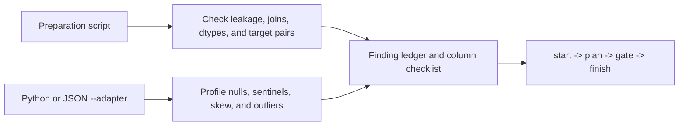

Run `xpd data-prep <paths>` to check Python data preparation code from raw ingestion through joins, imputation, train-test splits, and feature or target scaling. Add `--adapter` to profile the real columns and record every scaling and cleaning decision in a gated ledger.



## What xpd data-prep checks

| Group | Example finding kinds |
| --- | --- |
| Leakage | `fit-before-split`, `fit-on-test`, `cross-val-on-fitted-data`, `scaler-fit-before-split`, `prefit-before-cross-validation` |
| Joins and alignment | `merge-without-validate`, `polars-join-without-validate`, `merge-asof-unsorted`, `concat-columns-unchecked`, `join-key-unvalidated` |
| Target transforms | `transformed-target-pair`, `scaled-target-without-inverse` |
| Dtypes and missing values | `compare-to-missing`, `polars-null-comparison`, `nan-to-int`, `silent-dtype-coercion` |
| Pipeline shape | `stateful-function-transformer`, `read-parquet-all-columns`, `frame-column-write`, `no-inplace` |

## Write a column adapter

Commit a preparation script, a reproducible check command, and a small adapter file that returns the data the script reads. Declare `target` and `model_family` when you want scaling guidance tailored to the model family.

```python title="columns.py"
from pathlib import Path

model_family = "linear"
target = "sale_price"


def columns():
    return Path(__file__).with_name("sales.csv")
```

## Run a recorded review

1. Start the run from a clean commit with `xpd data-prep start prep.py --check "python prep.py" --adapter columns.py`.
2. Inspect findings and column questions with `xpd data-prep prep.py --adapter columns.py --format json`.
3. Review the pipeline graph and measured columns. Confirm what sentinels, nulls, outliers, and duplicate rows mean before transforming them, and choose a time or group split when rows depend on each other.
4. Record ordered fixes, accepted exceptions, and column answers with `xpd data-prep plan plan.json`. Each checklist answer pairs an `item` such as `amount/outlier-meaning` with a `verdict` (`pass`, `na`, or `accepted`) and a `reason`. Fixes addressing judgment items set `"goal": "design"` and cite their item IDs in `questions`.
5. Run `xpd data-prep approve <fix-id>` after approving an interface change, commit one fix, and verify it with `xpd data-prep gate <fix-id>`. Restore an abandoned edit before running `xpd data-prep drop <fix-id> --reason "<why>"`.
6. Resume across sessions with `xpd data-prep status`, and close the run with `xpd data-prep finish` once every fix, new finding, and checklist item is settled.

## Scaling guidance

Fit every scaler and imputer on training rows or inside a scikit-learn Pipeline.

| Measured distribution | Suggested transform |
| --- | --- |
| Heavy tails or high outlier share | `RobustScaler` |
| Right-skewed nonnegative target | `TransformedTargetRegressor` (check loss in original units) |
| Roughly symmetric numeric feature | `StandardScaler` |
| Pure tree pipeline (`model_family = "tree"`) | No scaling required |

See the [command reference](../../commands/data-prep/) for all adapter inputs, flags, and stage commands.
