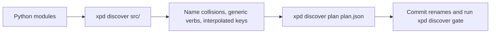

Run `xpd discover` to find public names defined in multiple modules, bare verb functions such as `load` or `clean`, error messages starting with interpolated values, and dynamic keys or imports that plain-text search misses.



## Survey discoverability findings

`xpd discover` inspects Python source statically and reports both mechanical findings and how many public names are uniquely defined across the scanned files.

```sh
xpd discover src/
xpd discover src/ --since main --format json
```

| Finding kind | What it catches |
| --- | --- |
| `name-collision` | Two or more modules define the same public function or class name |
| `generic-verb-name` | A public function is named only with a bare verb instead of a domain phrase |
| `vague-module-name` | A module uses a role name such as `utils`, `helpers`, or `config` |
| `module-private-name` | A module-level definition uses a leading underscore instead of `__all__` |
| `interpolated-key` | An event name, settings key, or module path is assembled with an f-string |
| `error-message-prefix` | An error message begins with a runtime value instead of searchable literal text |
| `deprecated-without-decorator` | A deprecation warns at runtime instead of using `@warnings.deprecated` |
| `id-without-newtype` | Multiple identifier parameters share plain `str` or `int` types that callers can swap |

## Run a recorded discover ledger

1. Start from a clean commit with `xpd discover start src/ --check "<project-check>"`.
2. Inspect findings and per-module checklist items with `xpd discover src/ --format json`.
3. Submit ordered rename fixes, accepted exceptions, and checklist answers with `xpd discover plan plan.json`.
4. Record interface approval with `xpd discover approve <fix-id>` when renaming public symbols, commit each rename, and verify with `xpd discover gate <fix-id>`.
5. Close the run with `xpd discover finish`.

See [`xpd discover`](../../commands/discover/) for every option and recorded stage.
