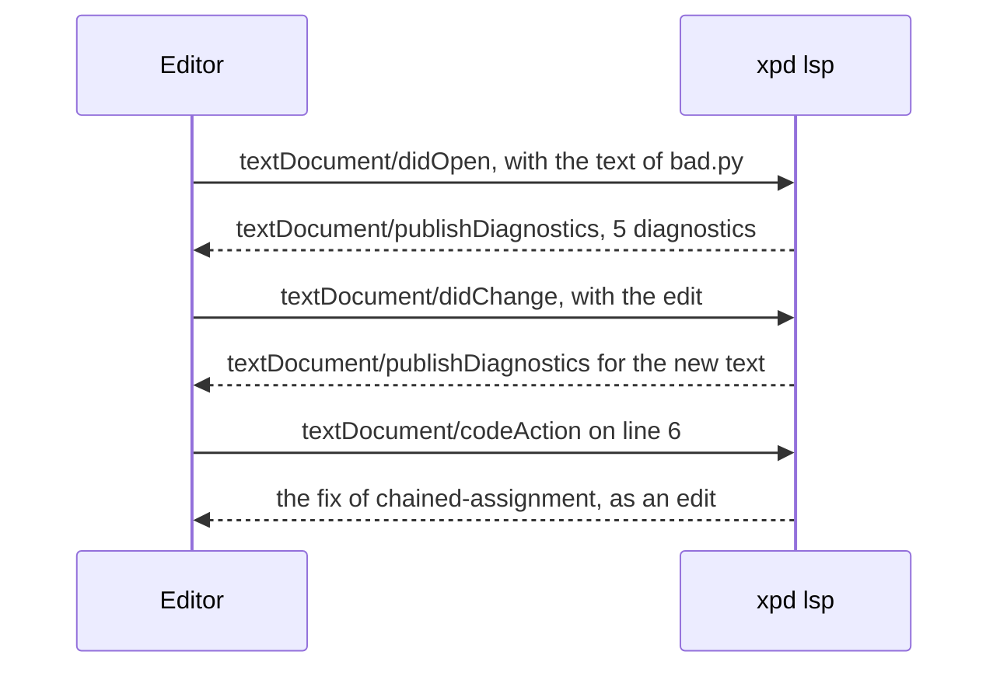

Configure your editor to start `xpd lsp`, and it shows xpd's issues while you type, offers each
fix as a quick fix, and shows the rule's explanation when you hover over an issue. The language
server is part of the xpd binary, so it needs no Python. It speaks the
[Language Server Protocol](https://microsoft.github.io/language-server-protocol/) (LSP) on stdin
and stdout.

## Set up an editor

Install xpd on `PATH`, as [Get started](../../#install) shows, and then add the configuration
for your editor.

| Editor | What starts xpd | Fix every issue in a file |
| --- | --- | --- |
| [Neovim 0.11 and later](#neovim) | `vim.lsp.config()` and `vim.lsp.enable()` | `vim.lsp.buf.code_action()` with `source.fixAll.xpd` |
| [Helix](#helix) | `languages.toml` | The code action menu |
| [Zed](#zed) | An extension of three files | The format action |
| [VS Code](#vs-code-and-editors-built-on-it) | The Generic LSP Client extension | `editor.codeActionsOnSave` |
| [Another editor](#another-editor) | Its own LSP client | `source.fixAll.xpd` |

### Neovim

Add the following to `init.lua` to start xpd for Python buffers in Neovim 0.11 and later.

```lua title="init.lua"
vim.lsp.config('xpd', {
  cmd = { 'xpd', 'lsp' },
  filetypes = { 'python' },
  root_markers = { 'pyproject.toml', '.git' },
  init_options = { unsafeFixes = false },
})
vim.lsp.enable('xpd')
```

`:checkhealth vim.lsp` then lists xpd under the enabled configurations. `K` shows the hover, and
`gra` opens the code actions. The command below applies every safe fix of the buffer.

```vim
:lua vim.lsp.buf.code_action({ context = { only = { 'source.fixAll.xpd' } }, apply = true })
```

Neovim doesn't watch files on Linux by default, so save a buffer to make xpd read changed project
rules. See [`:help lsp-quickstart`](https://neovim.io/doc/user/lsp/#lsp-quickstart).

### Helix

Add the server to `languages.toml` in your Helix configuration folder, or in `.helix/` in the
project. `language-servers` replaces the list that Helix ships for Python, so name the servers you
already use as well. Helix 25.07.1 ships `ty`, `ruff`, `jedi` and `pylsp` for Python.

```toml title="languages.toml"
[language-server.xpd]
command = "xpd"
args = ["lsp"]
config = { unsafeFixes = false }

[[language]]
name = "python"
language-servers = ["ty", "ruff", "jedi", "pylsp", "xpd"]
```

Helix shows the diagnostics and code actions of every server in the list. For a hover, it asks
only the first server in the list that supports hover, so put `xpd` first when you want the rule's
explanation on hover. See
[Languages](https://docs.helix-editor.com/languages.html#configuring-language-servers-for-a-language).

### Zed

Zed starts a language server only from an
[extension](https://zed.dev/docs/extensions/languages#language-servers), and xpd has no published
Zed extension. Write the three files below, and install the folder with the
`zed: install dev extension` action. Zed builds the extension with Rust from
[rustup](https://www.rust-lang.org/tools/install).

```text
xpd-zed/
├── extension.toml
├── Cargo.toml
└── src/lib.rs
```

```toml title="extension.toml"
id = "xpd"
name = "xpd"
version = "0.0.1"
schema_version = 1
authors = ["Your Name <you@example.com>"]
description = "Starts the xpd language server for Python files"
repository = "https://github.com/bjoernaagaard/xpd"

[language_servers.xpd]
name = "xpd"
languages = ["Python"]
```

```toml title="Cargo.toml"
[package]
name = "xpd-zed"
version = "0.0.1"
edition = "2021"

[lib]
crate-type = ["cdylib"]

[dependencies]
zed_extension_api = "0.7.0"
```

```rust title="src/lib.rs"
use zed_extension_api::{self as zed, settings::LspSettings, LanguageServerId, Result};

struct Xpd;

impl zed::Extension for Xpd {
    fn new() -> Self {
        Self
    }

    fn language_server_command(
        &mut self,
        _id: &LanguageServerId,
        worktree: &zed::Worktree,
    ) -> Result<zed::Command> {
        let command = worktree
            .which("xpd")
            .ok_or("xpd is not on PATH. Install it with: uv tool install xpd")?;
        Ok(zed::Command {
            command,
            args: vec!["lsp".into()],
            env: worktree.shell_env(),
        })
    }

    fn language_server_initialization_options(
        &mut self,
        id: &LanguageServerId,
        worktree: &zed::Worktree,
    ) -> Result<Option<zed::serde_json::Value>> {
        Ok(LspSettings::for_worktree(id.as_ref(), worktree)?.initialization_options)
    }
}

zed::register_extension!(Xpd);
```

Zed then starts xpd beside its other Python servers. The settings below pass `unsafeFixes` and
make the format action apply every safe fix. The `formatter` setting replaces the formatter you
have for Python, so to keep yours, give `formatter` a list with your formatter after the code
action, and Zed runs the list in order.

```json title="settings.json"
{
  "lsp": {
    "xpd": {
      "initialization_options": { "unsafeFixes": false }
    }
  },
  "languages": {
    "Python": {
      "formatter": { "code_action": "source.fixAll.xpd" }
    }
  }
}
```

See [Configuring languages](https://zed.dev/docs/configuring-languages).

### VS Code and editors built on it

xpd has no extension for VS Code, so install the
[Generic LSP Client](https://marketplace.visualstudio.com/items?itemName=llllvvuu.llllvvuu-glspc)
extension, which starts any language server from settings. Add the following to `settings.json`.

```json title="settings.json"
{
  "glspc.serverCommand": "xpd",
  "glspc.serverCommandArguments": ["lsp"],
  "glspc.languageId": "python",
  "glspc.initializationOptions": { "unsafeFixes": false },
  "editor.codeActionsOnSave": { "source.fixAll.xpd": "explicit" }
}
```

The `editor.codeActionsOnSave` line applies every safe fix when you save, so leave it out to apply
fixes by hand with the Quick Fix command. The extension starts one server, so it can't run xpd
beside another server that you also start through it. When VS Code doesn't find `xpd`, start VS
Code from a terminal that has `xpd` on `PATH`, or set `PATH` in `glspc.environmentVariables`.

### Another editor

Configure any other LSP client with the values below.

| Setting | Value |
| --- | --- |
| Command | `xpd lsp` |
| Transport | stdio |
| Languages | Python, and each language that a project rule names |
| Initialization options | `{"unsafeFixes": false}` |
| Exit code | 0 after `shutdown` and `exit`, and 1 when the client goes away without them |

## What the editor shows

The editor gets the issues that [`xpd check`](../../commands/check/) prints for the text in the
editor, saved or not, because the server lints with the same code and the same rules. When you
open `bad.py` from [Get started](../../#check-a-sample-file), the server sends five diagnostics.



The diagnostic for line 6 follows. Lines and characters count from 0, and `codeDescription` links
to the rule's page, which an editor can open from the code.

```json
{
  "code": "chained-assignment",
  "codeDescription": {
    "href": "https://bjoernaagaard.github.io/xpd/rules/pandas/chained-assignment/"
  },
  "message": "Chained assignment writes to a copy under copy-on-write, so the frame keeps its old values. Assign to df.loc[i, \"a\"] instead.",
  "range": {
    "end": { "character": 14, "line": 5 },
    "start": { "character": 4, "line": 5 }
  },
  "severity": 1,
  "source": "xpd"
}
```

`severity` is 1 for `error`, 2 for `warning`, 3 for `info` and 4 for `hint`. A
`# ast-grep-ignore: pandas/chained-assignment` comment turns the rule off for the next line in the
editor too, as it does for `xpd check`.

### Fixes as code actions

Use a quick fix to fix one issue, or the `source.fixAll.xpd` action to fix every issue in the
file. A safe fix keeps what the code does, so it is the preferred fix, and an editor's key for the
preferred fix applies it. An unsafe fix has a title that says it may change what the code does, so
read the code after you apply it.

| Title | Kind | When the server offers it |
| --- | --- | --- |
| `xpd: fix pandas/convert-then-drop-zone` | `quickfix`, preferred | The cursor touches an issue that has a safe fix |
| `xpd: fix pandas/chained-assignment (unsafe fix, may change behavior)` | `quickfix` | The cursor touches an issue that has an unsafe fix |
| `xpd: apply every safe fix` | `source.fixAll.xpd` | `unsafeFixes` is `false` and the file has a safe fix |
| `xpd: apply every fix, also unsafe ones that may change behavior` | `source.fixAll.xpd` | `unsafeFixes` is `true` and the file has a fix |

### Rule help on hover

Hover over an issue to read the explanation of its rule, which is the text of the rule's page,
with a link to the page at the end. For a rule of your project, the hover shows the rule's `note`,
or its `message` when it has no note.

## Files that run cell by cell

An editor such as VS Code, Spyder or PyCharm runs a `.py` file cell by cell in an interactive
window when the file has cell markers. xpd reads such a file as any other `.py` file, and it
knows the markers `# %%`, `# <codecell>` and `# In[1]:`. Four things differ in a file with a
marker.

| Rule | In a file with a cell marker |
| --- | --- |
| [`python/import-side-effect`](../../rules/python/import-side-effect/) | Leaves the file alone, because the file is run and never imported |
| [`numpy/result-discarded`](../../rules/numpy/result-discarded/) | Leaves the last statement of each cell alone, because the window shows its value |
| [`pandas/filter-ladder`](../../rules/pandas/filter-ladder/), [`pandas/reassign-ladder`](../../rules/pandas/reassign-ladder/) and [`pandas/frame-column-write`](../../rules/pandas/frame-column-write/) | A marker ends a run of statements, so one step in each cell is not reported |
| [`pandas/script-steps`](../../rules/pandas/script-steps/) | Leaves the file alone |

A cell can hold an IPython magic line, such as `%matplotlib inline`, `%%time` or `!pip list`.
xpd reports the issues around such a line and offers their fixes, and a fix leaves the line as
it is. The body of a cell that is not Python, as under `%%bash`, still takes the fixes away from
the file. [`xpd equiv`](../../commands/equiv/) runs a file with Python itself, so it reports a
magic line as `raised SyntaxError`.

xpd does not read a Jupyter notebook. `xpd check notebook.ipynb` says so and exits with 2. Write
the notebook as a `.py` file with markers, as `jupytext --to py:percent notebook.ipynb` does, and
check that file.

## Settings

The server has one setting. Set `unsafeFixes` to `true` to make the `source.fixAll.xpd` action
apply unsafe fixes too, as `xpd check --fix --unsafe-fixes` does. The default is `false`.

| The client sends it in | Form | An invalid value shows |
| --- | --- | --- |
| `initializationOptions` | `{"unsafeFixes": true}` or `{"xpd": {"unsafeFixes": true}}` | A warning, and the setting keeps its value |
| `workspace/didChangeConfiguration` | The same form, as `settings` | An error |

## The project, its rules and its virtual environment

The server finds the project and its virtual environment as `xpd check` does when you run it in the
project folder, so it skips a rule for a newer library version than the one installed.

```text
project of a file
├── inside a workspace folder    that folder, or the innermost one when folders nest
└── otherwise                    the folder the file is in

virtual environment of a project
├── VIRTUAL_ENV is set for the server    that environment
└── otherwise                            the nearest .venv in or above the project folder
```

Save a file after `uv add` or `uv sync`, because the server reads the virtual environment again
each time a file opens or is saved. A project with an `sgconfig.yml` gets its own rules in the
editor, from the same files that `xpd check` reads. The server reads them again when a file of the
project opens or is saved, and when a YAML file changes and the client watches files for the
server. When the new rules have an error, it keeps the last rules that loaded and shows the error
on the rule file.

A lint of a long file can take seconds, so the server lints only the newest text of a file. When
several edits arrive while a lint runs, it applies all of them and lints once more.

## What the server leaves out

The server offers only what `xpd check` has data for, and xpd reads one file at a time without
following names, types or imports across files.

| Not offered | Why |
| --- | --- |
| Completion, go to definition, references, rename, symbols, signature help | xpd does not resolve names |
| Formatting | xpd has no formatter. Use Ruff |
| The findings of [`xpd graph`](../../commands/graph/) | They come from another command |
| Jupyter notebooks | `xpd check` reads `.py` files. See [Files that run cell by cell](#files-that-run-cell-by-cell) |
| Settings that pick rules, as `--rule` and `--severity` do | The server runs every rule. Use a `# ast-grep-ignore` comment to turn one rule off on one line |

Any other request gets the error `MethodNotFound`, -32601, with a message such as
`xpd does not answer textDocument/completion`.
