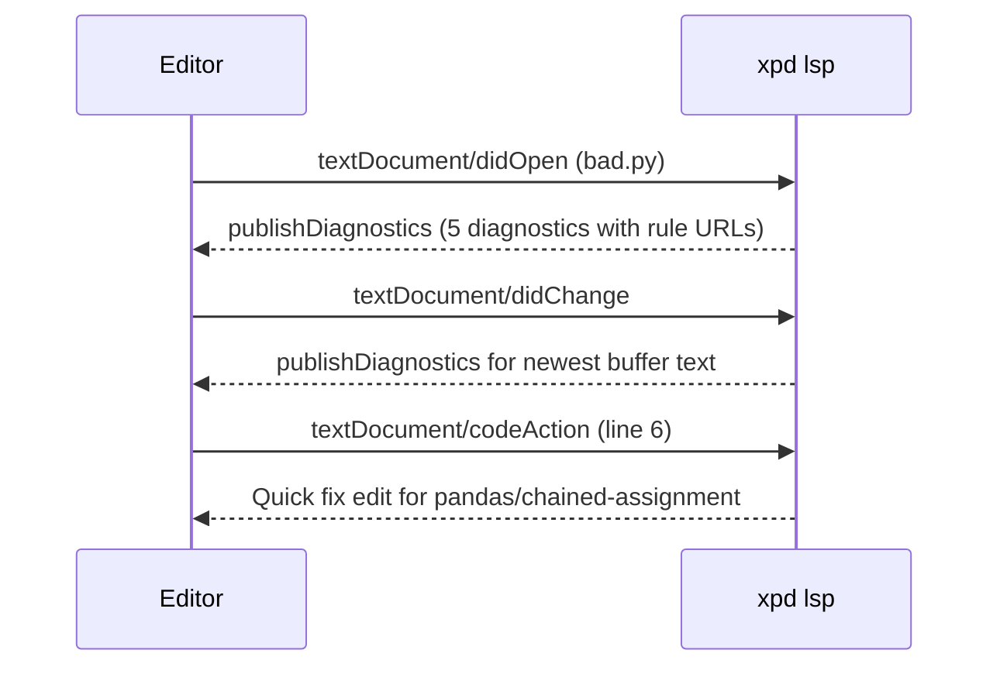

Point your editor's LSP client at `xpd lsp` to receive diagnostics, quick fixes, and rule documentation on hover as you type. `xpd lsp` runs inside the compiled Rust binary over stdio and needs no Python runtime.



## Set up an editor

Install `xpd` on `PATH` as [Get started](../../#install) shows, then configure your editor.

| Editor | Launcher | Fix all safe issues |
| --- | --- | --- |
| [Neovim 0.11+](#neovim) | `vim.lsp.config()` and `vim.lsp.enable()` | `vim.lsp.buf.code_action()` with `source.fixAll.xpd` |
| [Helix](#helix) | `languages.toml` | Code action menu |
| [Zed](#zed) | Three-file dev extension | Format action |
| [VS Code](#vs-code-and-editors-built-on-it) | Generic LSP Client extension | `editor.codeActionsOnSave` |
| [Another editor](#another-editor) | Any stdio LSP client | `source.fixAll.xpd` |

### Neovim

Add the block below to `init.lua` for Neovim 0.11 or newer. Use `K` for hover help, `gra` for quick fixes, and save buffers after editing project rules on Linux.

```lua title="init.lua"
vim.lsp.config('xpd', {
  cmd = { 'xpd', 'lsp' },
  filetypes = { 'python' },
  root_markers = { 'pyproject.toml', '.git' },
  init_options = { unsafeFixes = false },
})
vim.lsp.enable('xpd')
```

```vim
:lua vim.lsp.buf.code_action({ context = { only = { 'source.fixAll.xpd' } }, apply = true })
```

### Helix

Add `xpd` to `languages.toml` (global or `.helix/`). Keep your existing Python servers in `language-servers`, and place `xpd` first if you want `xpd` hover docs to win.

```toml title="languages.toml"
[language-server.xpd]
command = "xpd"
args = ["lsp"]
config = { unsafeFixes = false }

[[language]]
name = "python"
language-servers = ["ty", "ruff", "jedi", "pylsp", "xpd"]
```

### Zed

Create a local extension folder with three files and install it via `zed: install dev extension` (requires `rustup`).

```text
xpd-zed/
├── extension.toml
├── Cargo.toml
└── src/lib.rs
```

```toml title="extension.toml"
id = "xpd"
name = "xpd"
version = "0.0.1"
schema_version = 1
authors = ["Your Name <you@example.com>"]
description = "Starts the xpd language server for Python files"
repository = "https://github.com/bjoernaagaard/xpd"

[language_servers.xpd]
name = "xpd"
languages = ["Python"]
```

```toml title="Cargo.toml"
[package]
name = "xpd-zed"
version = "0.0.1"
edition = "2021"

[lib]
crate-type = ["cdylib"]

[dependencies]
zed_extension_api = "0.7.0"
```

```rust title="src/lib.rs"
use zed_extension_api::{self as zed, settings::LspSettings, LanguageServerId, Result};

struct Xpd;

impl zed::Extension for Xpd {
    fn new() -> Self {
        Self
    }

    fn language_server_command(
        &mut self,
        _id: &LanguageServerId,
        worktree: &zed::Worktree,
    ) -> Result<zed::Command> {
        let command = worktree
            .which("xpd")
            .ok_or("xpd is not on PATH. Install it with: uv tool install xpd")?;
        Ok(zed::Command {
            command,
            args: vec!["lsp".into()],
            env: worktree.shell_env(),
        })
    }

    fn language_server_initialization_options(
        &mut self,
        id: &LanguageServerId,
        worktree: &zed::Worktree,
    ) -> Result<Option<zed::serde_json::Value>> {
        Ok(LspSettings::for_worktree(id.as_ref(), worktree)?.initialization_options)
    }
}

zed::register_extension!(Xpd);
```

Enable fix-on-format in Zed `settings.json` (put your existing Python formatter after the code action if you want both).

```json title="settings.json"
{
  "lsp": {
    "xpd": {
      "initialization_options": { "unsafeFixes": false }
    }
  },
  "languages": {
    "Python": {
      "formatter": { "code_action": "source.fixAll.xpd" }
    }
  }
}
```

### VS Code and editors built on it

Install the [Generic LSP Client](https://marketplace.visualstudio.com/items?itemName=llllvvuu.llllvvuu-glspc) extension and add the settings below to `settings.json`.

```json title="settings.json"
{
  "glspc.serverCommand": "xpd",
  "glspc.serverCommandArguments": ["lsp"],
  "glspc.languageId": "python",
  "glspc.initializationOptions": { "unsafeFixes": false },
  "editor.codeActionsOnSave": { "source.fixAll.xpd": "explicit" }
}
```

### Another editor

| Setting | Value |
| --- | --- |
| Command | `xpd lsp` over stdio |
| Languages | Python and every language named in project rules |
| Settings | `{"unsafeFixes": false}` (or `{"xpd": {"unsafeFixes": true}}`) |
| Exit code | `0` after `shutdown` and `exit`, `1` on unexpected disconnect |

## Code actions, hover, and cell files

`xpd lsp` runs the same rules as [`xpd check`](../../commands/check/), respects `# ast-grep-ignore: <pack>/<rule>`, and links every diagnostic `codeDescription` to its rule page. Hover over any diagnostic to read the rule documentation inline.

| Code action | Kind | Offered when |
| --- | --- | --- |
| `xpd: fix <pack>/<rule>` | `quickfix` (preferred) | Cursor is on an issue with a safe fix |
| `xpd: fix <pack>/<rule> (unsafe fix, may change behavior)` | `quickfix` | Cursor is on an issue with an unsafe fix |
| `xpd: apply every safe fix` | `source.fixAll.xpd` | `unsafeFixes` is `false` and safe fixes exist |
| `xpd: apply every fix, also unsafe ones that may change behavior` | `source.fixAll.xpd` | `unsafeFixes` is `true` and fixes exist |

### Files that run cell by cell

`xpd` recognizes interactive cell markers (`# %%`, `# <codecell>`, and `# In[1]:`) and adjusts script-oriented rules automatically. Convert `.ipynb` notebooks to percent scripts with `jupytext --to py:percent notebook.ipynb` before checking.

| Rule | Behavior in cell files |
| --- | --- |
| [`python/import-side-effect`](../../rules/python/import-side-effect/) and [`pandas/script-steps`](../../rules/pandas/script-steps/) | Skipped |
| [`numpy/result-discarded`](../../rules/numpy/result-discarded/) | Ignores the final expression of each cell |
| [`pandas/filter-ladder`](../../rules/pandas/filter-ladder/), [`pandas/reassign-ladder`](../../rules/pandas/reassign-ladder/), [`pandas/frame-column-write`](../../rules/pandas/frame-column-write/) | Cell markers reset statement runs |

## Workspace resolution and scope

```text
workspace and venv lookup
├── project root     innermost workspace folder, else the file's directory
├── virtual env      VIRTUAL_ENV, else nearest .venv (re-read on open and save)
└── project rules    sgconfig.yml and xpd.yml (re-read on open, save, and YAML change)
```

| Not provided by `xpd lsp` | Reason |
| --- | --- |
| Completion, go-to-definition, rename, references | `xpd` lints syntax without cross-file type resolution |
| Formatting | Use Ruff |
| Dataflow issues from [`xpd graph`](../../commands/graph/) | Separate command |
| Per-rule enable flags | Run all rules and silence individual lines with `# ast-grep-ignore` |
