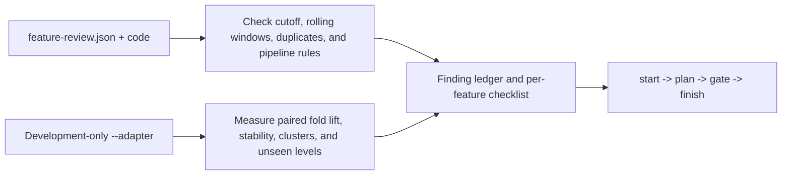

Run `xpd feature-review <paths>` to verify how each candidate model feature relates to the target, prove it is available at the prediction cutoff, and measure paired ablation lift across development folds without touching the holdout set.



## What xpd feature-review checks

| Group | Example finding kinds |
| --- | --- |
| Cutoff and folds | `encode-before-split`, `fit-before-split`, `scaler-fit-before-split`, `target-encoder-before-outer-cv`, `rolling-includes-current`, `rolling-crosses-groups`, `transform-with-test-target` |
| Computation | `duplicate-feature-computation`, `node-mutates-input`, `frame-column-write`, `nan-into-pipeline`, `zero-regularization` |
| Pipeline | `cols-left-to-dtype`, `named-cols-after-array-step`, `stateful-function-transformer`, `unseeded-random-estimator`, `score-on-training-rows` |

## Declare features in a manifest

Commit `feature-review.json` at the repository root to declare the target, prediction cutoff, development snapshot, holdout boundary, baseline columns, and every candidate feature or deferred hypothesis.

```json title="feature-review.json"
{
  "target": "price",
  "prediction_cutoff": "11:00 UTC on the day before delivery",
  "development": {"snapshot": "training-2025", "holdout": "delivery year 2026"},
  "baseline": ["hour"],
  "inputs": {"hour": "Delivery hour", "load": "Load forecast", "wind": "Wind forecast"},
  "features": [
    {"id": "residual", "name": "Residual load", "kind": "feature",
     "owner": "features.py", "node": "residual_load", "column": "residual_load"}
  ]
}
```

## Run a recorded review

1. Research each feature's domain mechanism from primary sources and verify input publication and revision times against `prediction_cutoff`.
2. Commit the manifest, feature modules, and a development-only adapter defining `review()`, then run `xpd feature-review start --adapter adapter.py --check "git diff --check"`.
3. Inspect findings, lineage, and fold measurements with `xpd feature-review --format json`. Use `xpd graph` to check node dependencies and `xpd equiv` when rewiring code that should preserve results.
4. Review paired fold ablation scores alongside stability, correlation clusters, and unseen validation levels. Keep low-lift features only with a source-backed domain reason tied to measured lift, and record unimplemented hypotheses with their deferral reason.
5. Record fixes, accepted findings, and checklist verdicts with `xpd feature-review plan plan.json`. Approve interface changes with `xpd feature-review approve <fix>`, commit one fix, and verify it with `xpd feature-review gate <fix>`. A kept gate reopens checklist answers whose measured evidence changed.
6. Restore an abandoned edit before `xpd feature-review drop <fix> --reason "<reason>"`, resume with `xpd feature-review status`, and close the ledger with `xpd feature-review finish`.

Inspect the built-in five-question catalog at any time:

```console
$ xpd feature-review --questions --format json | jq -c '[.questions[].id] | sort'
["availability","lineage","mechanism","regimes","value"]
```

See the [command reference](../../commands/feature-review/) for the full manifest and adapter contracts.
