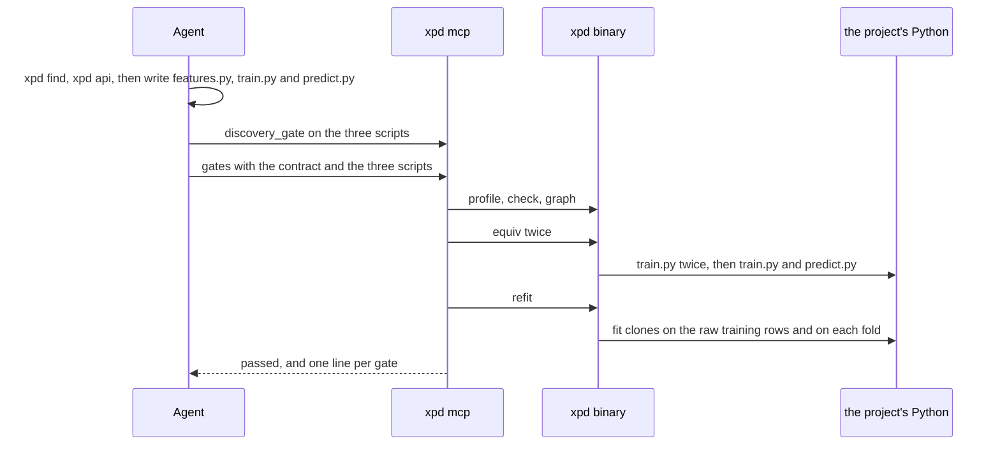

An agent can train, check and save a scikit-learn model from a data file, and one call to the
`gates` tool of xpd's MCP server then says whether the run is done, with one line of evidence for
each check. On this page you run the sample project in `samples/pipeline/` of the xpd repository,
which passes every gate.

`gates` runs the stages itself, so the agent passes it the names of four files and no result of
its own.



## Before you start

You need a checkout of the xpd repository, xpd installed as a Python package, and a Python
environment with pandas and scikit-learn for the project's scripts. `gates` runs the
scripts with the Python of `VIRTUAL_ENV`, or else with the Python of the nearest `.venv`.

```sh
git clone https://github.com/bjoernaagaard/xpd
cd xpd
uv tool install xpd
uv venv /tmp/penguins
uv pip install --python /tmp/penguins pandas scikit-learn fastmcp
export VIRTUAL_ENV=/tmp/penguins
```

The sample holds the scripts that an agent writes before it calls `gates`, and the training
script writes the model and its contract.

```text
samples/pipeline/
├── penguins.csv      the raw rows, 344 penguins with nulls in five columns
├── discovery.json    the library choice, which train.py copies into the contract
├── features.py       two feature steps, as step code that graph reads
├── train.py          the split, one Pipeline, cross-validation, the saved model and its contract
├── predict.py        loads the saved model and gives the class probabilities of the held out rows
├── leaky.py          train.py with one leak
└── model/            what train.py writes, which Git ignores
```

Run the training script once, so the model and the contract exist.

```sh
cd samples/pipeline && $VIRTUAL_ENV/bin/python train.py && cd ../..
```

The table is the [Palmer penguins](https://github.com/allisonhorst/palmerpenguins) data, under the
CC0 license.

## Run the gates in one call

The `build_pipeline` prompt takes `data`, `target` and an optional `task`, and it tells the agent
how to work.

1. The agent runs `xpd find` with the task and `xpd api` on each candidate, and it chooses one
   and states the reason. It runs `xpd profile` on the data file, and it writes `features.py`,
   `train.py` and `predict.py`. It asks you before it adds a library to the project.
2. It calls `discovery_gate` with the three scripts and the record of its choice.
3. It calls `gates` with the contract, the three scripts and the result of `discovery_gate`.
4. It is done when `gates` returns `passed: true`. For a gate that fails, it reads the gate's
   `detail`, fixes the scripts and calls `gates` again, and it never edits the contract by hand.

The client below plays the agent's part for steps 2 and 3. Save it as `run_gates.py` and run it
from the root of the repository with `$VIRTUAL_ENV/bin/python run_gates.py`. FastMCP's stdio
client passes on only a few environment variables, so the client passes `VIRTUAL_ENV` to the
server itself.

```python title="run_gates.py"
import asyncio
import json
import sys
from pathlib import Path

from fastmcp import Client
from fastmcp.client.transports import StdioTransport

ROOT = Path("samples/pipeline")
SCRIPTS = {"train": "train.py", "predict": "predict.py", "features": "features.py"}


async def main() -> None:
    server = StdioTransport(
        "xpd", ["mcp", "--root", str(ROOT)], env={"VIRTUAL_ENV": sys.prefix}
    )
    async with Client(server) as client:
        discovery = await client.call_tool(
            "discovery_gate",
            {
                "paths": list(SCRIPTS.values()),
                "discovery": json.loads((ROOT / "discovery.json").read_text()),
            },
        )
        report = await client.call_tool(
            "gates",
            {
                "contract": "model/contract.json",
                "scripts": SCRIPTS,
                "discovery": discovery.structured_content,
            },
        )
        print(json.dumps(report.structured_content, indent=2))


asyncio.run(main())
```

On `samples/pipeline/`, the run returns `passed: true` and 15 gates, each with its `name`,
`passed` and `detail`.

## The stages

Each stage of a run hands one result of a fixed shape to the next, and the training script
writes most of them into one JSON file, the contract. The [`contract`](../../mcp/tools/contract/)
tool reads the contract and refuses one that lacks a required field.

| Stage | What it hands on | Where it comes from |
| --- | --- | --- |
| Discovery | The task, the candidates the agent read, and the choice with its reason | `xpd find`, `xpd api` and the agent |
| Raw data | The file, the target column and the row count | The contract |
| Profile | Each column's dtype, nulls and distinct values | `xpd profile`, which `gates` runs |
| Split | The seed, the share held out, and the rows on each side | The contract |
| Preprocessing | The raw columns the model takes, and each step of the one Pipeline | The contract |
| Model | The last step of the Pipeline | The contract |
| Validation | The splitter, one score per fold, and one score for the held out rows | The contract |
| Proof | What `discovery_gate` found, and what `xpd check`, `graph`, `equiv` and `refit` print | `discovery_gate`, and the commands that `gates` runs |
| Saved model | The model file, the class of the saved object, the versions that wrote it and the code files it imports | The contract |

`xpd refit` repeats the training on the raw rows that the contract names and compares the results
exactly, so the training script must save its scores without rounding. For the sample, it fits a
clone of the saved Pipeline on the 258 training rows and on each of 5 folds, and the held out
scores were 0.9883720930232558 in the contract and in the refit.

`predict.py` loads the model in a new Python process and gives the probability of each species
for the 86 held out rows. The most likely species was right for 85 of them, and the first three
rows, rounded to four places, follow.

```text
     Adelie  Chinstrap  Gentoo
298  0.0461     0.9531  0.0008
157  0.0002     0.0045  0.9954
137  0.9884     0.0113  0.0003
```

`predict.py` compares the input columns, the scikit-learn version and the code files with the
contract, and it stops before it loads the model when one of them differs. Without
`features.py`, it raises `FileNotFoundError: The model imports ['features.py'], and no such file is here.`

## Discovery before the run

The run stops before any project code runs when the scripts call the chosen library with a name or
keyword that xpd's index doesn't know. The agent records its choice in a discovery record, and
[`discovery_gate`](../../mcp/tools/discovery_gate/) checks the calls in the scripts against it.

```text
discovery
├── question     the task in plain words
├── candidates   symbols, rules and recipes, each as xpd api --format json printed it
└── choice       the name of one candidate, the reason, and the symbols the code must call

discovery_gate(paths, discovery)
  fail unless choice.name is one of the candidates
  for each direct call into a module of a chosen symbol, such as sklearn.linear_model
    fail when api doesn't know the name as a callable
    fail on a keyword that is not one of its indexed parameters, and on ** arguments
  fail when a chosen symbol has no direct call
```

The gate reads the source and runs nothing, so it can't see instance methods, names that Python
resolves at run time, or whether the library is installed. The training script saves the same
record in the contract from `discovery.json`. After the agent makes a new choice, it saves the new
record in `discovery.json` and runs `train.py` again, or the gate `discovery-is-recorded` fails.

## The gates

A run is done when every gate passes. [`gates`](../../mcp/tools/gates/) runs the commands and
judges what they print: the profiled data, the seeded split, the input columns and feature
dataflow, a single scikit-learn `Pipeline`, zero lint errors, cross-validation scores,
reproducibility, raw-training refit agreement, saved-model prediction equivalence and recorded
versions. When the contract or the call holds a discovery record, it also checks the indexed API
calls and that the discovery choice matches the contract. See [`gates`](../../mcp/tools/gates/)
for the live tool description and schema.

## A leak fails a gate

A training script with a leak that one of xpd's rules reports fails the gate
`check-reports-no-error`. To see it, set `"train": "leaky.py"` in `run_gates.py`. `leaky.py` tries
four strengths of regularization and keeps the one with the best score on the held out rows. The
run returned `passed: false`, and the gate named the rule.

```text
check-reports-no-error
leaky.py:74 sklearn/tune-on-test.
```

`xpd api sklearn/tune-on-test` explains the rule. Run `train.py` again afterwards, so the model
and the contract are those of `train.py`.

## What the gates don't check

A passed report proves only what the gates check. Read the table before you rely on a run.

| Limit | What happens |
| --- | --- |
| `discovery_gate` runs before `gates` | Nothing checks that a file changed after `discovery_gate` read it |
| No gate judges the score | A model no better than guessing passes |
| The model file is a joblib pickle | Loading it runs code, so load only a file you wrote |
| The contract describes one file and one random split | It has no place for groups, a split by time, or data from several files |
| No time limit applies to a `gates` call | A training script that hangs keeps `gates` open |
| A leak under another name | `tune-on-test` knows the held out rows by a name with `test` in it, so the same loop over `X_hold` passes |
| The scripts run in the project root | The server's root must be the folder of the scripts, because `train.py` reads `penguins.csv` by a relative path |
