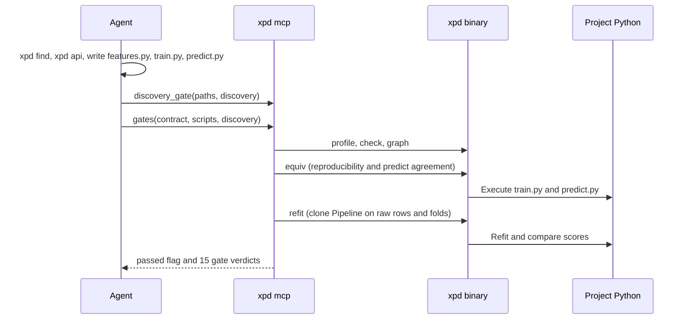

Call `discovery_gate` and `gates` over `xpd mcp` to verify a scikit-learn pipeline against 15 automated checks covering API validity, linting, dataflow, cross-validation, reproducibility, raw-row refit agreement, and saved-model equivalence. Each check runs the real project scripts and returns one pass or fail line of evidence.



## Run the sample pipeline

Clone the repository, prepare a Python environment with pandas and scikit-learn, and run `samples/pipeline/train.py` once to write `model/contract.json`. `gates` uses `VIRTUAL_ENV` or the nearest `.venv`.

```sh
git clone https://github.com/bjoernaagaard/xpd
cd xpd
uv tool install xpd
uv venv /tmp/penguins
uv pip install --python /tmp/penguins pandas scikit-learn fastmcp
export VIRTUAL_ENV=/tmp/penguins
(cd samples/pipeline && $VIRTUAL_ENV/bin/python train.py)
```

```text
samples/pipeline/
├── penguins.csv      344 rows with nulls in five columns (Palmer penguins, CC0)
├── discovery.json    indexed library choice copied into model/contract.json
├── features.py       two feature steps traced by xpd graph
├── train.py          split, Pipeline, cross-validation, saved model, and contract
├── predict.py        verifies contract metadata and scores held-out rows
├── leaky.py          train.py variant with a test-set tuning leak
└── model/            generated model pickle and contract.json
```

Run `discovery_gate` and `gates` against the sample using FastMCP's stdio client. Save `run_gates.py` at the repository root and run `$VIRTUAL_ENV/bin/python run_gates.py`.

```python title="run_gates.py"
import asyncio
import json
import sys
from pathlib import Path

from fastmcp import Client
from fastmcp.client.transports import StdioTransport

ROOT = Path("samples/pipeline")
SCRIPTS = {"train": "train.py", "predict": "predict.py", "features": "features.py"}


async def main() -> None:
    server = StdioTransport(
        "xpd", ["mcp", "--root", str(ROOT)], env={"VIRTUAL_ENV": sys.prefix}
    )
    async with Client(server) as client:
        discovery = await client.call_tool(
            "discovery_gate",
            {
                "paths": list(SCRIPTS.values()),
                "discovery": json.loads((ROOT / "discovery.json").read_text()),
            },
        )
        report = await client.call_tool(
            "gates",
            {
                "contract": "model/contract.json",
                "scripts": SCRIPTS,
                "discovery": discovery.structured_content,
            },
        )
        print(json.dumps(report.structured_content, indent=2))


asyncio.run(main())
```

On `samples/pipeline/`, `gates` returns `passed: true` with 15 passing gate records. Swap `"train": "leaky.py"` in `SCRIPTS` to watch `check-reports-no-error` fail on `leaky.py:74 sklearn/tune-on-test`.

## Pipeline contract stages

The `build_pipeline` prompt instructs an agent to record its library choice in `discovery.json`, write `features.py`, `train.py`, and `predict.py`, and fix any failing gate without hand-editing `model/contract.json`.

| Stage | Checked artifact | Verified by |
| --- | --- | --- |
| Discovery | Task, indexed candidates, chosen symbols | [`discovery_gate`](../../mcp/tools/discovery_gate/) (static AST call check) |
| Data and profile | File path, target column, row count, dtypes, nulls | `xpd profile` and [`contract`](../../mcp/tools/contract/) |
| Split and preprocessing | Seed, holdout share, raw columns, single `Pipeline` | `xpd graph` and `contract` |
| Lint and leaks | Zero lint errors across all three scripts | `xpd check` |
| Validation and refit | Fold scores, exact unrounded holdout score, raw-row refit match | `xpd refit` |
| Reproducibility and serving | Deterministic reruns and `predict.py` agreement with `train.py` | `xpd equiv` |

See [`gates`](../../mcp/tools/gates/) for the full tool schema.

## Known limits

| Limit | Impact |
| --- | --- |
| `discovery_gate` runs before `gates` | Edits made between the two calls are not re-checked by `discovery_gate` |
| Score quality is not judged | A weak model with no leaks still passes |
| Model artifact is a joblib pickle | Load only artifacts generated by code you trust |
| Single file and random split contract | Grouped splits, time-series splits, and multi-file joins are outside the schema |
| No execution timeout on `gates` | A hanging training script keeps the tool call open |
| Heuristic holdout naming | `sklearn/tune-on-test` detects variables containing `test` and misses custom names like `X_hold` |
| Relative data paths | Set `--root` to the folder that holds the scripts and data file |
