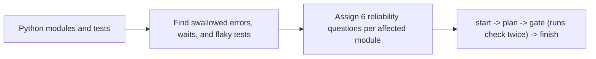

Run `xpd harden <paths>` to find silent failures, fixed waits, retries, and unreliable tests across a Python repository, and prove every fix against a recorded reliability checklist and determinism gate.



## What xpd harden checks

| Group | Finding kinds | What it catches |
| --- | --- | --- |
| Silent failure and reliability errors | `swallowed-exception`, `rule-issue` | Bare or empty exception handlers and error-severity lint findings |
| Fixed waits and retries | `sleep-or-retry` | `time.sleep`, `asyncio.sleep`, and retry wrappers hiding timing bugs |
| Disabled or unreliable tests | `disabled-test`, `flaky-test` | Skipped tests, test sleeps, reruns, suppressed health checks, and mock imports |

Each module with a finding, including test files, receives six reliability checklist items. Run `xpd harden --questions` to inspect the catalog. At every gate, `xpd` runs the first `--check` command twice and verifies that both exit status and stdout SHA-256 digest match.

## Walkthrough on a failing module

Save a module that hides invalid input behind `except ValueError: pass`, start a recorded run, fix it, and close the ledger.

```python title="loader.py"
def load_count(raw):
    try:
        return int(raw)
    except ValueError:
        pass
```

```console
$ git init -q && git add loader.py && git -c user.name=xpd -c user.email=xpd@example.com -c commit.gpgsign=false commit -qm start
$ xpd harden start loader.py --check "python3 -m py_compile loader.py" --format json | jq -c '{findings: .run.was, next: .next.stage}'
{"findings":1,"next":"plan"}
$ xpd harden loader.py --format json | jq -c '{kinds: [.findings[].kind], items: (.checklist | length)}'
{"kinds":["swallowed-exception"],"items":6}
$ printf '%s\n' '{"fixes":[{"id":"propagate","title":"Propagate invalid input","goal":"design","questions":["loader.py/fails-loudly"]}]}' | xpd harden plan - --format json | jq -c .next.stage
"fix"
$ sed -i 's/        pass/        raise/' loader.py && git -c user.name=xpd -c user.email=xpd@example.com -c commit.gpgsign=false commit -qam "Propagate invalid input"
$ xpd harden gate propagate --format json | jq -c '.run.answered["loader.py/fails-loudly"].verdict'
"fixed"
$ xpd harden finish --format json | jq -c .run.finished
xpd: 1 findings at the start, 0 now: 1 fixed, 0 added, 0 left without a reason; lines 5 -> 5
true
```

## Run stages

1. Start from a clean commit with `xpd harden start . --check "<project-check>"`.
2. List finding IDs and checklist items with `xpd harden . --format json`.
3. Record fixes, accepted findings, and checklist answers (`pass`, `na`, or `accepted`) with `xpd harden plan plan.json`.
4. Approve interface changes with `xpd harden approve <fix-id>`, commit one fix, and run `xpd harden gate <fix-id>`.
5. Restore an abandoned edit before `xpd harden drop <fix-id> --reason "<why>"`, check `xpd harden status` after a break, and close the run with `xpd harden finish`.

See the [command reference](../../commands/harden/) for every flag and subcommand.
