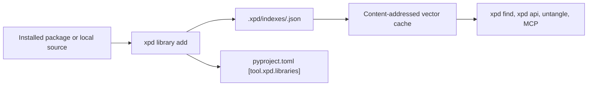

Run `xpd library add <package>` to parse any installed third-party or internal Python package into a project-local index under `[tool.xpd.libraries]` without importing or executing that library. Once added, `xpd find`, `xpd api`, `xpd hook`, `xpd untangle`, and MCP `discovery_gate` search your project libraries alongside xpd's bundled indexes.



## Add, list, and remove project libraries

Add a package from your project's active virtual environment or pass an explicit `--source` folder for an uninstalled checkout.

```sh
xpd library add pydantic
xpd library add my_internal_pkg --source ../my-internal-pkg/src
xpd library list
```

`xpd library add` parses signatures, defaults, docstrings, and defining module paths (`defined_in`) using Griffe, writes `.xpd/indexes/<package>.json`, records the entry under `[tool.xpd.libraries]` in `pyproject.toml`, and caches embeddings in `$XDG_CACHE_HOME/xpd/indexes/` keyed by content hash so unchanged symbols never re-embed.

```toml title="pyproject.toml"
[tool.xpd.libraries]
pydantic = ".xpd/indexes/pydantic.json"
my_internal_pkg = ".xpd/indexes/my_internal_pkg.json"
```

Remove a library index when a project drops the dependency.

```sh
xpd library remove pydantic
```

## Search and inspect indexed symbols

After indexing a package, search it with `xpd find` using hybrid semantic and keyword ranking, or inspect exact parameter defaults with `xpd api`.

```sh
xpd find --package pydantic "validate model fields from json"
xpd api pydantic.BaseModel.model_validate_json
```

| Command | Effect |
| --- | --- |
| [`xpd library add`](../../commands/library/add/) | Parse a package, write its JSON index, and register it in `pyproject.toml` |
| [`xpd library list`](../../commands/library/list/) | Show configured `[tool.xpd.libraries]` entries, versions, and cached vector counts |
| [`xpd library remove`](../../commands/library/remove/) | Remove an entry from `[tool.xpd.libraries]` and optionally delete its index file |
| [`xpd find`](../../commands/find/) | Search bundled and project libraries together using cached EmbeddingGemma vectors |
| [`xpd api`](../../commands/api/) | Print exact parameter annotations, defaults, members, and guarding rules |
