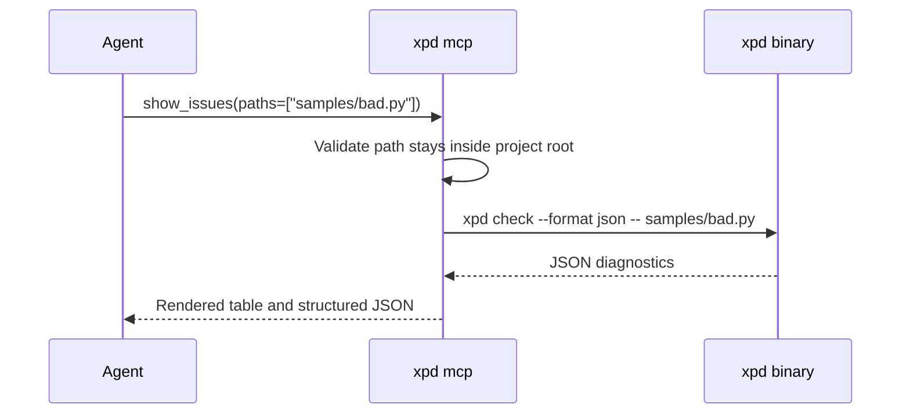

Run `claude mcp add xpd -- uvx xpd mcp` to expose xpd's 14 MCP tools for visual tables, module maps, ledger views, model training gates, and Manim animations. Standard lint and search commands stay in the agent's shell, and the server delegates every tool call to the matching `xpd` binary.



## Connect a client

Add the server to Claude Code with one command (requires [uv](https://docs.astral.sh/uv/)).

```sh
claude mcp add xpd -- uvx xpd mcp
```

For any other MCP client, add the same launcher under `mcpServers`.

```json
{
  "mcpServers": {
    "xpd": {
      "command": "uvx",
      "args": ["xpd", "mcp"]
    }
  }
}
```

Use `uvx xpd mcp` or `uv tool install xpd`. A binary compiled directly with `cargo` ships no Python runtime and exits with `2` on `xpd mcp`.

## Available tools

Browse schemas and live examples in the [MCP reference](../../mcp/).

| Tool group | Tools | Built on |
| --- | --- | --- |
| Visual views | [`show_issues`](../../mcp/tools/show_issues/), [`show_dataflow`](../../mcp/tools/show_dataflow/), [`show_columns`](../../mcp/tools/show_columns/), [`show_map`](../../mcp/tools/show_map/), [`show_ledger`](../../mcp/tools/show_ledger/) | `xpd check`, `xpd graph`, `xpd profile`, `xpd untangle --map`, and all 10 ledgers |
| Model gates | [`discovery_gate`](../../mcp/tools/discovery_gate/), [`contract`](../../mcp/tools/contract/), [`gates`](../../mcp/tools/gates/) | `xpd api`, `profile`, `check`, `graph`, `equiv`, `refit` |
| Animations | [`animate_status`](../../mcp/tools/animate_status/), [`animate_guide`](../../mcp/tools/animate_guide/), [`animate_catalog`](../../mcp/tools/animate_catalog/), [`animate_render`](../../mcp/tools/animate_render/), [`animate_artifact`](../../mcp/tools/animate_artifact/), [`animate_source`](../../mcp/tools/animate_source/) | `xpd animate` |

The server also serves five workflow [prompts](../../mcp/prompts/) and rule and skill [resources](../../mcp/resources/).

## Project root and security

Every file path passed to a tool must stay inside the resolved project root.

```text
project root resolution
├── --root or XPD_MCP_ROOT is set    use that folder
├── PLUGIN_ROOT is set               use the client's first local root from MCP roots
└── otherwise                        use the server's starting working directory
```

When running over HTTP, set a server-side root and pass `--allow-writes` if you want to expose `gates`. Binding a non-loopback `--host` requires `XPD_MCP_AUTH_TOKEN` for bearer authentication.

| Flag | Environment variable | Default | Effect |
| --- | --- | --- | --- |
| `--root PATH` | `XPD_MCP_ROOT` | Working directory or client root | Sets the project root boundary |
| `--allow-writes` | `XPD_MCP_ALLOW_WRITES=1` | On over stdio, off over HTTP | Enables `gates` over HTTP (`--no-allow-writes` disables) |
| None | `XPD_MCP_AUTH_TOKEN` | Unset | Bearer token for HTTP clients, required on non-loopback hosts |
| `--transport stdio\|http` | `FASTMCP_TRANSPORT` | `stdio` | Selects stdio or streamable HTTP transport |
| `--host HOST` | `FASTMCP_HOST` | `127.0.0.1` | HTTP bind address |
| `--port PORT` | `FASTMCP_PORT` | `8000` | HTTP bind port |

## Serve over HTTP or test from a shell

```sh
# Streamable HTTP at http://127.0.0.1:8000/mcp
uvx xpd mcp --transport http --port 8000

# Inspect tools, resources, and prompts from a terminal
uvx fastmcp list --command 'uvx xpd mcp' --resources --prompts
uvx fastmcp call --command 'uvx xpd mcp' --target contract --input-json '{"file": "model/contract.json"}'
```
