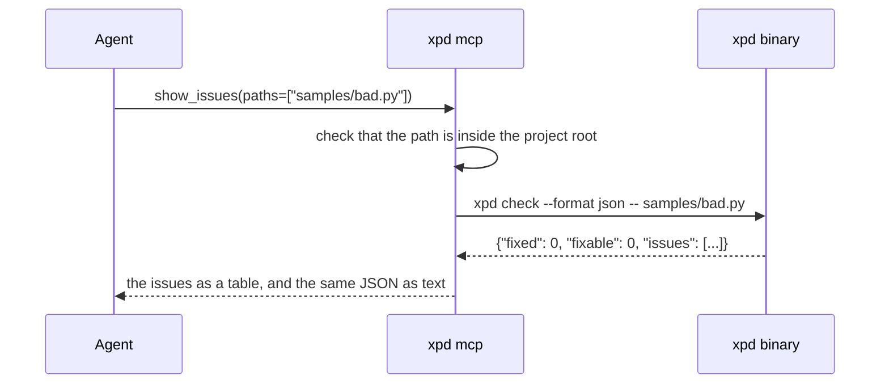

Run `claude mcp add xpd -- uvx xpd mcp`, and Claude Code gets the 11 tools of xpd that a shell
command cannot be: the views that draw results, the gates of a model run, and the animation
tools. The agent runs every other part of xpd, such as `xpd check` and `xpd find`, in its shell,
and the server's instructions name those commands. The server speaks the
[Model Context Protocol](https://modelcontextprotocol.io) (MCP), and it takes every rule and every
result from the xpd binary of the same install, so it matches the version you run. The
[MCP reference](../../mcp/) lists each tool, resource and prompt.

## Add the server to a client

The server needs [uv](https://docs.astral.sh/uv/), which downloads xpd and its Python packages the
first time `uvx` runs. Add the server to Claude Code with the following command.

```sh
claude mcp add xpd -- uvx xpd mcp
```

`claude mcp list` then shows the server as connected.

```text
$ claude mcp list
xpd: uvx xpd mcp - ✔ Connected
```

For another client, add the server to the client's `mcpServers` setting.

```json
{
  "mcpServers": {
    "xpd": {
      "command": "uvx",
      "args": ["xpd", "mcp"]
    }
  }
}
```

`xpd mcp` starts the server with the Python that the xpd package installed, so it works after
`uv tool install xpd` or `uvx xpd`. A binary that you build with `cargo` has no Python beside it,
and its `xpd mcp` prints `Run it as: uvx xpd mcp` and exits with 2.

For Manim recipes, local rendering, and revising a saved scene from MCP, see
[Animate a concept with Manim](../animate/).

## Choose the project root

Every path that a tool takes is relative to the project root, and the server refuses a path
outside it. Set `--root` or `XPD_MCP_ROOT` when your client starts servers in another folder than
the project.

```text
project root of a call
├── --root or XPD_MCP_ROOT is set    that folder
├── PLUGIN_ROOT is set               the first root of the client that is a folder on this machine
└── otherwise                        the folder the server started in
```

Claude Code and Codex start the server of the [plugin](../claude-code/#agent-plugin) in the
project's folder. A client that starts it in the plugin's folder sets `PLUGIN_ROOT`, and the
server then asks the client on each call for its
[roots](https://modelcontextprotocol.io/specification/2025-06-18/client/roots), the folders that
the client shares with servers. When none of them is a folder on the machine, a tool fails with a
message that names `--root` and `XPD_MCP_ROOT`.

## What the server adds to the commands

A tool runs the xpd binary in the project root and returns its JSON as a typed result, or draws
it.

| Tools | What they do | The command they build on |
| --- | --- | --- |
| [`show_issues`](../../mcp/tools/show_issues/), [`show_dataflow`](../../mcp/tools/show_dataflow/), [`show_columns`](../../mcp/tools/show_columns/) | Draw a table or a chart in a host that renders MCP Apps | `xpd check`, `xpd graph`, `xpd profile` |
| [`discovery_gate`](../../mcp/tools/discovery_gate/), [`contract`](../../mcp/tools/contract/), [`gates`](../../mcp/tools/gates/) | Judge a run from a data file to a saved model, as [Train a model with gates](../gates/) shows | `xpd api`, `profile`, `check`, `graph`, `equiv`, `refit` |
| The five `animate_` tools | Render and inspect a Manim scene, as [Animate a concept with Manim](../animate/) shows | `xpd animate` |



The server also gives the agent five [prompts](../../mcp/prompts/), each with the steps of one
workflow and the commands to run, and the [resources](../../mcp/resources/) that hold the rules
and the skills.

## Settings

Each flag of the server has an environment variable, for clients that start the server without
flags. Set the variables in the `env` setting of the client, because a client may not pass on the
variables of your shell.

| Flag | Environment | Default | Effect |
| --- | --- | --- | --- |
| `--root PATH` | `XPD_MCP_ROOT` | The folder the server started in, or the client's first root for a plugin | The project root |
| `--allow-writes` | `XPD_MCP_ALLOW_WRITES=1` | Off over HTTP, on over stdio | Exposes `gates`, which runs the project's scripts, over HTTP |
| — | `XPD_MCP_AUTH_TOKEN` | Unset | Bearer token for HTTP clients; required when binding HTTP to a non-loopback `--host` |
| `--transport stdio\|http` | `FASTMCP_TRANSPORT` | `stdio` | How clients connect |
| `--host HOST` | `FASTMCP_HOST` | `127.0.0.1` | The address to listen on for HTTP |
| `--port PORT` | `FASTMCP_PORT` | `8000` | The port for HTTP |

`XPD_MCP_ALLOW_WRITES` also takes `true`, `yes` and `on`, and `--no-allow-writes` turns the flag
off again. [`xpd mcp`](../../commands/mcp/)
prints the same list with `xpd mcp -h`.

## Serve several clients over HTTP

Start the server over HTTP to serve several clients, or a client on another machine.

```sh
uvx xpd mcp --transport http --port 8000
```

Clients then connect to `http://127.0.0.1:8000/mcp`. Over HTTP, the server requires a
server-selected project root (`--root`, `XPD_MCP_ROOT`, or the starting working directory) and
leaves out `gates` unless `--allow-writes` or `XPD_MCP_ALLOW_WRITES=1` is set. Binding a
non-loopback `--host` requires `XPD_MCP_AUTH_TOKEN` for bearer authentication.

## Call the server from a terminal

FastMCP's own client commands start `xpd mcp` and call it, which helps when you write a prompt or
check a result.

```sh
uvx fastmcp list --command 'uvx xpd mcp' --resources --prompts
uvx fastmcp call --command 'uvx xpd mcp' --target contract --input-json '{"file": "model/contract.json"}'
```
