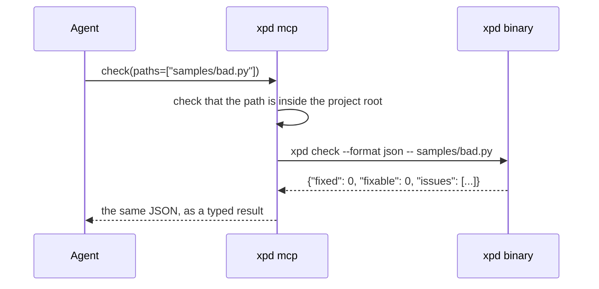

Run `claude mcp add xpd -- uvx xpd mcp`, and Claude Code can call xpd's tools, such as `check`,
`fix`, `find` and `equiv`, without a shell. The server speaks the
[Model Context Protocol](https://modelcontextprotocol.io) (MCP), and it takes every rule and every
result from the xpd binary of the same install, so it matches the version you run. The
[MCP reference](../../mcp/) lists each tool, resource and prompt.

## Add the server to a client

The server needs [uv](https://docs.astral.sh/uv/), which downloads xpd and its Python packages the
first time `uvx` runs. Add the server to Claude Code with the following command.

```sh
claude mcp add xpd -- uvx xpd mcp
```

`claude mcp list` then shows the server as connected.

```text
$ claude mcp list
xpd: uvx xpd mcp - ✔ Connected
```

For another client, add the server to the client's `mcpServers` setting.

```json
{
  "mcpServers": {
    "xpd": {
      "command": "uvx",
      "args": ["xpd", "mcp"]
    }
  }
}
```

`xpd mcp` starts the server with the Python that the xpd package installed, so it works after
`uv tool install xpd` or `uvx xpd`. A binary that you build with `cargo` has no Python beside it,
and its `xpd mcp` prints `Run it as: uvx xpd mcp` and exits with 2.

For Manim recipes, local rendering, and revising a saved scene from MCP, see
[Animate a concept with Manim](../animate/).

## Choose the project root

Every path that a tool takes is relative to the project root, and the server refuses a path
outside it. Set `--root` or `XPD_MCP_ROOT` when your client starts servers in another folder than
the project.

```text
project root of a call
├── --root or XPD_MCP_ROOT is set    that folder
├── PLUGIN_ROOT is set               the first root of the client that is a folder on this machine
└── otherwise                        the folder the server started in
```

Claude Code and Codex start the server of the [plugin](../claude-code/#agent-plugin) in the
project's folder. A client that starts it in the plugin's folder sets `PLUGIN_ROOT`, and the
server then asks the client on each call for its
[roots](https://modelcontextprotocol.io/specification/2025-06-18/client/roots), the folders that
the client shares with servers. When none of them is a folder on the machine, a tool fails with a
message that names `--root` and `XPD_MCP_ROOT`.

## Lint and fix through the tools

A tool call runs the xpd binary in the project root and returns its JSON as a typed result. For
example, `check` with `paths` set to `["samples/bad.py"]` runs `xpd check` and returns the five
issues of the sample.



Each issue in the result has the fields below.

```json
{
  "package": "pandas",
  "rule": "merge-without-validate",
  "file": "samples/bad.py",
  "line": 8,
  "column": 5,
  "severity": "warning",
  "message": "merge without validate= can silently duplicate rows.",
  "fix": null
}
```

[`fix`](../../mcp/tools/fix/) writes the safe fixes. With `unsafe` set to `true`, it first asks
the user, through the client, whether it may write the fixes that may change what the code does.
When the user declines, it writes only the safe fixes. [`rewrite`](../../mcp/tools/rewrite/) asks
the same way before it writes a structural replacement.

The `lint_and_fix` prompt gives the agent the whole loop. The agent lints, fixes, and lints again
until only warnings it can explain are left. The [prompts](../../mcp/prompts/) page lists the
other four prompts.

## Look up a library before writing code

Have the agent call `find` with the task in plain words, and then `api` with a name that `find`
returned. Both read the index inside the xpd binary, so they work for a library that the project
hasn't installed.

```text
find(task="time series bootstrap for cross validation")
  returns up to 5 symbols, 3 rules and 3 recipes, each kind ranked on its own
api(name="mapie.subsample.BlockBootstrap")
  returns the parameters as the source writes them, the summary, the members
  and the rules that guard the name
```

The first `find` on a machine downloads the 333 MB model that ranks entries by meaning, so it can
take a few minutes. [`xpd find`](../../commands/find/) says where the model is saved.

## Settings

Each flag of the server has an environment variable, for clients that start the server without
flags. Set the variables in the `env` setting of the client, because a client may not pass on the
variables of your shell.

| Flag | Environment | Default | Effect |
| --- | --- | --- | --- |
| `--root PATH` | `XPD_MCP_ROOT` | The folder the server started in, or the client's first root for a plugin | The project root |
| `--code-mode` | `XPD_MCP_CODE_MODE=1` | Off | Lists FastMCP's `search`, `get_schema` and `execute` in place of xpd's tools, as [code mode](../code-mode/) shows |
| `--allow-writes` | `XPD_MCP_ALLOW_WRITES=1` | Off over HTTP, on over stdio | Exposes file-writing and code-executing tools (`fix`, `rewrite`, `new`, `test`, `refit`, `equiv`) over HTTP |
| — | `XPD_MCP_AUTH_TOKEN` | Unset | Bearer token for HTTP clients; required when binding HTTP to a non-loopback `--host` |
| `--transport stdio\|http` | `FASTMCP_TRANSPORT` | `stdio` | How clients connect |
| `--host HOST` | `FASTMCP_HOST` | `127.0.0.1` | The address to listen on for HTTP |
| `--port PORT` | `FASTMCP_PORT` | `8000` | The port for HTTP |

`XPD_MCP_CODE_MODE` and `XPD_MCP_ALLOW_WRITES` also take `true`, `yes` and `on`, and
`--no-code-mode` or `--no-allow-writes` turns each flag off again. [`xpd mcp`](../../commands/mcp/)
prints the same list with `xpd mcp -h`.

Code mode is not available on Windows on Arm, because pydantic-monty, which runs it, has no
wheel for that platform. There `xpd mcp --code-mode` stops with a message that says so.

## Serve several clients over HTTP

Start the server over HTTP to serve several clients, or a client on another machine.

```sh
uvx xpd mcp --transport http --port 8000
```

Clients then connect to `http://127.0.0.1:8000/mcp`. Over HTTP, the server requires a
server-selected project root (`--root`, `XPD_MCP_ROOT`, or the starting working directory) and
exposes read-only tools unless `--allow-writes` or `XPD_MCP_ALLOW_WRITES=1` is set. Binding a
non-loopback `--host` requires `XPD_MCP_AUTH_TOKEN` for bearer authentication.

## Call the server from a terminal

FastMCP's own client commands start `xpd mcp` and call it, which helps when you write a prompt or
check a result.

```sh
uvx fastmcp list --command 'uvx xpd mcp' --resources --prompts
uvx fastmcp call --command 'uvx xpd mcp' --target rule --input-json '{"package": "pandas", "rule": "row-loop"}'
```
