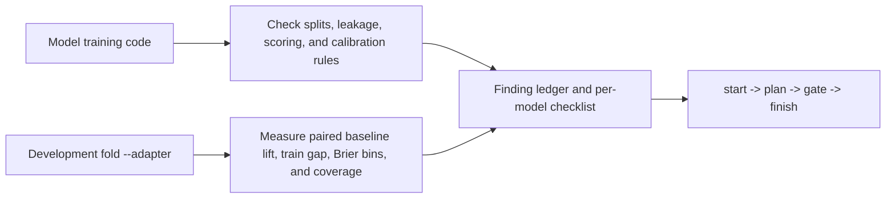

Run `xpd model-review <paths>` before trusting a reported model score. It finds named scikit-learn models, MAPIE wrappers, LightGBM, and XGBoost estimators, measures paired development folds against a naive baseline, and records every validation and calibration judgment in a gated ledger.



## What xpd model-review checks

| Group | Finding kinds |
| --- | --- |
| Validation and selection | `split-mismatch`, `test-set-tuning`, `validation-leakage`, `validation-reproducibility`, `boosting-validation` |
| Comparisons and metrics | `baseline-not-observed`, `metric-loss-mismatch`, `metric-response` |
| Calibration | `conformal-leakage`, `conformal-configuration` |

Inspect the eight-question catalog at any time:

```console
$ xpd model-review --questions --format json | jq -c '[.questions[].id]'
["validation-scheme","baseline","metric-and-loss","selection","probability-calibration","interval-coverage","first-failure","pipeline-evidence"]
```

## Run a recorded review

1. Decide which rows represent the deployment population, which inputs are available at prediction time, and which failures hurt first. Run `xpd model-review <paths> --limit 0 --format json` to read named models, findings, and checklist IDs.
2. Write a [fold adapter](../../commands/model-review/#adapter) with the real split, scorer, naive baseline, and any group or time metadata. Keep the final test holdout outside the adapter, and score the model and baseline on identical validation rows.
3. Commit the model code and adapter, then run `xpd model-review start <paths> --adapter adapter.py --check "git diff --check"` and `xpd model-review <paths> --adapter adapter.py --format json`. Inspect per-fold scores, paired baseline lift, train-to-validation gaps, reliability-bin support, and conformal coverage.
4. Record fixes, accepted findings, and checklist verdicts with `xpd model-review plan plan.json`. Approve interface changes with `xpd model-review approve <fix>`, commit one fix, and run `xpd model-review gate <fix>`. Restore the last kept commit before `xpd model-review drop <fix> --reason "<reason>"`.
5. Resume with `xpd model-review status`, record any remaining answers with `xpd model-review plan -`, and close with `xpd model-review finish`. A finished review records what was verified while leaving deployment to the owner.

## Related proofs

Use `xpd profile` for raw data, `xpd graph` for feature paths, and `xpd check`, `xpd rules`, `xpd find`, and `xpd api` for code and library rules. For a compatible saved pipeline, run [the MCP gates](../gates/) at the reviewed commit and cite the verdicts under `pipeline-evidence`, or use `xpd refit model/contract.json` when only saved-model agreement applies.

See the [command reference](../../commands/model-review/) for the full adapter contract, recorded walkthrough, and exit codes.
