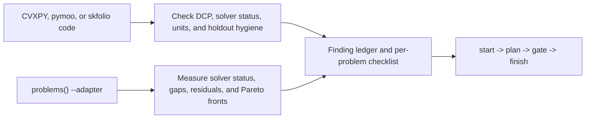

Run `xpd opt-review <paths>` to check CVXPY, pymoo, and skfolio formulations, inspect real solver statuses and residuals, catch portfolio holdout leakage, and gate changes against project tolerances.



## What xpd opt-review checks

| Group | Finding kinds | What it catches |
| --- | --- | --- |
| Formulation | `non-dcp-problem`, `constraint-unit-mismatch` | Non-DCP CVXPY expressions and mismatched constraint units |
| Solving | `unchecked-solver-status` | Reading `problem.value` without checking `problem.status` |
| Portfolio validation | `fit-on-holdout` | Fitting a skfolio estimator on holdout returns |
| Pack rules | `pack-rule` | Built-in `cvxpy`, `pymoo`, and `skfolio` pack findings |

## Measure an actual solution

In a Git project, save a small CVXPY problem as `solve.py`.

```python title="solve.py"
import cvxpy as cp


def build():
    x = cp.Variable()
    problem = cp.Problem(cp.Minimize(cp.abs(x)), [x >= 1])
    return problem


if __name__ == "__main__":
    problem = build()
    problem.solve(solver="SCS", eps_abs=1e-8, eps_rel=1e-8)
    assert problem.status == cp.OPTIMAL
    assert abs(problem.value - 1) < 1e-6
    assert problem.constraints[0].violation() < 1e-6
```

Copy the problem ID from `xpd opt-review solve.py --format json | jq -r '.read.problems[0].id'` into `adapter.py`.

```python title="adapter.py"
from solve import build


def problems():
    return {
        "<problem-id>": {
            "library": "cvxpy",
            "problem": build(),
            "solve_kwargs": {"solver": "SCS", "eps_abs": 1e-8, "eps_rel": 1e-8},
        },
    }
```

The adapter reports the solver status and measured facts for the problem.

```console
$ git init -q
$ python solve.py
$ sed -i "s/<problem-id>/$(xpd opt-review solve.py --format json | jq -r '.read.problems[0].id')/" adapter.py
$ xpd opt-review solve.py --adapter adapter.py --format json | jq -r '.read.facts.problems[0].facts["solver-status"].value.status'
optimal
```

The example check uses tight tolerances for a small fixture. Choose tolerances and fallback behavior that fit the real decision.

## Record and finish

1. Commit the project files and start the ledger with `xpd opt-review start solve.py --check "python solve.py" --adapter adapter.py`.
2. List again with the same paths and adapter, then run `xpd opt-review plan plan.json` with ordered fixes, accepted findings, and checklist verdicts with reasons.
3. Run `xpd opt-review approve <fix>` for approved interface changes, commit one fix, and verify it with `xpd opt-review gate <fix>`.
4. Resume across sessions with `xpd opt-review status`. To abandon a fix, restore the last kept commit and run `xpd opt-review drop <fix> --reason "<reason>"`.
5. Update any revised answers with `xpd opt-review plan -` and close the run with `xpd opt-review finish`.

See the [command reference](../../commands/opt-review/) for all library adapter schemas, flags, and stage commands.
