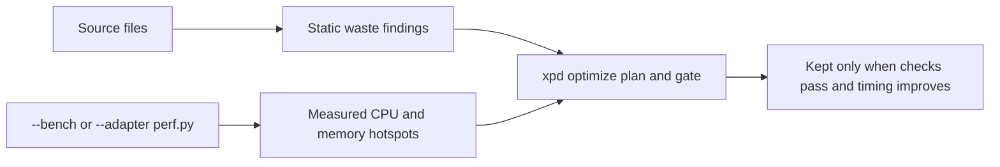

Run `xpd optimize` to find repeated calls, loop-invariant work, linear scans, and oversized intermediates, then prove each speedup against real project workloads with `--bench` and profiler adapters.



## Survey static waste and measure hotspots

Run a static scan first to locate mechanical performance waste without executing code.

```sh
xpd optimize src/
xpd optimize src/ --since HEAD~1 --format json
```

Add `--bench` to time a representative command at `start` and at every `gate`, or pass `--adapter perf.py` (defining `workloads()` returning named zero-argument callables) so functions consuming at least 5 percent of workload CPU time enter the performance checklist automatically.

| Input | What it measures |
| --- | --- |
| Static survey | `rule-issue`, `repeated-call`, `repeated-mask`, `loop-invariant-call`, `matrix-reduced`, `materialized-for-one`, `linear-scan-in-loop` |
| `--bench "<command>"` | Median, minimum, and maximum wall-clock duration across commits on the same machine class |
| `--adapter perf.py` | Per-function CPU share, call counts, and peak memory bytes for hotspot checklist items |

## Run a recorded optimize ledger

1. Start from a clean commit with `xpd optimize start src/ --check "<project-check>" --bench "<workload>"`.
2. Inspect findings and hotspots with `xpd optimize src/ --format json`, or view the active ledger in MCP with [`show_ledger`](../../mcp/tools/show_ledger/).
3. Write `plan.json` citing finding IDs or fix goals (`faster`, `both`, or `design`) and submit it with `xpd optimize plan plan.json`.
4. Commit one optimization at a time and gate it with `xpd optimize gate <fix-id>`. For data pipeline rewrites, confirm identical output with `xpd equiv`.
5. Close the run with `xpd optimize finish` once every fix and checklist item is settled.

See [`xpd optimize`](../../commands/optimize/) for all flags and adapter schemas.
