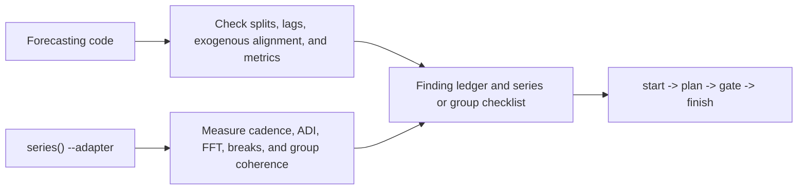

Run `xpd ts-review <paths>` to inspect time series cadence, intermittency, seasonal drivers, regime breaks, and group coherence before fitting a forecasting model. Add `--adapter` to measure each series and compare candidate pooling or hierarchy groups.



## What xpd ts-review checks

| Group | Example finding kinds |
| --- | --- |
| Evaluation | `random-time-split`, `mape-on-intermittent`, `mase-without-train-df`, `intervals-without-calibration`, `unscaled-returns` |
| Lags and exogenous features | `ungrouped-lag`, `missing-future-exog`, `mintrace-without-insample`, `fitted-values-without-fitted`, `indptr-missing-zero` |
| Grouping and identity | `not-a-time-series`, `incoherent-group`, `time-before-entity-index`, `panel-ols-without-effects`, `clustered-without-clusters` |

## Static check on a sample script

Running `xpd ts-review` without an adapter flags static forecasting mistakes directly from source.

```console
$ xpd ts-review samples/tsreview/faults.py --format json | jq -c '[.findings[].kind]'
["random-time-split","mape-on-intermittent","ungrouped-lag","missing-future-exog"]
```

## Write a series adapter and run the review

Define `series()` in a Python adapter file returning a pandas or Polars DataFrame (or file path) with `unique_id`, `ds`, `y`, and candidate metadata columns.

```python title="series.py"
from pathlib import Path


def series():
    return Path(__file__).with_name("demand.parquet")
```

1. Start the run from a clean commit with `xpd ts-review start forecast.py --check "python -m py_compile forecast.py" --adapter series.py`.
2. Inspect findings and per-series measurements with `xpd ts-review forecast.py --adapter series.py --format json`.
3. Check cadence, missing or duplicate timestamps, ADI and CV squared intermittency, seasonal periods, phase alignment, and structural breaks before picking a model family.
4. Compare metadata eta squared, silhouette scores, and cluster assignments to decide whether each series belongs in an independent model, a pooled global model, or a reconciled hierarchy.
5. Record fixes, accepted findings, and checklist verdicts (`pass`, `na`, or `accepted`) with `xpd ts-review plan plan.json`. Drop any seasonal period with fewer than two observed cycles and record `na` with that reason.
6. Approve interface changes with `xpd ts-review approve <fix-id>`, commit one fix, and run `xpd ts-review gate <fix-id>`. Restore an abandoned edit before `xpd ts-review drop <fix-id> --reason "<why>"`, resume with `xpd ts-review status`, and close with `xpd ts-review finish`.

See the [command reference](../../commands/ts-review/) for adapter options, hierarchy declarations, and all stage commands.
