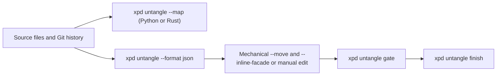

Run `xpd untangle` to find code that changes together in separate files, needless module links, and dead weight using source files and Git history without running project code.



## Map module coupling and health

Print a Mermaid coupling map for any Python package or Rust crate directory, or pass `--format json` to inspect nodes, directed edges, import cycles, orphans, and hidden co-change links.

```sh
xpd untangle src/ --map
xpd untangle src/ --map --format json
```

When connected over MCP, agents can render the same graph interactively with [`show_map`](../../mcp/tools/show_map/). In an editor running `xpd lsp`, workspace-level structural findings such as `untangle/import-cycle`, `untangle/orphaned-module`, `untangle/facade-module`, `untangle/single-use-module`, `untangle/mixed-responsibilities`, and `untangle/shared-state` appear as `HINT` diagnostics.

## Preview and apply mechanical Python refactors

Use `--move` to relocate a Python module and rewrite every importing caller, or `--inline-facade` to collapse a re-export shim directly onto its defining modules. Both flags print a unified diff in dry-run mode first and validate every edited file with `libcst` before writing when `--apply` is passed.

```sh
xpd untangle --move pkg/old_module.py pkg/new_module.py
xpd untangle --move pkg/old_module.py pkg/new_module.py --apply

xpd untangle --inline-facade pkg/compat_shim.py
xpd untangle --inline-facade pkg/compat_shim.py --apply
```

## Run a recorded untangle ledger

Record structural cleanups in a Duroxide ledger so every commit must pass your checks and lower or settle findings.

| Stage | Command | Purpose |
| --- | --- | --- |
| Start | `xpd untangle start src/ --check "<cmd>"` | Record the baseline commit, paths, and project checks |
| Survey | `xpd untangle src/ --format json` | Read stable finding IDs and six structural checklist items per module |
| Plan | `xpd untangle plan plan.json` | Register ordered fixes (`shorter` or `design`), accepted findings, and checklist verdicts |
| Gate | `xpd untangle gate <fix-id>` | Verify checks pass, findings do not regress, and goal constraints hold |
| Finish | `xpd untangle finish` | Confirm every open fix, new finding, and checklist item is settled |

See [`xpd untangle`](../../commands/untangle/) for every finding kind and stage command.
