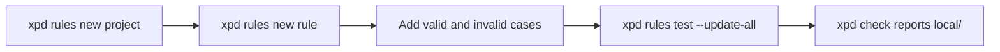
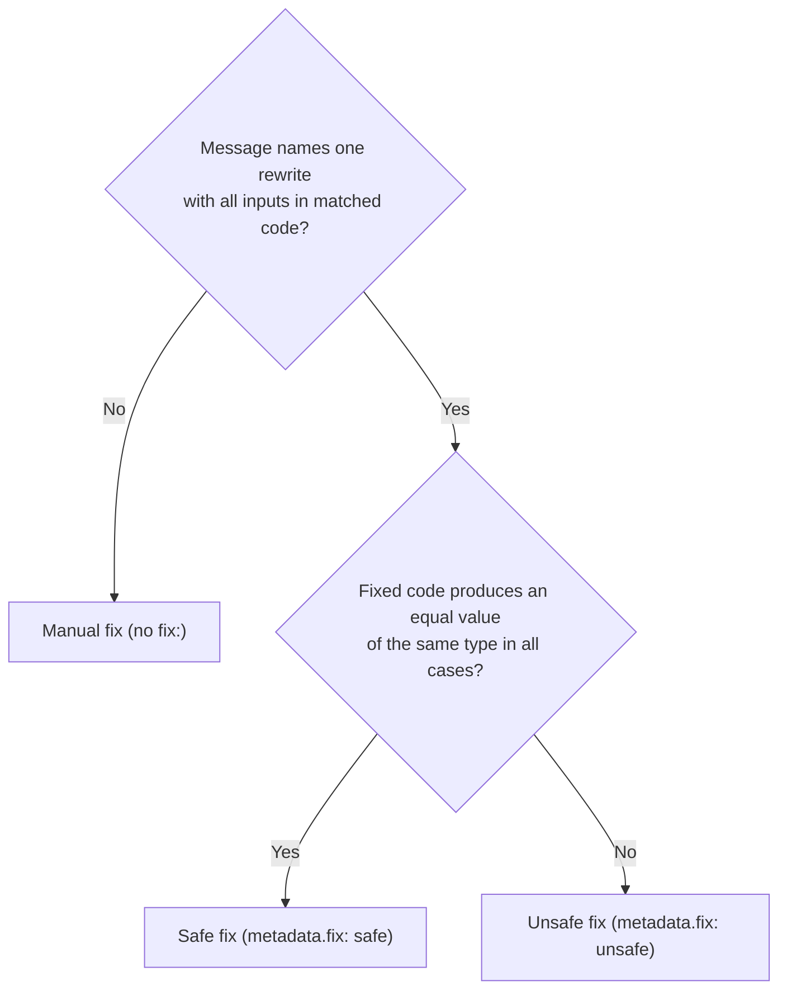

Run `xpd rules new project` and `xpd rules new rule` to turn any code pattern into a tested lint rule that runs in `xpd check`, `xpd lsp`, and `xpd hook`. Every rule is an [ast-grep](https://ast-grep.github.io/guide/rule-config.html) YAML file paired with a Markdown explanation.



## Create and test a project rule

Initialize the rule folders, scaffold a `no-print` rule, and check `app.py`.

```console
$ xpd rules new project --yes
Created project
  created  /tmp/project/sgconfig.yml
  created  /tmp/project/xpd.yml
  created  /tmp/project/rules/.gitkeep
  created  /tmp/project/rule-tests/.gitkeep
  created  /tmp/project/utils/.gitkeep
$ xpd rules new rule no-print --language python --pattern 'print($X)' --message 'Use the logger, so the output has a level and a time.' --with-test --yes
Created rule no-print
  created  /tmp/project/rules/no-print.yml
  created  /tmp/project/rules/no-print.md
  created  /tmp/project/rule-tests/no-print-test.yml
```

```text
.
├── sgconfig.yml                  ruleDirs: rules, utilDirs: utils, testConfigs: rule-tests
├── xpd.yml                       project packs
├── rules/no-print.yml            ast-grep rule definition
├── rules/no-print.md             explanation shown on editor hover and in xpd rules
└── rule-tests/no-print-test.yml  valid and invalid test cases
```

```python title="app.py"
import logging

print("loaded")
logging.info("loaded")
```

```console
$ xpd check app.py --format text
app.py:3:1: warning [local/no-print] Use the logger, so the output has a level and a time.
xpd: 1 issue
```

Add `valid` and `invalid` examples to `rule-tests/no-print-test.yml`, write snapshots with `--update-all`, and verify with `xpd rules test`.

```yaml title="rule-tests/no-print-test.yml"
id: no-print
valid:
  - logging.info("loaded")
invalid:
  - print("loaded")
```

```console
$ xpd rules test --update-all
no-print: passed
no-print: updated
2 cases, 0 failed
$ xpd rules test
no-print: passed
no-print: passed
2 cases, 0 failed
```

## Scope rules to one library pack

Pass `--pack <module>` so a rule runs only on files that import that library, and add `--fix` and `--fix-safety` for automatic rewrites. See [`xpd rules new rule`](../../commands/rules/new/rule/) and [`xpd check`](../../commands/check/#project-rules).

```console
$ xpd rules new rule old-api --pack mylib --pattern 'mylib.old($X)' --fix 'mylib.new($X)' --fix-safety safe --message 'old() was removed in 2.0.' --yes
Created rule mylib/old-api
  created  /tmp/project/rules/mylib/old-api.yml
  created  /tmp/project/rules/mylib/old-api.md
  modified /tmp/project/xpd.yml
```

Assign categories on a pack with `--category` or in `xpd.yml` (`pack.yml` for built-in packs). The longest dotted module prefix wins, falling back to `defaultCategory` and then `workflow`.

```yaml
defaultCategory: features
categoryPrefixes:
  mylib.datasets: data
  mylib.datasets.metrics: evaluation
```

## Contribute a rule to xpd

Built-in packs live under `rules/<module>/` and compile into the binary at build time. Add a new pack folder to `website/src/packs.mjs` so the site lists it, mark expected sample lines with `# xpd: <rule-id>` under `samples/<module>/`, and verify with `cargo build` and `python3 .github/scripts/check_sample_marks.py`.



`xpd` re-parses every rewritten file with [LibCST](https://github.com/Instagram/LibCST) and drops any fix that produces invalid Python syntax.

| Rule or pack setting | Effect |
| --- | --- |
| `fix:` with `metadata.fix` | Declares an ast-grep rewrite as `safe` or `unsafe` |
| `aliases` and `members` in `pack.yml` | Limits fixes writing aliases like `pd.` or bare imports to files that bind them |
| `metadata.since` and `metadata.until` | Gates the rule by the library version in the project's virtual environment |
| `files` and `ignores` | Restricts matching paths with globs (`**/` matches at any depth) |
| `everyFile: true` in `pack.yml` | Runs the pack on every file without checking imports |
| `packages` in `pack.yml` | Warns when the virtual environment has the library but lacks a companion package |

## Index a new library pack

Generate `indexes/<package>.json` with Griffe 2.4.1 against an isolated library install, then rebuild vectors and verify `indexes/questions.json`.

```sh
uv venv /var/tmp/xpd-source/venv
uv pip install --python /var/tmp/xpd-source/venv/bin/python --no-deps scikit-lego
uv run --with griffe==2.4.1 xpd index /var/tmp/xpd-source/venv/lib/python3.15/site-packages --package sklego
cargo build
target/debug/xpd find --write-vectors indexes/vectors.bin
cargo run --quiet -- find --check indexes/questions.json
```
