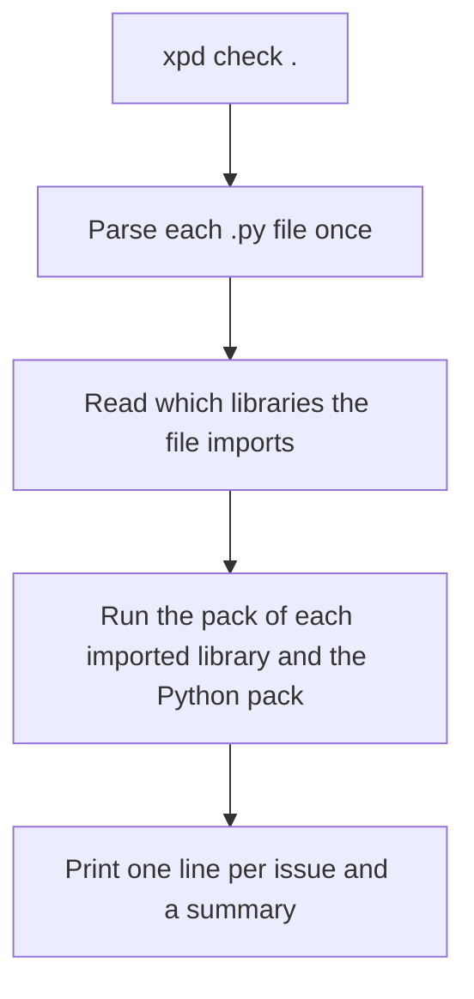

Run `uvx xpd check .` in a Python project to find the lines that are slow or give a wrong result.
On this page you check a small file, read what xpd reports, and decide which fixes it may write.
xpd checks code that uses pandas, NumPy, SciPy, scikit-learn, scikit-lego, MAPIE, Category
Encoders, linearmodels, arch, pymoo, plotly or Apache Hamilton.

## Install

Install the `xpd` command with [uv](https://docs.astral.sh/uv/getting-started/installation/).

```sh
uv tool install xpd
```

You can also run xpd once without installing it, with `uvx xpd` in place of `xpd` in each command
on this page.

## Check a sample file

Make an empty directory and save the following code in it as `bad.py`. xpd reads the code and
doesn't run it, so you don't need pandas or the file `x.csv`.

```python title="bad.py" showLineNumbers
import pandas as pd

df = pd.DataFrame({"a": [1, 2], "k": [1, 2]})
other = df.copy()
for i, row in df.iterrows():
    df["a"][i] = row["a"] * 2
df.dropna(inplace=True)
m = pd.merge(df, other, on="k")
out = pd.DataFrame()
for f in ["x.csv"]:
    out = pd.concat([out, pd.read_csv(f)])
```

Run xpd on the file from the same directory.

```sh
xpd check bad.py
```

xpd prints one line for each issue it finds, and a summary at the end. It exits with status 1,
because one of the issues is an error.

```text
bad.py:5:15: warning [pandas/row-loop] iterrows() builds a Series for every row. Compute on whole columns instead, such as df["a"] * df["w"]. When each row has to become a Python object, loop over itertuples() or to_dict("records").
bad.py:6:5: error [pandas/chained-assignment] Chained assignment writes to a copy under copy-on-write, so the frame keeps its old values. Assign to df.loc[i, "a"] instead.
bad.py:7:1: info [pandas/no-inplace] inplace=True gives no speedup and blocks chaining. Reassign instead.
bad.py:8:5: warning [pandas/merge-without-validate] merge without validate= can silently duplicate rows.
bad.py:11:5: warning [pandas/concat-in-loop] out grows by one concat per pass, and each concat copies every earlier row. Collect the frames in a list and concat once after the loop.
xpd: 5 issues, 2 more with --fix --unsafe-fixes
```

xpd prints text in a terminal and JSON when another program reads its output. Add
`--format text` to get the lines above in a script or a log.

## Read an issue

Fix every error, and fix a warning unless you can say why the code is right in that place. Each
line names the place in the file, the severity, the rule and what to write instead. The table
splits the line for line 6 of `bad.py` into its parts.

| Part | Example | Meaning |
| --- | --- | --- |
| Place | `bad.py:6:5` | The file, the line and the column |
| Severity | `error` | How serious the issue is, from the table below |
| Rule | `pandas/chained-assignment` | The pack and the rule, which `xpd rules` describes |
| Message | `Chained assignment writes to a copy ...` | What goes wrong, and what to write instead |

| Severity | Meaning |
| --- | --- |
| `error` | The code gives a wrong result or raises an exception. |
| `warning` | The code is slow or easy to get wrong. |
| `info` | A shorter or newer form exists. |

The summary line `2 more with --fix --unsafe-fixes` means that xpd can rewrite two of the five
lines, but only when you allow fixes that may change what the code does.

## Apply the safe fixes

`--fix` writes each fix that keeps what the code does. None of the five issues in `bad.py` has
such a fix, so xpd leaves the file as it was.

```sh
xpd check bad.py --fix
```

xpd prints the same five lines and the same summary, and it exits with status 1 again.

```text
xpd: 5 issues, 2 more with --fix --unsafe-fixes
```

## Choose the fixes that may change what the code does

Add `--unsafe-fixes` only when you accept that a fix may change what the code does, and read the
diff afterwards. Keep the file under version control, or keep a copy, so you can compare it and
undo a fix.

```sh
xpd check bad.py --fix --unsafe-fixes
```

xpd rewrites lines 6 and 7 and reports the three issues it has no fix for. It exits with status
0, because no error is left.

```text
bad.py:5:15: warning [pandas/row-loop] iterrows() builds a Series for every row. Compute on whole columns instead, such as df["a"] * df["w"]. When each row has to become a Python object, loop over itertuples() or to_dict("records").
bad.py:8:5: warning [pandas/merge-without-validate] merge without validate= can silently duplicate rows.
bad.py:11:5: warning [pandas/concat-in-loop] out grows by one concat per pass, and each concat copies every earlier row. Collect the frames in a list and concat once after the loop.
xpd: fixed 2, 3 issues
```

The diff shows the two lines that xpd rewrote.

```diff lang="python"
 for i, row in df.iterrows():
-    df["a"][i] = row["a"] * 2
-df.dropna(inplace=True)
+    df.loc[i, "a"] = row["a"] * 2
+df = df.dropna()
```

Both fixes change what the code does, which is why they need your consent. Under pandas
copy-on-write, the old line 6 left `df` unchanged, and the new line writes the doubled values into
`df`. On line 7, `df = df.dropna()` makes a new frame, so another name that still refers to the
old frame no longer sees the dropped rows.

## Check your own project

Run xpd on the directory of your project.

```sh
xpd check .
```

xpd reads the files and starts no Python, so you can run it after every edit. The diagram shows
what one run does.



## Where to go next

Pick the page for what you want to do next.

| You want to | Page |
| --- | --- |
| Read what a rule reports and how to fix it | [Rules](rules/) |
| Show a coding agent the issues of each file it edits | [Claude Code and other agents](guides/claude-code/) |
| Give an agent xpd's tools, rules and prompts | [Connect an agent with MCP](guides/mcp/) |
| Take a data file to a saved scikit-learn model with checks that xpd runs | [Train a model in code mode](guides/code-mode/) |
| See issues, fixes and rule help in an editor | [Use xpd in an editor](guides/editors/) |
| Report a pattern of your own project | [Write a rule](guides/write-a-rule/) |
| Look up a command, its options and its exit status | [Commands](commands/) |
